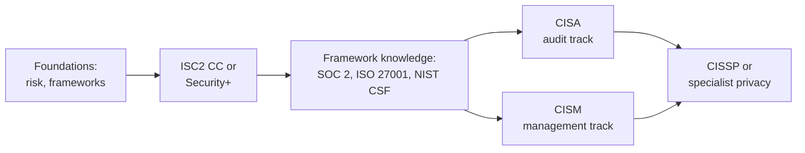

# GRC Analyst Certification Roadmap

GRC stands for governance, risk and compliance. A GRC analyst helps the organisation decide which risks matter, write the policies that manage them, and prove to auditors and customers that the controls work. It is the least code-heavy path in security and rewards clear writing and patience.

Beside the [Security Engineer roadmap](./certification-roadmap-security-engineer.md), this is the path for people who prefer paper, process and people to terminals.

## What the job is

- **Risk:** keep a risk register, assess new vendors and projects. See [Risk management basics](../learn/concepts/risk-management-basics.md).
- **Compliance:** map controls to frameworks, gather evidence, support audits (SOC 2, ISO 27001, PCI DSS, HIPAA and others).
- **Policy and awareness:** write standards people can follow and run training. See [Security awareness training](../learn/concepts/security-awareness-training.md).
- **Third-party risk:** send and review security questionnaires.

Titles: GRC analyst, compliance analyst, IT auditor, risk analyst, security compliance manager.

*Two branches after the frameworks: CISA for auditing, CISM for managing a programme.*

## Stage 1 - foundations

Learn what a control is and why one exists. Read [Risk management basics](../learn/concepts/risk-management-basics.md), [Security from Scratch](../learn/security-from-scratch.md) and [Shared responsibility model](../learn/concepts/shared-responsibility-model.md).

## Stage 2 - first certificate

- **[ISC2 Certified in Cybersecurity (CC)](../exams/isc2/cc/)** - entry level.
- **[CompTIA Security+](../exams/comptia/security-plus/)** - broad, widely recognised.

## Stage 3 - frameworks (the real work)

Read the compliance guides in this order, and note how the same control shows up in each:

1. [SOC 2](./compliance-guides/soc2.md) - the usual first request from customers.
2. [ISO 27001](./compliance-guides/iso-27001.md)
3. [NIST CSF 2.0](./compliance-guides/nist-csf.md)
4. By sector: [HIPAA](./compliance-guides/hipaa.md), [PCI DSS](./compliance-guides/pci-dss.md), [GDPR](./compliance-guides/gdpr.md), [FedRAMP](./compliance-guides/fedramp.md), [CMMC](./compliance-guides/cmmc.md), [NIS2](./compliance-guides/nis2.md), [DORA](./compliance-guides/dora.md)

Primary references: **[📖 NIST SP 800-53 Rev. 5](https://csrc.nist.gov/pubs/sp/800/53/r5/upd1/final)** - the control catalogue; **[📖 CIS Critical Security Controls](https://www.cisecurity.org/controls)** - a short prioritised control list.

## Stage 4 - professional certificates

- **[ISACA CISA](../exams/isaca/cisa/)** - the auditor's credential. Choose it for internal audit, IT audit and assurance roles.
- **[ISACA CISM](../exams/isaca/cism/)** - the manager's credential: governance, risk, programme and incident management. Read the guide's note on the outline update first.
- **[ISC2 CISSP](../exams/isc2/cissp/)** - broad leadership credential, once you meet the experience requirement.
- **[CCSK](../exams/cloud-security-alliance/ccsk/)** - cloud governance, useful when your auditors ask about cloud.
- **[Microsoft SC-401](../exams/azure/sc-401/)** - information protection and data governance, if your employer is a Microsoft shop.

## Skills that matter more than certificates

| Skill | How to practise |
|---|---|
| Control mapping | Map one control (MFA) across SOC 2, ISO 27001 and NIST CSF in a table |
| Evidence thinking | For any control, write what an auditor would ask to see |
| Risk writing | Write three risk statements: cause, event, impact, rating |
| Plain writing | Rewrite a policy paragraph for a non-technical reader |
| Technical literacy | Enough to read a cloud configuration or a log and know what it says |
| Frameworks outside the list | **[📖 ISACA COBIT](https://www.isaca.org/resources/cobit)** - an IT governance framework |

## Getting the first job

- Offer to help a small company or a club write a risk register or a policy set.
- Build a one-page "controls on a page" map for a framework you studied.
- Practise: [GRC and audit interview prep](./interview-prep/grc-audit-interview.md).
- Many startups hire a first compliance person to get a SOC 2 report. That is a good entry point.

## Next steps

- [Study Hub](../STUDY-HUB.md) and [Budget study plan](./budget-study-plan.md)
