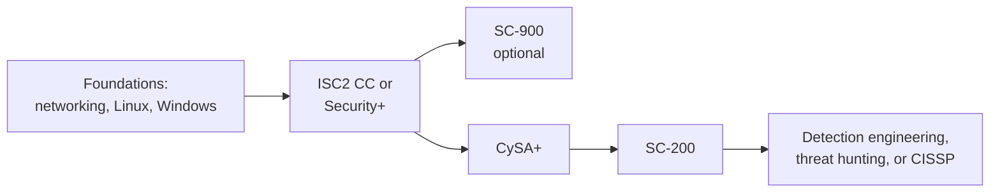

# SOC Analyst Certification Roadmap

A SOC (security operations center) analyst watches alerts, decides which are real, and starts the response. It is the most common first job in security, and the one where practice counts for more than any single certificate.

This roadmap uses only the study guides on this site. It sits beside the [Security Engineer roadmap](./certification-roadmap-security-engineer.md) and shares its early steps.

## What the job is

- **Tier 1:** triage alerts and user reports, close false positives, escalate real ones. See [Phishing report triage](./playbooks/phishing-report-triage.md).
- **Tier 2:** investigate escalations, scope the incident, contain. See the [playbooks](./playbooks/).
- **Tier 3 and detection engineering:** hunt for threats, write and tune detections, improve the pipeline.

Titles: SOC analyst, security analyst, incident responder, threat hunter, detection engineer.

*The suggested order. Security+ then CySA+ is the vendor-neutral spine; SC-200 adds the Microsoft tools most SOCs run.*

## Stage 1 - foundations (0 to 3 months)

Skills: how a packet travels, DNS, HTTP, the Linux command line, Windows event logs, and what a normal day on a network looks like. You cannot spot odd until you know normal.

Read: [Network security basics](../learn/concepts/network-security-basics.md), [Logging and detection](../learn/concepts/logging-and-detection.md), [Security from Scratch](../learn/security-from-scratch.md).

## Stage 2 - first certificate

Pick one:

- **[ISC2 Certified in Cybersecurity (CC)](../exams/isc2/cc/)** - entry level, a gentle start.
- **[CompTIA Security+ (SY0-701)](../exams/comptia/security-plus/)** - the one most job ads name. Check the guide's note about the SY0-701 and SY0-801 transition before booking.

## Stage 3 - analyst skills

- **[CompTIA CySA+](../exams/comptia/cysa-plus/)** - the analyst-focused exam: log analysis, threat intelligence, vulnerability management, incident response. The guide notes the version change; read it before you book.
- **[Microsoft SC-900](../exams/azure/sc-900/)** - optional vocabulary for Microsoft's security stack.
- **[Microsoft SC-200 Security Operations Analyst](../exams/azure/sc-200/)** - hands-on with Sentinel, Defender and KQL, the toolset many employers run.

## Stage 4 - specialise

- **Cloud detection:** the cloud security exams in the [Security Engineer roadmap](./certification-roadmap-security-engineer.md).
- **Management and breadth:** [CISSP](../exams/isc2/cissp/) once you meet the experience requirement.
- **Offensive knowledge for threat hunters:** [OSCP](../exams/offensive-security/oscp-pen-200/) is optional and hard. It teaches how attackers think, which helps with detection.

## Skills that matter more than certificates

| Skill | How to practise |
|---|---|
| Reading logs | [Centralized logging and alerting](./hands-on-projects/centralized-logging-and-alerting.md) |
| Triage method | Work the [playbooks](./playbooks/) on paper with sample alerts |
| ATT&CK vocabulary | **[📖 MITRE ATT&CK Enterprise matrix](https://attack.mitre.org/matrices/enterprise/)** - the shared language for attacker behaviour |
| Endpoint view | [Endpoint security: EDR and XDR](../learn/concepts/endpoint-security-edr-xdr.md) |
| Writing | Write a one-page incident summary after every lab |
| Query language | KQL or SPL: write five searches a week against a free dataset |

Pipeline reference: [SOC detection and response pipeline](./architecture-patterns/soc-detection-and-response-pipeline.md).

## Getting the first job

- Build a small home lab that collects logs and fires five tested alerts, then write it up.
- Keep a short portfolio of incident write-ups with the sensitive details removed.
- Practise the interview: [SOC analyst interview prep](./interview-prep/soc-analyst-interview.md).
- Be ready for shift work, a noisy queue and a lot of writing. Those are the job.

## Next steps

- [Study Hub](../STUDY-HUB.md) for the full cert list
- [Budget study plan](./budget-study-plan.md) and [Study strategies](./study-strategies.md)
