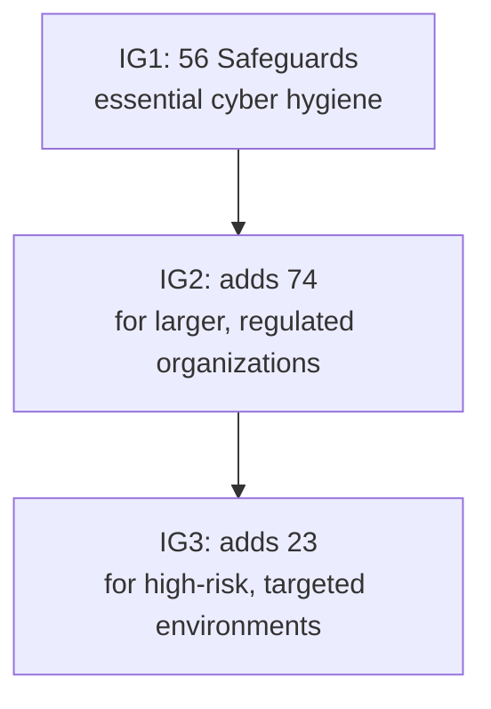

# Compliance Guide - CIS Critical Security Controls v8

> **As of 2026-11-07.** Read from the Center for Internet Security (CIS) controls pages. The current release is **v8.1, published 24 June 2024**. Check cisecurity.org for a newer version.

## Overview

The **CIS Critical Security Controls** (CIS Controls) are a short, prioritized list of defensive actions, written by a community of practitioners, "to defend against the most prevalent cyber attacks against systems and networks" in CIS's words. Version 8 reorganized the older 20 controls into **18 controls**, and put the emphasis on activities rather than on who owns a device. That fits cloud, remote work and outsourcing.

Like the [NIST CSF](./nist-csf.md), the CIS Controls are **voluntary**: no one is "CIS certified" by completing them. What makes them useful is that they are **concrete and ordered**. A small team can read the list on Monday and have a work plan by Friday. Many teams use CIS Controls as the "how" under a "what" framework such as CSF, and many regulators and cyber-insurers treat them as a recognized baseline.

**[📖 CIS Critical Security Controls v8](https://www.cisecurity.org/controls/v8)** - overview, design principles and downloads.

**[📖 CIS Controls v8.1 white paper](https://www.cisecurity.org/insights/white-papers/cis-critical-security-controls-v8-1)** - what changed in v8.1.

---

## The 18 Controls

| # | Control | In plain English |
|---|---------|------------------|
| 1 | Inventory and Control of Enterprise Assets | Know every device that touches your data |
| 2 | Inventory and Control of Software Assets | Know every program and block the unapproved |
| 3 | Data Protection | Know where sensitive data is; encrypt, retain, dispose |
| 4 | Secure Configuration of Enterprise Assets and Software | Harden defaults |
| 5 | Account Management | Manage the life cycle of every account |
| 6 | Access Control Management | Give the least access needed, with MFA |
| 7 | Continuous Vulnerability Management | Find and fix weaknesses on a schedule |
| 8 | Audit Log Management | Collect, retain and review logs |
| 9 | Email and Web Browser Protections | Reduce phishing and web-borne attacks |
| 10 | Malware Defenses | Detect and stop malicious code |
| 11 | Data Recovery | Back up, and test the restore |
| 12 | Network Infrastructure Management | Keep network devices patched and configured |
| 13 | Network Monitoring and Defense | Watch the network and respond |
| 14 | Security Awareness and Skills Training | Train people |
| 15 | Service Provider Management | Hold suppliers to account |
| 16 | Application Software Security | Build and buy secure software |
| 17 | Incident Response Management | Be ready to handle incidents |
| 18 | Penetration Testing | Test the defenses |

Controls 1 to 6 are the foundation, and that order is deliberate: you cannot protect what you cannot list, and you cannot control access to something you did not know existed.

---

## Safeguards and Implementation Groups

Each control is broken down into **Safeguards**: specific, testable actions. CIS states there are **153 Safeguards** in v8 and v8.1. Not every organization needs all of them, so Safeguards are assigned to three **Implementation Groups (IGs)**:

| Group | Safeguards | Who it fits |
|-------|-----------|-------------|
| **IG1** | 56 | "Essential cyber hygiene": small and mid-size organizations with limited IT and security staff, low-sensitivity data, and little tolerance for downtime |
| **IG2** | +74 (130 cumulative, by CIS's "additional 74") | Organizations with more staff, more systems and more sensitive data, subject to regulation |
| **IG3** | +23 (153 total) | Organizations facing targeted attacks and holding sensitive or regulated data at scale |

(The IG1 count and the "additional 74" and "additional 23" figures come from CIS's own IG pages; the 130 cumulative number is simple addition.)

Start with **IG1**. CIS describes it as an "emerging minimum standard of information security for all enterprises". IG1 is a reasonable first target for a startup.

*The diagram shows the groups are cumulative. IG2 includes everything in IG1 and adds Safeguards. IG3 includes everything and has all 153 Safeguards.*

---

## What v8.1 changed

Per CIS's white paper, v8.1 (June 2024) is an **iterative** update to v8:

- Revised **asset classes** and new mappings of them to Safeguards.
- Added and clarified **glossary** terms (for example "plan", "process", "sensitive data").
- Realigned **NIST CSF** function mappings to **CSF 2.0**, and added a **Governance** security function to the mappings.
- Fixed typos and clarified a few Safeguard descriptions.

CIS says the Implementation Groups were not modified.

---

## Using the Controls in practice

1. **Pick an IG** that matches your size and risk. Most startups: IG1.
2. **Assess** each Safeguard: not implemented, partly, fully. CIS offers a free tracking spreadsheet and the **CIS Controls Navigator** to filter by IG, control or mapped framework.
3. **Prioritize** gaps by risk and effort. Quick wins in IG1 are usually asset inventory, MFA on every account, patching, backups with a restore test, and email filtering.
4. **Map** to other frameworks to reuse the work. CIS publishes mappings to NIST CSF, [NIST SP 800-53](./nist-sp-800-53.md), ISO 27001 and others, and the Navigator lets you view them.
5. **Measure** with simple metrics: percentage of assets in inventory, percentage of accounts with MFA, mean time to patch critical vulnerabilities.

**[📖 CIS Controls Navigator v8.1](https://www.cisecurity.org/controls/cis-controls-navigator)** - filter Safeguards by IG and view mappings.

**[📖 CIS Implementation Groups](https://www.cisecurity.org/controls/implementation-groups)** - IG definitions.

### Cloud notes

- The CIS Controls apply to cloud accounts: asset inventory means cloud resource inventory, account management includes IAM users, roles and service principals.
- CIS also publishes separate **CIS Benchmarks** (detailed hardening guides for AWS, Azure, Google Cloud, Kubernetes, operating systems) and hardened images. They are a different product from the Controls, though they support Control 4.

---

## Preparation checklist (IG1 starter)

- [ ] Hardware and software inventories exist, with owners, and are reconciled monthly
- [ ] Sensitive data is identified; backups encrypted and restore tested
- [ ] Defaults hardened; unneeded services and accounts removed
- [ ] Every account has an owner; MFA required for all remote and admin access
- [ ] Vulnerability scans run on a schedule; critical fixes tracked to closure
- [ ] Logs from key systems collected and retained
- [ ] Email filtering and DNS filtering in place; endpoint protection on all endpoints
- [ ] Security awareness training given at hire and yearly
- [ ] A written incident response plan with contacts
- [ ] Vendor list with the data each vendor holds

### Common gaps

- Inventories that were right once and never refreshed
- MFA on staff but not on service accounts or admin roles
- Backups that have never been restored
- Controls 15 (service providers) and 17 (incident response) treated as paperwork

---

## Certification exam relevance

- [CompTIA Security+](../../exams/comptia/security-plus/) and [CySA+](../../exams/comptia/cysa-plus/) - basic hygiene controls, vulnerability management, logging
- [ISC2 CC](../../exams/isc2/cc/) and [CISSP](../../exams/isc2/cissp/) - control selection and frameworks
- [ISACA CISM](../../exams/isaca/cism/) - program development using a framework

---

## Related

- [NIST CSF 2.0](./nist-csf.md), [NIST SP 800-53](./nist-sp-800-53.md), [ISO 27001](./iso-27001.md), [CMMC](./cmmc.md)
- [Vulnerability management](../../learn/concepts/vulnerability-management.md)
- [MFA and passkeys](../../learn/concepts/mfa-and-passkeys.md)
- [Backup and ransomware resilience](../../learn/concepts/backup-and-ransomware-resilience.md)

---

## Documentation Links

**[📖 CIS Controls list](https://www.cisecurity.org/controls/cis-controls-list)** - the 18 Controls.

**[📖 CIS Controls IG1](https://www.cisecurity.org/controls/implementation-groups/ig1)** - the 56-Safeguard starting set.
