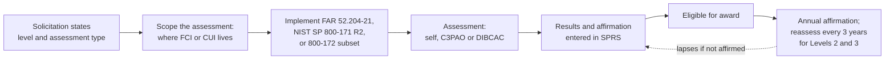

# Compliance Guide - CMMC (Cybersecurity Maturity Model Certification)

## Overview

**CMMC** is the US Department of Defense (DoD) program that verifies whether defense contractors actually protect the government information they handle. It applies across the **Defense Industrial Base**: prime contractors and their subcontractors at every tier, from aerospace giants to 20-person machine shops. CMMC does not invent new security controls. It checks that contractors implement requirements they were already bound to by contract (FAR 52.204-21 and DFARS 252.204-7012), which self-attestation alone had failed to enforce.

The program has two rules:

| Rule | What it does | Published | Effective |
|------|--------------|-----------|-----------|
| **32 CFR Part 170** (the CMMC Program rule) | Defines the levels, assessments, scoring, POA&M rules and the assessor ecosystem | 15 October 2024 | **16 December 2024** |
| **48 CFR** (DFARS acquisition rule) | Adds clause DFARS 252.204-7021 and provision 252.204-7025 so CMMC status becomes a **condition of contract award** | 10 September 2025 | **10 November 2025** |

CMMC is being phased into contracts over four years (see below). As of this page's date, **Phase 1 is in effect and Phase 2 starts on 10 November 2026**.

The key idea: **the contract decides the level**. A solicitation states the CMMC level and assessment type required, and the contractor must hold that status in the DoD's Supplier Performance Risk System (SPRS) **at the time of award** for the information systems that will process, store or transmit the contract's information.

---

## Two kinds of information

| Type | What it is | Example | CMMC level |
|------|------------|---------|------------|
| **FCI** (Federal Contract Information) | Information not intended for public release, provided by or generated for the government under a contract | Contract schedules, pricing correspondence, a parts list from the program office | Level 1 |
| **CUI** (Controlled Unclassified Information) | Government information that law, regulation or policy requires to be safeguarded, listed in the CUI Registry | Controlled technical drawings, export-controlled specifications, some test data | Level 2 or 3 |

Classified information is out of CMMC's scope; it has its own regime.

---

## CMMC at a glance

The CMMC path: the contract sets the level, you scope and implement the requirements, pass the right assessment, record it in SPRS with an affirmation, and keep affirming every year.

---

## The three levels

| | Level 1 | Level 2 | Level 3 |
|---|---|---|---|
| Protects | FCI | CUI | CUI for the highest-priority programs, against advanced persistent threats |
| Requirements | **15** security requirements from FAR 52.204-21 | **110** security requirements of **NIST SP 800-171 Rev. 2** | The 110 Level 2 requirements plus **24** selected requirements from **NIST SP 800-172** (February 2021) |
| Assessment | **Self-assessment**, annually | **Self-assessment or C3PAO assessment**, as the contract specifies, every **3 years** | **DIBCAC** (DCMA's Defense Industrial Base Cybersecurity Assessment Center) every **3 years**; requires a **Final Level 2 (C3PAO)** status for the same scope first |
| POA&M allowed? | **No**: all 15 must be met | Yes, limited (see below) | Yes, limited |
| Affirmation | After each assessment, annually | After each assessment and annually | After each assessment and annually |

An **affirmation** is a statement by a senior official of the company that it has met and will maintain the requirements. Affirmations are made in SPRS. If an annual affirmation is missed, the CMMC status lapses. False affirmations carry legal risk under the False Claims Act, which is why the affirming official should see real evidence before signing.

**Why Rev. 2 and not Rev. 3?** NIST published SP 800-171 Revision 3 in May 2024, but the CMMC rule incorporates **Revision 2** by reference, and DoD has kept DFARS 252.204-7012 on Revision 2 for now. Build to Rev. 2 for CMMC and track DoD announcements about moving to Rev. 3.

---

## Scoring and POA&Ms

Level 2 uses the **DoD Assessment Methodology** scoring: you start at **110** and subtract **5, 3 or 1 point** for each requirement not met, depending on how much it matters. Many important requirements (for example MFA and FIPS-validated encryption of CUI) are worth more than one point, and two (MFA and FIPS-validated cryptography) can receive partial credit in defined cases.

You can receive a **Conditional** status and be eligible for award with some requirements not met, if:

- your score is at least **80% of the maximum** (88 of 110 for Level 2);
- the unmet requirements are ones the rule **allows** on a POA&M (in general, one-point requirements; the highest-weighted requirements, and some specific ones, cannot be deferred);
- every POA&M item is **closed within 180 days**, verified by a **POA&M closeout assessment**.

If the closeout does not confirm all requirements are met within 180 days, the Conditional status **expires**. Operational plans of action for temporary deficiencies are a separate concept from the assessment POA&M.

---

## Phased rollout

| Phase | Starts | What DoD includes in solicitations |
|-------|--------|------------------------------------|
| **Phase 1** | 10 November 2025 | Level 1 (Self) and Level 2 (Self) as a condition of award; DoD may, at its discretion, require Level 2 (C3PAO) |
| **Phase 2** | **10 November 2026** | Adds **Level 2 (C3PAO)** certification as a condition of award for applicable contracts |
| **Phase 3** | 10 November 2027 | Adds **Level 3 (DIBCAC)** for applicable contracts, and Level 2 (C3PAO) for option periods |
| **Phase 4** | 10 November 2028 | Full implementation: CMMC requirements in all applicable solicitations and contracts, including option periods |

Each phase starts one calendar year after the previous one, counted from the 48 CFR rule's effective date. C3PAO assessment capacity is limited, so organisations expecting Level 2 (C3PAO) contracts should book assessments well before they need the status.

---

## Scoping: the decision that drives cost

Most of the effort and cost of CMMC depends on **how much of your environment touches CUI**. The rule defines asset categories for Level 2:

| Category | What it is | Treatment |
|----------|------------|-----------|
| **CUI assets** | Process, store or transmit CUI | Assessed against all requirements |
| **Security protection assets** | Provide security to the CUI environment (IdP, SIEM, firewalls, MSSP tooling) | Assessed against relevant requirements |
| **Contractor risk managed assets** | Could process CUI but are prevented by policy and procedure | Documented; checked if suspicious |
| **Specialized assets** | IoT, operational technology, government property, test equipment | Documented in the system security plan |
| **Out-of-scope assets** | Cannot process CUI and are separated from it | Not assessed |

A common strategy is an **enclave**: a separate, tightly controlled environment (often a dedicated cloud tenant) where all CUI work happens, so the rest of the company is out of scope. The trade-off is that people must actually do CUI work only inside it.

**Cloud and external service providers**: under DFARS 252.204-7012, a cloud service storing, processing or transmitting CUI must meet the **FedRAMP Moderate baseline** or equivalent, plus the clause's incident reporting and forensics requirements. Managed service providers that handle security functions are in scope as security protection assets. See the [FedRAMP guide](./fedramp.md).

**Incident reporting**, which sits in DFARS 252.204-7012 rather than in CMMC itself: report cyber incidents affecting covered defense information to DoD within **72 hours** of discovery, preserve images for 90 days, and submit malware samples.

---

## Cloud Provider CMMC Support

Organisations handling CUI usually use the providers' **US government** environments, which carry FedRAMP High or Moderate authorisations and support ITAR and DoD requirements. Commercial regions are generally not the right home for CUI.

### AWS

| Area | AWS option | NIST 800-171 families helped |
|------|------------|------------------------------|
| Environment for CUI | AWS GovCloud (US) | Scope boundary for all families |
| Access control and MFA | IAM Identity Center, IAM, MFA | Access Control (3.1), Identification and Authentication (3.5) |
| Audit logging | CloudTrail, CloudWatch Logs, Security Lake | Audit and Accountability (3.3) |
| Configuration baselines | AWS Config, Systems Manager | Configuration Management (3.4) |
| FIPS-validated encryption | KMS (FIPS 140 validated HSMs), FIPS endpoints | System and Communications Protection (3.13) |
| Evidence | AWS Artifact, Audit Manager | Security Assessment (3.12) |

### Azure

| Area | Azure option | NIST 800-171 families helped |
|------|--------------|------------------------------|
| Environment for CUI | Azure Government; Microsoft 365 GCC High | Scope boundary for all families |
| Access control and MFA | Microsoft Entra ID, Conditional Access, PIM | Access Control (3.1), Identification and Authentication (3.5) |
| Audit logging | Azure Monitor, Microsoft Sentinel | Audit and Accountability (3.3) |
| Configuration baselines | Azure Policy (NIST SP 800-171 initiative), Intune | Configuration Management (3.4) |
| FIPS-validated encryption | Key Vault Managed HSM | System and Communications Protection (3.13) |
| Compliance tracking | Purview Compliance Manager CMMC templates | Security Assessment (3.12) |

### Google Cloud

| Area | GCP option | NIST 800-171 families helped |
|------|------------|------------------------------|
| Environment for CUI | Assured Workloads (US regions, FedRAMP and IL control packages) | Scope boundary for all families |
| Access control and MFA | Cloud IAM, Cloud Identity, BeyondCorp Enterprise | Access Control (3.1), Identification and Authentication (3.5) |
| Audit logging | Cloud Audit Logs, Google Security Operations | Audit and Accountability (3.3) |
| Configuration baselines | Organization Policy, Security Command Center | Configuration Management (3.4) |
| FIPS-validated encryption | Cloud KMS and Cloud HSM | System and Communications Protection (3.13) |
| Compliance tracking | Security Command Center compliance view | Security Assessment (3.12) |

Check each provider's current list of in-scope services before relying on one for CUI; not every service is available or authorised in the government environments.

---

## CMMC vs other frameworks

| Aspect | CMMC Level 2 | NIST SP 800-171 alone | FedRAMP | ISO 27001 |
|--------|--------------|-----------------------|---------|-----------|
| Who | DoD contractors handling CUI | Non-federal systems handling CUI (any agency) | Cloud services sold to federal agencies | Anyone |
| Controls | 110 (800-171 Rev. 2) | 110 (Rev. 2) or 97 (Rev. 3) | NIST SP 800-53 baselines | Annex A, risk-selected |
| Proof | Self or third-party (C3PAO) assessment, recorded in SPRS | Self-assessment score in SPRS | Agency or program authorization after 3PAO assessment | Certification audit |
| Cycle | 3 years plus annual affirmation | Score no more than 3 years old | Continuous monitoring | 3-year certificate, annual surveillance |

---

## Preparation Checklist

### Scope and plan

- [ ] Identify every contract and where FCI and CUI enter, live and leave the company (data flow diagrams help; see [Threat modeling explained](../../learn/concepts/threat-modeling-explained.md))
- [ ] Decide the boundary: enterprise-wide or an enclave
- [ ] Categorise assets (CUI, security protection, contractor risk managed, specialized, out of scope)
- [ ] Write the **System Security Plan (SSP)** describing how each requirement is implemented
- [ ] Confirm cloud and managed service providers meet FedRAMP Moderate (or equivalent) where they handle CUI

### Implement

- [ ] Work through all 110 requirements; prioritise the 5-point and 3-point ones that cannot go on a POA&M
- [ ] MFA for privileged access and network access to CUI systems
- [ ] FIPS-validated cryptography protecting CUI at rest and in transit
- [ ] Centralised audit logging with review and retention
- [ ] Incident response capability that can meet the 72-hour DoD reporting duty
- [ ] Flow requirements down to subcontractors handling FCI or CUI

### Assess

- [ ] Run a mock assessment against NIST SP 800-171A objectives
- [ ] Enter the self-assessment score in SPRS, or book a C3PAO through the Cyber AB marketplace
- [ ] Senior official affirmation in SPRS; calendar the annual re-affirmation

### Evidence Collection

| Evidence type | Source | Automation |
|--------------|--------|------------|
| System Security Plan and network diagrams | GRC tool, architecture docs | Diagrams as code |
| Access control and MFA | IdP reports, access reviews | Conditional Access / IAM policy exports |
| Audit logs and reviews | SIEM | Saved searches, review tickets |
| Configuration baselines | CIS or STIG benchmark scans, policy engine reports | Azure Policy / AWS Config / Organization Policy |
| Vulnerability and patch management | Scanner and patch reports | Scheduled scans |
| Training | Awareness and insider threat training records | LMS exports |
| Incident response | IR plan, exercise reports | Ticketing workflow |
| FIPS validation | CMVP certificate numbers for the modules used | Vendor documentation |

### Common gaps

- Scope far bigger than necessary because CUI is spread across email, file shares and laptops.
- Encryption in place but not FIPS-validated.
- SSP written to the standard's wording rather than describing how the company really works.
- Assessment objectives (800-171A has several per requirement) not all evidenced.
- Subcontractors never told which information is CUI.
- Affirming officials signing without seeing evidence.

---

## Certification Exam Relevance

CMMC knowledge is relevant for:
- [ISC2 CISSP](../../exams/isc2/cissp/) and [CCSP](../../exams/isc2/ccsp/) - regulatory compliance and supply chain requirements
- [ISACA CISA](../../exams/isaca/cisa/) - assessing controls against a framework and working with assessors
- [CompTIA Security+](../../exams/comptia/security-plus/) - regulatory frameworks and attestation concepts
- [Microsoft SC-100](../../exams/azure/sc-100/) - regulatory compliance in a security strategy

The Cyber AB also runs CMMC-specific credentials (Certified CMMC Professional and Certified CMMC Assessor) for people who work on assessments.

---

## Documentation Links

**[📖 DoD CIO: Cybersecurity Maturity Model Certification](https://dodcio.defense.gov/CMMC/)** - the official program site, documents and guidance

**[📖 32 CFR Part 170: CMMC Program final rule (Federal Register)](https://www.federalregister.gov/documents/2024/10/15/2024-22905/cybersecurity-maturity-model-certification-cmmc-program)** - levels, assessments, scoring and phase-in

**[📖 48 CFR CMMC acquisition rule (Federal Register)](https://www.federalregister.gov/documents/2025/09/10/2025-17359/defense-federal-acquisition-regulation-supplement-assessing-contractor-implementation-of-cybersecurity-requirements)** - the DFARS clauses that make CMMC a condition of award

**[📖 NIST SP 800-171 Rev. 2](https://csrc.nist.gov/pubs/sp/800/171/r2/upd1/final)** - the 110 requirements Level 2 assesses

**[📖 NIST SP 800-172](https://csrc.nist.gov/pubs/sp/800/172/final)** - the enhanced requirements Level 3 draws on

**[📖 The Cyber AB](https://cyberab.org/)** - the accreditation body for C3PAOs and assessors, and the marketplace to find them
