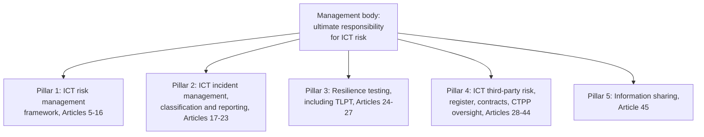

# Compliance Guide - DORA (Digital Operational Resilience Act)

## Overview

**DORA** is the EU regulation that makes financial entities prove they can **withstand, respond to and recover from ICT disruption**: cyber attacks, outages, failed changes and failures at their technology providers. Its full name is **Regulation (EU) 2022/2554** on digital operational resilience for the financial sector. Before DORA, ICT risk rules for banks, insurers and investment firms were scattered across sector guidelines; DORA puts them in one directly applicable regulation, and for the first time gives EU financial supervisors **direct oversight of critical technology providers** such as major cloud platforms.

Key dates:

| Date | What happened |
|------|---------------|
| 27 December 2022 | Published in the Official Journal (with the companion Directive (EU) 2022/2556 amending sector directives) |
| 16 January 2023 | Entered into force |
| 2024 to 2025 | Regulatory and implementing technical standards (RTS / ITS) adopted, filling in the detail |
| **17 January 2025** | **DORA applies** |
| 2025 | First registers of information on ICT third-party arrangements submitted to supervisors, which fed the designation of critical providers |
| 18 November 2025 | The European Supervisory Authorities (EBA, EIOPA, ESMA) published the first list of designated **critical ICT third-party providers (CTPPs)** |

Because DORA is a **regulation**, it applies identically in every member state with no national transposition. National competent authorities (the financial supervisors) enforce it and set penalties.

The key idea: DORA is about **operational resilience**, not just security. The question is not only "can attackers get in?" but "when something fails, including something a supplier runs, can you keep delivering critical functions and recover within tolerance?"

---

## DORA at a glance

DORA's five pillars, all under the management body's responsibility: a risk management framework, incident reporting, resilience testing, third-party risk, and voluntary information sharing.

---

## Who is in scope

Article 2 lists around twenty types of **financial entities**, including:

- Credit institutions, payment institutions, electronic money institutions and account information service providers
- Investment firms, trading venues, central securities depositories, central counterparties, trade repositories, data reporting service providers
- Crypto-asset service providers and issuers of asset-referenced tokens
- Managers of alternative investment funds and UCITS management companies
- Insurance and reinsurance undertakings and larger insurance intermediaries, and institutions for occupational retirement provision
- Credit rating agencies, administrators of critical benchmarks, crowdfunding service providers and securitisation repositories

It also reaches **ICT third-party service providers**: indirectly, through the contract terms financial entities must impose, and directly, if designated as critical.

**Proportionality** runs through DORA. Microenterprises and some small, non-interconnected entities apply a **simplified ICT risk management framework** (Article 16) instead of the full one, and only entities selected by their authorities must run threat-led penetration testing.

**Relationship with NIS2**: for financial entities, DORA is **lex specialis** to [NIS2](./nis2.md). Where DORA covers a topic (risk management, incident reporting, testing), DORA's rules apply instead of NIS2's.

---

## The five pillars

### Pillar 1: ICT risk management (Articles 5-16)

- The **management body** defines, approves, oversees and is accountable for the ICT risk management framework, sets the digital operational resilience strategy and allocates budget. Members must keep their ICT risk knowledge up to date.
- A documented **ICT risk management framework**, reviewed at least yearly and after major incidents, covering: identification of ICT assets and dependencies (with a mapping of which support critical or important functions), protection and prevention, detection, response and recovery, backup policies and restoration, learning and evolving, and crisis communication.
- An **independent control function** for ICT risk (three lines of defence), with internal audit reviewing the framework.
- **Commission Delegated Regulation (EU) 2024/1774** sets out the detailed requirements for the framework (and the simplified version), from encryption and access control to logging and patch management.

### Pillar 2: ICT-related incident management, classification and reporting (Articles 17-23)

Entities need a process to detect, log, classify and respond to ICT incidents. Incidents are classified as **major** using criteria set in Delegated Regulation (EU) 2024/1772: clients affected, reputational impact, duration and downtime, geographical spread, data losses, criticality of services affected and economic impact.

Major incidents are reported to the competent authority on a fixed timeline (set by the RTS and ITS on reporting, Delegated Regulation (EU) 2025/301 and Implementing Regulation (EU) 2025/302):

| Report | Deadline |
|--------|----------|
| **Initial notification** | Within **4 hours** of classifying the incident as major, and no later than **24 hours** after becoming aware of it |
| **Intermediate report** | Within **72 hours** of the initial notification (and updated as the situation changes) |
| **Final report** | Within **one month** of the latest intermediate report |

Entities may also notify **significant cyber threats** voluntarily, and must inform clients of major incidents that affect their financial interests.

### Pillar 3: Digital operational resilience testing (Articles 24-27)

- A **risk-based testing programme** covering vulnerability assessments and scans, open source analyses, network security assessments, gap analyses, physical security reviews, scenario-based tests, compatibility testing, performance testing, end-to-end testing and penetration testing. Systems supporting critical or important functions are tested at least yearly.
- **Threat-led penetration testing (TLPT)** for entities identified by their competent authority: an intelligence-led red-team exercise on live production systems supporting critical functions, **at least every three years**, following the RTS on TLPT, which is based on the **TIBER-EU** framework. Testers must meet strict requirements, and ICT providers in scope participate. TLPT is commissioned and governed by the entity under regulatory oversight; it is not something an individual runs on their own initiative.

### Pillar 4: Managing ICT third-party risk (Articles 28-44)

This is the pillar with the most operational work for most firms.

- **Strategy and policy** for ICT third-party risk, with particular attention to providers supporting critical or important functions.
- **Register of information**: a structured inventory of every contractual arrangement with ICT providers, maintained at entity, sub-consolidated and consolidated level and reported to authorities in a prescribed format (Implementing Regulation (EU) 2024/2956). Supervisors used these registers to identify critical providers.
- **Pre-contract assessment**, including concentration risk and due diligence.
- **Mandatory contract terms** (Article 30): service descriptions and locations, data protection and access, service levels, assistance during ICT incidents, cooperation with authorities, termination rights, and, for critical or important functions, notice periods, testing participation, audit and access rights, and **exit strategies**.
- **Exit plans** that are documented and tested for critical services.

**The oversight framework** (Articles 31-44): the ESAs designate **critical ICT third-party providers** based on their systemic importance, the criticality of the functions they support and how substitutable they are. Each CTPP gets a **Lead Overseer** (EBA, EIOPA or ESMA) with powers to request information, run general investigations and on-site inspections, and issue recommendations. The Lead Overseer can impose periodic penalty payments of up to 1% of the CTPP's average daily worldwide turnover, for up to six months, to compel compliance. Financial entities remain fully responsible for their own compliance: using a designated CTPP does not shift that responsibility.

### Pillar 5: Information-sharing arrangements (Article 45)

Financial entities may share cyber threat information and intelligence (indicators of compromise, tactics, alerts) within trusted communities, under arrangements that protect confidentiality and personal data. Participation is voluntary but must be notified to the authority.

---

## Cloud Provider DORA Support

All three major cloud providers publish DORA materials and contract addenda that map their standard terms to Article 30, and offer register-of-information support data. Several hyperscalers are expected to be among the designated CTPPs; check the ESAs' published list for the current designations.

### AWS

| DORA area | AWS service or resource |
|-----------|-------------------------|
| ICT risk management, asset mapping | AWS Config, AWS Organizations, Security Hub |
| Incident detection and reporting | Amazon GuardDuty, Amazon Detective, AWS Health for provider-side events |
| Resilience testing | AWS Resilience Hub, AWS Fault Injection Service |
| Backup and recovery | AWS Backup with Vault Lock, AWS Elastic Disaster Recovery |
| Third-party risk evidence | AWS Artifact (audit reports, DORA addendum) |

### Azure

| DORA area | Azure service or resource |
|-----------|---------------------------|
| ICT risk management, asset mapping | Microsoft Defender for Cloud, Azure Resource Graph, Purview Compliance Manager |
| Incident detection and reporting | Microsoft Sentinel, Defender XDR, Azure Service Health |
| Resilience testing | Azure Chaos Studio, Azure Site Recovery drills |
| Backup and recovery | Azure Backup with immutable vaults, Azure Site Recovery |
| Third-party risk evidence | Microsoft Service Trust Portal, Microsoft Financial Services Compliance Program |

### Google Cloud

| DORA area | GCP service or resource |
|-----------|-------------------------|
| ICT risk management, asset mapping | Cloud Asset Inventory, Security Command Center |
| Incident detection and reporting | Google Security Operations, Personalized Service Health |
| Resilience testing | Multi-region architectures, disaster recovery testing guidance |
| Backup and recovery | Backup and DR Service, regional and multi-regional storage |
| Third-party risk evidence | Compliance Reports Manager, Google Cloud financial services contract terms |

---

## DORA vs other frameworks

| Aspect | DORA | NIS2 | ISO 27001 |
|--------|------|------|-----------|
| Type | EU regulation, directly applicable | EU directive, transposed nationally | Voluntary standard |
| Focus | Operational resilience of financial services, including ICT providers | Cybersecurity of critical and important sectors | Information security management system |
| Testing | Annual programme plus TLPT every 3 years for selected entities | Effectiveness assessment required; no TLPT | Internal audit and management review |
| Third parties | Detailed contract terms, register of information, direct oversight of critical providers | Supply chain security measure | Supplier controls in Annex A |
| Incident reporting | 4h (from classification, max 24h) / 72h / 1 month | 24h / 72h / 1 month | Not mandated |

---

## Preparation Checklist

### Governance and framework

- [ ] Management body approves the ICT risk management framework and digital operational resilience strategy, with records
- [ ] Independent ICT risk control function in place; internal audit plan covers DORA
- [ ] Map critical or important functions to the ICT assets, processes and providers that support them
- [ ] Framework reviewed at least yearly and after major incidents

### Incidents

- [ ] Incident classification procedure using the RTS criteria
- [ ] Reporting runbook with the 4h / 24h, 72h and one-month steps and templates
- [ ] Client communication procedure for major incidents

### Testing

- [ ] Annual testing programme covering systems that support critical or important functions
- [ ] Confirm with the competent authority whether TLPT applies, and plan for it if so

### Third parties

- [ ] Complete and maintained register of information in the prescribed format
- [ ] Contract remediation so ICT agreements contain the Article 30 terms
- [ ] Concentration risk assessment
- [ ] Documented and tested exit plans for critical services

### Evidence Collection

| Evidence type | Source | Automation |
|--------------|--------|------------|
| Board approval and training | Board minutes, training records | Board portal, LMS |
| Asset and dependency mapping | CMDB, cloud asset inventories | Cloud asset APIs into CMDB |
| Incident classification and reports | Incident tickets, regulator submissions | Ticket workflow with classification fields and deadline timers |
| Testing | Test plans, results, remediation tracking | Scanner and resilience-testing reports |
| Register of information | Vendor management system | Export in the ESA reporting format |
| Backup and recovery | Restore and failover test results | Scheduled restore tests, DR drills |

### Common gaps

- Register of information assembled by hand once, then out of date.
- Critical functions not mapped to the specific cloud services and SaaS tools behind them.
- Exit strategies that exist on paper but have never been tested even as a tabletop.
- Incident classification decided too late, so the four-hour clock is missed.
- Intra-group ICT providers forgotten; they are in scope too.

---

## Certification Exam Relevance

DORA knowledge is relevant for:
- [ISACA CISM](../../exams/isaca/cism/) and [CISA](../../exams/isaca/cisa/) - governance, third-party risk, audit of resilience
- [ISC2 CISSP](../../exams/isc2/cissp/) and [CCSP](../../exams/isc2/ccsp/) - regulatory compliance, business continuity, supply chain risk
- [CCSK v5](../../exams/cloud-security-alliance/ccsk/) - cloud governance and third-party risk
- [Microsoft SC-100](../../exams/azure/sc-100/) - regulatory compliance and resilience in a security strategy

Exam questions focus on concepts (operational resilience, third-party concentration risk, exit strategies, management accountability) rather than article numbers.

---

## Documentation Links

**[📖 Regulation (EU) 2022/2554 (DORA) on EUR-Lex](https://eur-lex.europa.eu/eli/reg/2022/2554/oj/eng)** - the official text

**[📖 EIOPA: Digital Operational Resilience Act](https://www.eiopa.europa.eu/digital-operational-resilience-act-dora_en)** - the ESAs' DORA hub, technical standards and Q&A

**[📖 ESAs designate critical ICT third-party providers (18 November 2025)](https://www.eiopa.europa.eu/european-supervisory-authorities-designate-critical-ict-third-party-providers-under-digital-2025-11-18_en)** - the announcement of the first CTPP list

**[📖 ECB: TIBER-EU framework](https://www.ecb.europa.eu/paym/cyber-resilience/tiber-eu/html/index.en.html)** - the threat-led testing framework DORA's TLPT builds on
