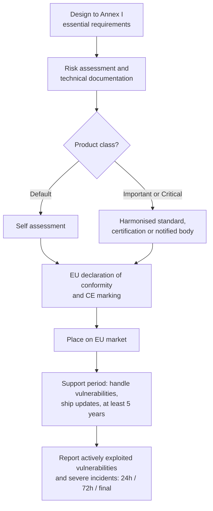

# Compliance Guide - EU Cyber Resilience Act (CRA)

> **As of 2026-11-07.** Dates and article text come from the regulation as published in the Official Journal (EUR-Lex) and the European Commission's CRA policy page (last updated by the Commission on 7 September 2026, which also records guidance published on 27 July 2026). Check the Commission page for later implementing acts, harmonised standards and guidance. I did not verify whether any amendment proposals are pending.

## Overview

The **Cyber Resilience Act** is **Regulation (EU) 2024/2847**, the EU law that puts cybersecurity requirements on **products with digital elements**: hardware and software that connect, directly or indirectly, to a device or network. It was adopted on 23 October 2024 and published in the Official Journal on 20 November 2024.

Before the CRA, a company could sell a router, camera, smart lock or software package into the EU with whatever security it chose, and stop patching whenever it liked. The CRA turns security into a condition of selling: products must meet **essential cybersecurity requirements**, show **conformity** and carry the **CE marking**, and manufacturers must **handle vulnerabilities for the support period** and **report actively exploited vulnerabilities** to the authorities.

It sits next to [NIS2](./nis2.md) and [DORA](./dora.md), but it is different in kind: NIS2 and DORA regulate organizations that operate services. The CRA regulates the **things that get sold**.

**[📖 Regulation (EU) 2024/2847 on EUR-Lex](https://eur-lex.europa.eu/eli/reg/2024/2847/oj/eng)** - the official text.

**[📖 European Commission: Cyber Resilience Act](https://digital-strategy.ec.europa.eu/en/policies/cyber-resilience-act)** - policy page, guidance and updates.

---

## Key dates

| Date | What |
|------|------|
| 20 November 2024 | Published in the Official Journal |
| 10 December 2024 | Entered into force (the Commission page gives this date; the regulation says the twentieth day after publication) |
| **11 June 2026** | **Chapter IV applies** (Articles 35 to 51): the rules on notification of conformity assessment bodies |
| **11 September 2026** | **Article 14 applies**: manufacturers must report actively exploited vulnerabilities and severe incidents |
| **11 December 2027** | **The rest of the regulation applies**, including the essential requirements, conformity assessment and CE marking for new products |

Article 71 sets these dates. **Today (7 November 2026) the reporting obligation is already live** and the main obligations are about thirteen months away. Treat the product requirements as a build-now problem, because products placed on the market after 11 December 2027 must already be designed to them.

---

## Who and what is in scope

**Products.** A "product with digital elements" is a software or hardware product and its remote data processing solutions, including components placed on the market separately (Article 3). Examples named by the Commission include smart watches, baby monitors, apps and computer programs.

**Outside scope (Article 2).** Products covered by specified EU rules for medical devices, in vitro diagnostics and motor vehicles are excluded, as are products certified under the EU aviation safety regulation and certain marine equipment. Pure **software as a service** is not in scope as such: the recitals say cloud services designed outside the manufacturer's responsibility are out, and that [NIS2](./nis2.md) applies to cloud computing services. But **remote data processing** that the product needs to work is part of the product.

**Roles.** Manufacturers carry most obligations. Importers and distributors have duties to check that manufacturers have done theirs. Open-source software is handled with a special approach: **open-source software stewards** have lighter obligations, and the penalty rules exclude them from fines for infringements (Article 64(10)).

---

## What manufacturers must do

### 1. Build to the essential requirements (Annex I)

Part I of Annex I sets design and production requirements; Part II sets vulnerability handling requirements. At a high level this means security by design and default, a risk assessment, and secure update mechanisms. Read Annex I directly for the exact list.

### 2. Handle vulnerabilities for the support period

Article 13(8) says the **support period** must reflect how long the product is expected to be used, and "shall be at least five years". If the product is expected to be used for less than five years, the support period matches the expected use time. During that period you must handle vulnerabilities effectively under Part II of Annex I.

### 3. Report to the authorities (Article 14)

You notify via the **single reporting platform** (Article 16) to the national CSIRT designated as coordinator and to **ENISA**, at the same time.

| Step | Actively exploited vulnerability | Severe incident affecting product security |
|------|---------------------------------|--------------------------------------------|
| Early warning | Within **24 hours** of becoming aware | Within **24 hours** |
| Main notification | Within **72 hours** | Within **72 hours** |
| Final report | No later than **14 days after** a fix or mitigation is available | Within **one month** of the 72-hour notification |

The 72-hour vulnerability notification covers the product concerned, the general nature of the exploit and vulnerability, and corrective or mitigating measures taken and those users can take. A severe incident is one that negatively affects, or could affect, the product's ability to protect the availability, authenticity, integrity or confidentiality of sensitive or important data or functions, or that led or could lead to execution of malicious code.

### 4. Prove conformity and mark the product

Under Article 32 the manufacturer assesses conformity through a defined procedure (internal control for most products, with stricter routes for higher classes) and draws up an **EU declaration of conformity** and technical documentation. Compliant products carry the **CE marking**.

### Product classes

Most products use self-assessment. Higher-risk products need more.

| Class | Examples (from Annexes III and IV) | Conformity route |
|-------|-------------------------------------|------------------|
| Default | Most products | Manufacturer's own assessment (internal control) |
| **Important, Class I** (Annex III) | Identity management and privileged access software, browsers, password managers, VPNs, SIEM, operating systems, routers and switches, smart home security products | Internal control only if harmonised standards or certification schemes are applied; otherwise third-party route (Article 32(2)) |
| **Important, Class II** (Annex III) | Hypervisors and container runtimes, firewalls and intrusion detection and prevention systems, tamper-resistant microprocessors and microcontrollers | Third-party route: EU-type examination plus production control (modules B and C), full quality assurance (module H), or a certification scheme at assurance level at least "substantial" (Article 32(3)) |
| **Critical** (Annex IV) | Hardware devices with security boxes, smart meter gateways, smartcards and secure elements | A European cybersecurity certification scheme where Article 8(1) applies; otherwise the Class II routes (Article 32(4)) |

(Routes summarized from Article 32(1) to (4), checked against the [Official Journal text on EUR-Lex](https://eur-lex.europa.eu/legal-content/EN/TXT/HTML/?uri=CELEX:32024R2847) on 2026-11-07. The default route in Article 32(1) also allows modules B and C, module H, or a certification scheme under Article 27(9).)

*The diagram shows the manufacturer's path. Design to the essential requirements, document the risk assessment, choose the conformity route for the product class, declare conformity and apply the CE marking, then place the product on the market. After that the manufacturer supports it for the support period and reports exploited vulnerabilities and severe incidents on the 24-hour, 72-hour and final-report schedule.*

---

## Penalties (Article 64)

Member States set the rules, but the regulation sets ceilings:

- Non-compliance with the Annex I essential requirements and the obligations in Articles 13 and 14: up to **EUR 15 million** or **2.5 percent** of worldwide annual turnover, whichever is higher.
- Other listed obligations: up to **EUR 10 million** or **2 percent**.
- Incorrect, incomplete or misleading information to authorities: up to **EUR 5 million** or **1 percent**.

Micro and small enterprises are not fined for missing the 24-hour early-warning deadline (Article 64(10)).

---

## How it connects to other guides

- **[NIS2](./nis2.md):** an essential or important entity buying products must still manage supply chain risk; the CRA raises the floor for what it can buy.
- **[Software supply chain security](../../learn/concepts/software-supply-chain-security.md):** SBOMs, dependency tracking and vulnerability handling are central to meeting Annex I Part II.
- **[Vulnerability management](../../learn/concepts/vulnerability-management.md):** CRA reporting depends on knowing when a vulnerability is being actively exploited. CISA's Known Exploited Vulnerabilities catalog is a US example of such a signal.
- **[Secure SDLC and DevSecOps](../../learn/concepts/secure-sdlc-and-devsecops.md):** the design-time requirements map here.

---

## Preparation checklist

### Now (reporting is live since 11 September 2026)

- [ ] Inventory of every product you sell into the EU, with its components and open-source dependencies
- [ ] An intake process for vulnerability reports and a named owner
- [ ] A runbook for the 24-hour early warning, 72-hour notification and final report, with templates
- [ ] A decision rule for "actively exploited" and "severe incident"
- [ ] Access to the single reporting platform once ENISA makes it available (check ENISA/Commission pages for current status)

### Before 11 December 2027

- [ ] Product class identified (default, important, critical) for each product
- [ ] Annex I requirements mapped to engineering controls, with evidence
- [ ] Support period set per product and published
- [ ] Software bill of materials per release; automated dependency monitoring
- [ ] Secure update mechanism with security fixes separable from feature updates where technically feasible
- [ ] Technical documentation file and EU declaration of conformity template
- [ ] Importers and distributors briefed on their obligations

### Evidence

| Evidence | Source |
|----------|--------|
| Risk assessment per product | Threat model, design review |
| Vulnerability handling records | Ticketing, advisories, patch release notes |
| SBOMs | Build pipeline |
| Reporting timeline | Incident record with timestamps |
| Conformity file | Test reports, standards mapping, declaration |

---

## Certification exam relevance

- [ISACA CISM](../../exams/isaca/cism/) - regulatory landscape and supply chain risk
- [ISC2 CISSP](../../exams/isc2/cissp/) and [CCSP](../../exams/isc2/ccsp/) - secure development, legal and regulatory requirements

Exams test concepts (secure by design, vulnerability disclosure, supply chain) rather than article numbers.

---

## Documentation Links

**[📖 Regulation (EU) 2024/2847](https://eur-lex.europa.eu/eli/reg/2024/2847/oj/eng)** - Article 14 (reporting), Article 32 (conformity), Article 64 (penalties), Article 71 (dates), Annexes I, III and IV.

**[📖 European Commission CRA page](https://digital-strategy.ec.europa.eu/en/policies/cyber-resilience-act)** - dates, guidance for manufacturers and updates.
