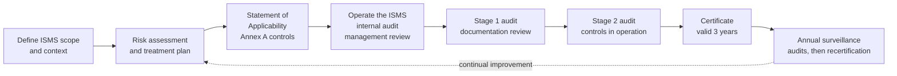

# Compliance Guide - ISO/IEC 27001

## Overview

ISO/IEC 27001 is the international standard for an **information security management system (ISMS)**: the policies, processes, roles and controls an organisation uses to manage information security risk, and to keep improving how it does so. Organisations can be **certified** against it by an accredited certification body, and the certificate is recognised worldwide. It is the most common security certification requested outside the US, and often accepted alongside or instead of [SOC 2](./soc2.md) by international customers.

The current version is **ISO/IEC 27001:2022** (with a 2024 amendment adding climate-change considerations to the context clauses). Certificates to the old 2013 version had to transition by 31 October 2025, so any valid certificate today should reference 2022.

The key idea that separates ISO 27001 from a control checklist: **it certifies the management system, not a fixed set of controls**. You identify your own risks, choose controls to treat them, and prove that the system for doing this runs, is measured and improves. Two certified organisations can have quite different controls.

---

## ISO 27001 certification at a glance

The certification journey: build and run the ISMS first, then pass a two-stage audit, then keep it running through annual surveillance audits.

---

## Structure of the standard

ISO 27001 has two parts that do different jobs.

### Clauses 4-10: the management system (mandatory)

Every clause is mandatory. You cannot exclude any of them.

| Clause | Title | What it requires in practice |
|--------|-------|------------------------------|
| 4 | Context of the organisation | Understand internal and external issues and interested parties; define the ISMS **scope** |
| 5 | Leadership | Top management commitment, an information security policy, assigned roles and responsibilities |
| 6 | Planning | A repeatable **risk assessment** and **risk treatment** process; security objectives; planning of changes |
| 7 | Support | Resources, competence, awareness, communication and **documented information** |
| 8 | Operation | Run the risk assessment and treatment at planned intervals; control outsourced processes |
| 9 | Performance evaluation | Monitoring and measurement, **internal audit**, **management review** |
| 10 | Improvement | Nonconformity handling, corrective action, continual improvement |

These clauses follow the "Annex SL" harmonised structure shared with ISO 9001 (quality) and ISO 42001 (AI management systems), so organisations can run integrated management systems.

### Annex A: the reference control set

Annex A lists **93 controls** in four themes (the 2013 version had 114 controls in 14 domains):

| Theme | Controls | Examples |
|-------|----------|----------|
| 5 Organisational | 37 | Policies, roles, asset inventory, access control, supplier security, cloud services, incident management, business continuity, legal requirements |
| 6 People | 8 | Screening, terms of employment, awareness and training, disciplinary process, remote working |
| 7 Physical | 14 | Physical perimeters and entry, securing offices, equipment protection, secure disposal |
| 8 Technological | 34 | Endpoint devices, privileged access, authentication, malware protection, vulnerability management, configuration management, backup, logging, monitoring, network security, cryptography, secure development |

The 2022 revision added 11 new controls that reflect modern practice:

- 5.7 Threat intelligence
- 5.23 Information security for use of cloud services
- 5.30 ICT readiness for business continuity
- 7.4 Physical security monitoring
- 8.9 Configuration management
- 8.10 Information deletion
- 8.11 Data masking
- 8.12 Data leakage prevention
- 8.16 Monitoring activities
- 8.23 Web filtering
- 8.28 Secure coding

**ISO/IEC 27002:2022** gives implementation guidance for each Annex A control. It is not certifiable on its own; it is the "how" companion to 27001's "what".

### The Statement of Applicability (SoA)

The SoA is the central document of an ISO 27001 audit. For every one of the 93 Annex A controls it records:

- whether the control is **applicable**;
- **why** it is included (which risk, legal or contractual requirement drives it) or why it is excluded;
- whether it is **implemented**.

Exclusions are allowed but must be justified. A cloud-only company with no offices might justify excluding some physical controls, while noting that the cloud provider's data centres are covered by the provider's own certification (the [shared responsibility model](../../learn/concepts/shared-responsibility-model.md) again).

---

## Risk assessment: the heart of the ISMS

Clause 6 requires a defined, repeatable method that produces "consistent, valid and comparable results". A typical approach:

1. **Identify risks**: for assets, processes or scenarios in scope, what could affect confidentiality, integrity or availability?
2. **Analyse** each risk's likelihood and impact on a defined scale.
3. **Evaluate** against risk acceptance criteria set by management.
4. **Treat** each risk above the threshold: modify (apply controls), avoid, share (insurance, outsourcing) or retain (accept).
5. **Assign risk owners** who approve the treatment plan and accept residual risk.

Auditors check that the method is documented, that it was actually followed, that controls in the SoA trace back to risks, and that risk owners signed off. [Threat modeling](../../learn/concepts/threat-modeling-explained.md) at the system level feeds this process well.

---

## Cloud Provider ISO 27001 Support

All three major clouds are certified to ISO 27001, along with the cloud-specific extensions **ISO/IEC 27017** (security controls for cloud services) and **ISO/IEC 27018** (protection of personal data in public clouds). Their certificates cover the infrastructure; your ISMS must still cover how you configure and use it.

### AWS

| Control area | AWS service | Annex A link |
|-------------|-------------|--------------|
| Access control and privileged access | IAM, IAM Identity Center, Organizations SCPs | 5.15-5.18, 8.2, 8.5 |
| Logging and monitoring | CloudTrail, CloudWatch, GuardDuty, Security Hub | 8.15, 8.16 |
| Configuration management | AWS Config, Systems Manager | 8.9 |
| Vulnerability management | Amazon Inspector, Systems Manager Patch Manager | 8.8 |
| Cryptography | KMS, CloudHSM, ACM | 8.24 |
| Backup and resilience | AWS Backup, multi-AZ and cross-region replication | 8.13, 8.14, 5.30 |
| Evidence for auditors | AWS Artifact (provider certificates), Audit Manager | 5.23 supplier evidence |

### Azure

| Control area | Azure service | Annex A link |
|-------------|---------------|--------------|
| Access control and privileged access | Entra ID, Conditional Access, PIM | 5.15-5.18, 8.2, 8.5 |
| Logging and monitoring | Azure Monitor, Microsoft Sentinel, Defender for Cloud | 8.15, 8.16 |
| Configuration management | Azure Policy, Azure Arc | 8.9 |
| Data leakage prevention | Microsoft Purview DLP | 8.12 |
| Cryptography | Key Vault, Managed HSM | 8.24 |
| Compliance reporting | Defender for Cloud regulatory compliance dashboard (ISO 27001 initiative) | 9 performance evaluation |

### Google Cloud

| Control area | GCP service | Annex A link |
|-------------|-------------|--------------|
| Access control and privileged access | Cloud IAM, Privileged Access Manager, BeyondCorp | 5.15-5.18, 8.2, 8.5 |
| Logging and monitoring | Cloud Audit Logs, Security Command Center, Google Security Operations | 8.15, 8.16 |
| Configuration management | Organization Policy, Config Controller | 8.9 |
| Data leakage prevention and masking | Sensitive Data Protection | 8.11, 8.12 |
| Cryptography | Cloud KMS, Cloud HSM, CMEK | 8.24 |
| Compliance reporting | Security Command Center compliance view | 9 performance evaluation |

---

## Related standards in the 27000 family

| Standard | What it covers | When you need it |
|----------|----------------|------------------|
| ISO/IEC 27002 | Guidance for each Annex A control | Always useful when implementing controls |
| ISO/IEC 27017 | Cloud-specific security controls | Cloud service providers and heavy cloud users |
| ISO/IEC 27018 | PII protection in public clouds | Cloud providers processing personal data |
| ISO/IEC 27701 | Privacy information management (extends the ISMS) | When privacy (for example GDPR) needs certification too |
| ISO/IEC 42001 | AI management system | Organisations building or deploying AI; see the [AI site](https://ai.noblerworks.com/safety/) |
| ISO 22301 | Business continuity management | When resilience needs separate certification |

---

## ISO 27001 vs SOC 2

| Aspect | ISO 27001 | SOC 2 |
|--------|-----------|-------|
| Origin | International standard (ISO/IEC) | US attestation standard (AICPA) |
| Output | Public certificate, valid 3 years | Private report from a CPA firm, typically annual |
| What is assessed | The management system plus chosen Annex A controls | Controls against the Trust Services Criteria |
| Scope | Defined by you in the ISMS scope statement | Defined by you via system description and chosen criteria |
| Detail for customers | Certificate shows scope only; SoA shared on request | Report details every control and test result |
| Typical demand | International and enterprise customers, public sector outside the US | US SaaS buyers |

Many companies do both. The controls overlap heavily, so a single control set mapped to both frameworks (one piece of evidence, two audits) saves real effort.

---

## Audit Preparation Checklist

### Mandatory documented information

- [ ] ISMS scope (clause 4.3)
- [ ] Information security policy (5.2)
- [ ] Risk assessment process and results (6.1.2, 8.2)
- [ ] Risk treatment process, plan and results (6.1.3, 8.3)
- [ ] Statement of Applicability (6.1.3 d)
- [ ] Information security objectives (6.2)
- [ ] Evidence of competence (7.2)
- [ ] Operational planning and control records (8.1)
- [ ] Monitoring and measurement results (9.1)
- [ ] Internal audit programme and results (9.2)
- [ ] Management review results (9.3)
- [ ] Nonconformities and corrective actions (10.2)

### Evidence Collection

| Evidence type | Source | Automation |
|--------------|--------|------------|
| Access reviews | IdP and cloud IAM exports | Entra access reviews, IAM Access Analyzer, IAM recommender |
| Logging and monitoring | Central SIEM, cloud audit logs | Retention policies, saved queries |
| Configuration baselines | IaC repositories, policy engines | Config rules, Azure Policy, Organization Policy |
| Vulnerability management | Scanner reports, patch records | Scheduled scans, SLA dashboards |
| Supplier security | Vendor assessments, provider certificates | AWS Artifact, Microsoft Service Trust Portal, Google Compliance Reports Manager |
| Training and awareness | Training platform completion records | LMS exports |
| Incident management | Tickets and post-incident reviews | Ticketing system export |
| Business continuity | Backup logs, restore tests, DR exercises | Automated restore testing |

### Common audit findings

- Risk assessment done once for certification and never updated.
- SoA says a control is implemented, but there is no evidence it operates.
- Internal audit not independent (people auditing their own work) or not completed.
- Management review held without the required inputs (audit results, objectives, risk status).
- Access reviews missed or not acted on.
- Supplier list incomplete; no security assessment of key SaaS vendors.

---

## Certification Exam Relevance

ISO 27001 knowledge is relevant for:
- [ISACA CISA](../../exams/isaca/cisa/) and [CISM](../../exams/isaca/cism/) - audit and governance
- [ISC2 CISSP](../../exams/isc2/cissp/) and [CCSP](../../exams/isc2/ccsp/) - security governance and cloud compliance
- [CCSK v5](../../exams/cloud-security-alliance/ccsk/) - cloud compliance and audit
- [Microsoft SC-100](../../exams/azure/sc-100/) - regulatory compliance in security strategy

There are also ISO 27001 Lead Implementer and Lead Auditor courses offered by several training bodies, aimed at people who run or audit an ISMS.

---

## Documentation Links

**[📖 ISO/IEC 27001:2022](https://www.iso.org/standard/27001)** - the standard itself (paid) and ISO's summary

**[📖 AWS: ISO 27001 compliance](https://aws.amazon.com/compliance/iso-27001-faqs/)** - AWS's certification scope and FAQs

**[📖 Azure: ISO/IEC 27001 offering](https://learn.microsoft.com/en-us/azure/compliance/offerings/offering-iso-27001)** - Microsoft's certification scope and audit reports

**[📖 Google Cloud: ISO/IEC 27001](https://cloud.google.com/security/compliance/iso-27001)** - Google Cloud's certification and services in scope
