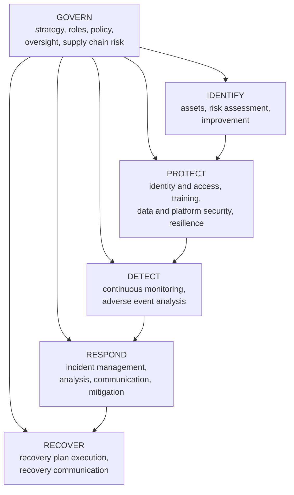

# Compliance Guide - NIST Cybersecurity Framework (CSF) 2.0

## Overview

The NIST Cybersecurity Framework (CSF) is a **voluntary** framework from the US National Institute of Standards and Technology for understanding, managing and communicating cybersecurity risk. It is organised around six functions: **Govern, Identify, Protect, Detect, Respond and Recover**. Version 2.0, published in February 2024, broadened it from critical infrastructure to organisations of every size and sector, and added the Govern function to put cybersecurity strategy, roles and supply chain risk at the centre.

Two things make the CSF different from the other guides in this section:

- **There is no CSF certification.** No auditor issues a "CSF certificate". Organisations use it to assess themselves, set targets, structure a security programme and report to boards and regulators. Claims of "CSF compliance" mean an assessment against it, usually by the organisation itself or a consultant.
- **It is outcome-based, not prescriptive.** It says *what* a good programme achieves ("Identities and credentials for authorised users are managed") without saying *how*. The how comes from mapped references such as NIST SP 800-53, ISO 27001 and the CIS Controls.

That makes it a common language: a CISO can describe the whole programme to a board in six words, and an engineer can trace any one of those words down to specific controls.

---

## The CSF at a glance

Govern sits over the other five functions and informs all of them; Identify, Protect, Detect, Respond and Recover describe the lifecycle of managing risk and incidents.

---

## The Core: functions, categories and subcategories

The CSF Core is a hierarchy: **6 functions**, **22 categories** and **106 subcategories** (specific outcomes). Each category has a short identifier used in assessments and mappings.

| Function | Categories | What it means in practice |
|----------|-----------|---------------------------|
| **Govern (GV)** | Organisational Context (GV.OC), Risk Management Strategy (GV.RM), Roles, Responsibilities and Authorities (GV.RR), Policy (GV.PO), Oversight (GV.OV), Cybersecurity Supply Chain Risk Management (GV.SC) | Security is tied to business goals; someone accountable owns it; policy exists; leadership reviews it; suppliers are managed |
| **Identify (ID)** | Asset Management (ID.AM), Risk Assessment (ID.RA), Improvement (ID.IM) | You know what you have, what threatens it, and you learn from assessments and incidents |
| **Protect (PR)** | Identity Management, Authentication and Access Control (PR.AA), Awareness and Training (PR.AT), Data Security (PR.DS), Platform Security (PR.PS), Technology Infrastructure Resilience (PR.IR) | Safeguards: [least privilege](../../learn/concepts/least-privilege-explained.md), [MFA](../../learn/concepts/mfa-and-passkeys.md), training, [encryption](../../learn/concepts/encryption-explained.md), hardened and patched platforms, resilient architecture |
| **Detect (DE)** | Continuous Monitoring (DE.CM), Adverse Event Analysis (DE.AE) | [Logging and detection](../../learn/concepts/logging-and-detection.md): find attacks and anomalies quickly |
| **Respond (RS)** | Incident Management (RS.MA), Incident Analysis (RS.AN), Incident Response Reporting and Communication (RS.CO), Incident Mitigation (RS.MI) | [Incident response](../../learn/concepts/incident-response-basics.md): triage, investigate, contain, communicate |
| **Recover (RC)** | Incident Recovery Plan Execution (RC.RP), Incident Recovery Communication (RC.CO) | Restore operations and communicate status |

### What changed from CSF 1.1

- **Govern is new.** Governance outcomes that were scattered across Identify in 1.1 now have their own function, alongside new outcomes on strategy and oversight.
- **Supply chain risk management** moved into Govern and expanded.
- **Scope widened** from critical infrastructure to all organisations, with Quick Start Guides for small businesses and other audiences.
- **Implementation Examples** were added for each subcategory, plus online **Informative References** mapping to other standards.
- Several 1.1 categories were merged or renamed (for example, Protect now has Platform Security and Technology Infrastructure Resilience).

---

## Tiers and Profiles

### Tiers: how mature is the risk management?

Tiers describe the rigour of an organisation's cybersecurity risk governance and management. They are not a maturity score to be maximised everywhere; organisations choose a target tier that fits their risk.

| Tier | Name | Characteristics |
|------|------|-----------------|
| 1 | Partial | Ad hoc, reactive, limited awareness of risk |
| 2 | Risk Informed | Management approves practices, but they are not organisation-wide policy |
| 3 | Repeatable | Formal, organisation-wide policy, updated as threats and business change |
| 4 | Adaptive | Continuous improvement from lessons learned and predictive indicators; risk-informed culture |

### Profiles: where are we, and where do we want to be?

- A **Current Profile** records which outcomes the organisation achieves today, and how well.
- A **Target Profile** records the outcomes it wants to achieve, prioritised for its risks and business goals.
- The **gap** between them becomes the action plan.

**Community Profiles** are shared target profiles for a sector or use case (for example, manufacturing or a specific threat like ransomware) that organisations can start from.

---

## How to use the CSF: a practical walk-through

1. **Scope**: decide which business units, systems or products the assessment covers.
2. **Gather context**: business objectives, legal and regulatory obligations, risk appetite, key suppliers.
3. **Build the Current Profile**: for each in-scope subcategory, rate how well the outcome is achieved today (for example on a 0-5 scale, or "not / partially / largely / fully"), with evidence.
4. **Build the Target Profile**: decide the desired level per subcategory, driven by risk, not by "max everything".
5. **Analyse the gaps** and estimate the cost and risk reduction of closing each.
6. **Write an action plan**, prioritised, with owners and dates.
7. **Implement and measure**, then reassess on a regular cycle (often yearly).

### A worked example

A 60-person SaaS company runs a first CSF assessment. Highlights:

| Subcategory area | Current | Target | Action |
|------------------|---------|--------|--------|
| GV.RR (roles) | No named security owner | Named owner with board reporting | Appoint a head of security; quarterly board update |
| ID.AM (assets) | Partial: cloud resources known, SaaS apps not | Full inventory incl. SaaS | SaaS discovery via SSO and expense data |
| PR.AA (access) | MFA for most, admins on SMS | Phishing-resistant MFA for admins, quarterly access reviews | Security keys for admins; automate reviews |
| DE.CM (monitoring) | Cloud logs collected, no alerts | Alerts on high-risk events with on-call | Build the [logging and alerting project](../hands-on-projects/centralized-logging-and-alerting.md) |
| RS.MA (incidents) | No plan | Written plan, yearly tabletop | Write IR plan and runbooks; schedule a tabletop |
| RC.RP (recovery) | Backups exist, never tested | Quarterly restore tests | Automate restore tests |

The action plan becomes the security roadmap, and the next year's assessment shows progress in the board's own vocabulary.

---

## Cloud Provider CSF Support

Because the CSF is outcome-based, cloud providers support it through mappings and automated checks that assess your configuration against mapped controls.

### AWS

| CSF function | AWS services | Notes |
|--------------|-------------|-------|
| Govern | Organizations, Control Tower, Audit Manager | Guardrails, account structure, evidence collection |
| Identify | AWS Config, Resource Explorer, Security Hub | Inventory and posture |
| Protect | IAM, IAM Identity Center, KMS, WAF, Shield, Systems Manager | Access, encryption, patching |
| Detect | GuardDuty, CloudTrail, Security Hub, Detective | Threat detection and investigation |
| Respond | EventBridge, Lambda, Systems Manager Incident Manager | Automated and manual response |
| Recover | AWS Backup, Elastic Disaster Recovery | Restore and failover |

AWS Config offers a conformance pack that maps managed rules to CSF subcategories, and Audit Manager includes CSF-based frameworks for evidence collection.

### Azure

| CSF function | Azure services | Notes |
|--------------|---------------|-------|
| Govern | Management groups, Azure Policy, Microsoft Purview Compliance Manager | Guardrails and compliance assessments |
| Identify | Azure Resource Graph, Defender for Cloud | Inventory and secure score |
| Protect | Entra ID, Conditional Access, PIM, Key Vault, Azure Firewall | Identity, access and data protection |
| Detect | Microsoft Sentinel, Defender XDR, Defender for Cloud | SIEM and extended detection |
| Respond | Sentinel playbooks (Logic Apps), Defender automated investigation | Orchestrated response |
| Recover | Azure Backup, Azure Site Recovery | Restore and DR |

### Google Cloud

| CSF function | GCP services | Notes |
|--------------|-------------|-------|
| Govern | Resource hierarchy, Organization Policy, Assured Workloads | Guardrails and regulated environments |
| Identify | Cloud Asset Inventory, Security Command Center | Inventory and posture |
| Protect | Cloud IAM, BeyondCorp, Cloud KMS, Cloud Armor, VPC Service Controls | Access, encryption, perimeter controls |
| Detect | Security Command Center, Google Security Operations, Cloud Audit Logs | Threat detection and SIEM |
| Respond | Google Security Operations SOAR, Cloud Functions | Automated response |
| Recover | Backup and DR Service, multi-region architectures | Restore and failover |

---

## How the CSF relates to other frameworks

| Framework | Relationship to the CSF |
|-----------|-------------------------|
| NIST SP 800-53 | The detailed US federal control catalogue; CSF subcategories map to 800-53 controls. [FedRAMP](./fedramp.md) is built on 800-53. |
| [ISO 27001](./iso-27001.md) | Certifiable management system; Annex A controls map to CSF outcomes. Many organisations certify to ISO 27001 and report using the CSF. |
| CIS Controls | 18 prioritised, practical safeguards; a common "how" for small and mid-sized organisations implementing CSF outcomes |
| [SOC 2](./soc2.md), [PCI DSS](./pci-dss.md), [HIPAA](./hipaa.md) | Sector or attestation requirements; their controls can be tagged to CSF functions so one programme reports both ways |
| NIST SP 800-61 | Incident response guidance, revised in 2025 to align with CSF 2.0 functions |
| NIST AI RMF | The AI equivalent of the CSF's risk approach; see the [AI site](https://ai.noblerworks.com/safety/governance/nist-ai-rmf/) |

---

## Assessment Preparation Checklist

### Documentation that makes an assessment straightforward

- [ ] Cybersecurity strategy and risk appetite statement (GV.RM)
- [ ] Named roles and RACI for security responsibilities (GV.RR)
- [ ] Security policies, approved and reviewed (GV.PO)
- [ ] Supplier inventory with risk tiers (GV.SC)
- [ ] Asset inventory: hardware, software, cloud, SaaS, data (ID.AM)
- [ ] Risk register (ID.RA)
- [ ] Access control standard and review records (PR.AA)
- [ ] Training records (PR.AT)
- [ ] Data classification and encryption standard (PR.DS)
- [ ] Hardening baselines and patch SLAs (PR.PS)
- [ ] Logging standard and alert catalogue (DE.CM, DE.AE)
- [ ] Incident response plan, runbooks and exercise records (RS)
- [ ] Backup, restore test and DR records (RC)

### Common gaps found in first assessments

- Govern outcomes missing: no one accountable, no risk appetite, security not reported to leadership.
- Incomplete asset inventories, especially SaaS and shadow IT.
- Detection exists on paper, but alerts are not monitored or have no owners.
- Incident response plans never exercised.
- Backups never restored in a test.
- Supplier risk managed only at contract signing, never reviewed.

---

## Certification Exam Relevance

NIST CSF knowledge is relevant for:
- [CompTIA Security+](../../exams/comptia/security-plus/) and [CySA+](../../exams/comptia/cysa-plus/) - frameworks and their purpose
- [ISC2 CISSP](../../exams/isc2/cissp/) and [CC](../../exams/isc2/cc/) - security governance and frameworks
- [ISACA CISM](../../exams/isaca/cism/) and [CISA](../../exams/isaca/cisa/) - building and auditing a security programme
- [Microsoft SC-100](../../exams/azure/sc-100/) - aligning a security strategy with industry frameworks

Exams commonly test the function names and their order, the difference between tiers and profiles, and the fact that the CSF is voluntary and not certifiable.

---

## Documentation Links

**[📖 NIST Cybersecurity Framework](https://www.nist.gov/cyberframework)** - the CSF home page, quick start guides and resources

**[📖 NIST CSF 2.0 (CSWP 29)](https://nvlpubs.nist.gov/nistpubs/CSWP/NIST.CSWP.29.pdf)** - the framework document itself

**[📖 AWS Config: Operational best practices for NIST CSF](https://docs.aws.amazon.com/config/latest/developerguide/operational-best-practices-for-nist-csf.html)** - the conformance pack mapping Config rules to CSF

**[📖 Azure: NIST CSF offering](https://learn.microsoft.com/en-us/azure/compliance/offerings/offering-nist-csf)** - Microsoft's CSF mapping and resources
