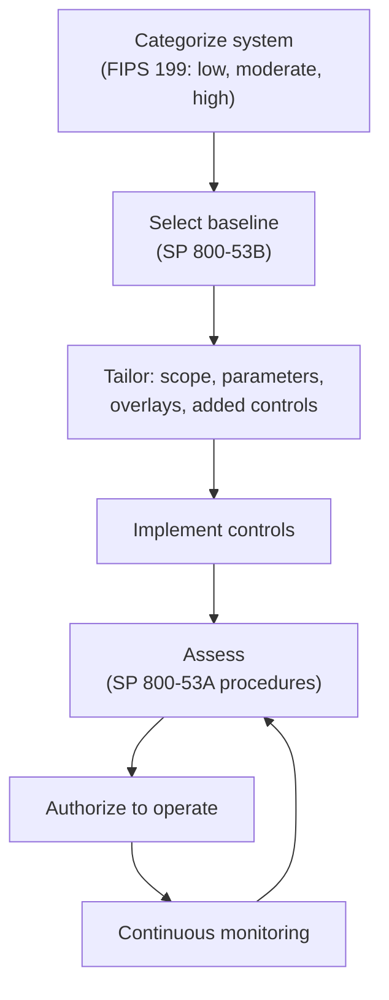

# Compliance Guide - NIST SP 800-53 (Security and Privacy Controls)

> **As of 2026-11-07.** Read from NIST SP 800-53 Rev. 5 (PDF), SP 800-53B (PDF) and the NIST CSRC publication page. The latest release shown on that page is 5.2.0 (27 August 2025). Check CSRC for a newer release.

## Overview

**NIST Special Publication 800-53** is the US government's catalog of security and privacy controls: the long list of specific safeguards, from "enforce least privilege" to "protect the audit logs", that federal systems are measured against. Its full title is *Security and Privacy Controls for Information Systems and Organizations*. **Revision 5** was published in September 2020 (with a December 2020 update); minor releases since then change individual controls. The CSRC page for it lists **Release 5.2.0 on 27 August 2025**, a minor release that added SA-15(13), SA-24 and SI-02(07), revised SI-07(12) and updated the discussion text of several others.

It is a **catalog, not a certification.** No one is "800-53 certified". Instead:

- It is the control catalog US federal agencies use for their systems. Its Authority statement says NIST developed it under the Federal Information Security Modernization Act (FISMA, 44 U.S.C. 3551 et seq.), consistent with OMB Circular A-130, and that nongovernmental organizations may use it on a voluntary basis.
- [FedRAMP](./fedramp.md) baselines for cloud services are built on it.
- [CMMC](./cmmc.md) Level 2 uses the sibling publication NIST SP 800-171, which is derived from it.
- The [NIST CSF](./nist-csf.md), [ISO 27001](./iso-27001.md) and [CIS Controls](./cis-controls-v8.md) all map to it, so it is often the common reference when a team must show how one program meets several frameworks.

**[📖 NIST SP 800-53 Rev. 5 on CSRC](https://csrc.nist.gov/pubs/sp/800/53/r5/upd1/final)** - publication page, release history and downloads.

**[📖 NIST SP 800-53 Rev. 5 (PDF)](https://nvlpubs.nist.gov/nistpubs/SpecialPublications/NIST.SP.800-53r5.pdf)** - the full control catalog.

---

## The family structure

Controls are grouped in **20 families**, each with a two-letter ID. Within a family there are **base controls** (for example AC-2, Account Management) and **control enhancements** (for example AC-2(1)), which add strength or specificity. An enhancement always requires its base control.

| ID | Family | ID | Family |
|----|--------|----|--------|
| AC | Access Control | PE | Physical and Environmental Protection |
| AT | Awareness and Training | PL | Planning |
| AU | Audit and Accountability | PM | Program Management |
| CA | Assessment, Authorization, and Monitoring | PS | Personnel Security |
| CM | Configuration Management | PT | PII Processing and Transparency |
| CP | Contingency Planning | RA | Risk Assessment |
| IA | Identification and Authentication | SA | System and Services Acquisition |
| IR | Incident Response | SC | System and Communications Protection |
| MA | Maintenance | SI | System and Information Integrity |
| MP | Media Protection | SR | Supply Chain Risk Management |

NIST notes that 17 of the 20 families line up with the minimum security requirements in FIPS 200. The three that do not (**PM**, **PT**, **SR**) cover enterprise program management, privacy and supply chain risk, which arrived later. (Not re-checked against the Rev. 5 text.)

Revision 5 also merged privacy into the same catalog, so one set of controls covers both security and privacy outcomes.

---

## Baselines: choosing which controls apply

You do not apply all controls. **SP 800-53B** defines **control baselines** and the tailoring guidance:

1. **Categorize** the system under FIPS 199 by the impact of losing confidentiality, integrity or availability: low, moderate or high.
2. Use the **high-water mark**: if any one security objective is high, the system is high-impact; if none is high but any is moderate, it is moderate-impact; otherwise low.
3. **Select the baseline** (low, moderate or high). There is also a separate **privacy baseline** applied where personally identifiable information is processed.
4. **Tailor** the baseline: remove controls that do not apply, add enhancements for specific risks, define the organization-set values (for example how often to review accounts), and apply overlays for a community (for example a cloud or a mission).
5. **Implement, assess, authorize and monitor.** Assessment procedures are in **SP 800-53A**.

*The diagram shows the control life cycle. A system is categorized, which selects a baseline. The baseline is tailored, the controls are implemented and assessed, an authorizing official accepts the residual risk, and continuous monitoring feeds back into reassessment.*

---

## How to read a control

Every control has a similar shape. Take the access control family as a pattern:

- **Control text** states what must be done, with blanks the organization fills in (frequency, roles).
- **Discussion** gives the intent and examples.
- **Related controls** link to others that work together.
- **Control enhancements** add strength.

When you are writing a System Security Plan, you describe, per control, **how** your system meets it and who is responsible (you, the cloud provider, or both). That is the shared-responsibility record. See [Shared responsibility model](../../learn/concepts/shared-responsibility-model.md).

### Mapping examples (concept level)

| You want to show | Look in family |
|------------------|----------------|
| Who can log in and what they can do | AC, IA |
| Changes are approved and tracked | CM |
| Logs exist and are protected | AU |
| You can recover from a failure | CP |
| You can detect and handle an incident | IR, SI |
| Vendors and components are trusted | SA, SR |
| Privacy of personal data | PT, plus the privacy baseline |

---

## Cloud notes

- **AWS, Azure and Google Cloud** each publish FedRAMP authorizations and control-mapping guides. Their documents show which controls the provider implements and which are the customer's.
- For a customer system, the provider's authorization covers the inherited controls. You still own identity, configuration, data protection and monitoring for your workloads.
- Cloud policy tools (AWS Config conformance packs, Azure Policy regulatory compliance initiatives, Google Cloud Security Command Center compliance reports) include 800-53 mappings that give a continuous check of the technical controls.

---

## Preparation checklist

- [ ] System boundary documented and the system categorized (FIPS 199) with a recorded rationale
- [ ] Baseline selected from SP 800-53B, with tailoring decisions written down
- [ ] System Security Plan describes how each selected control is implemented and who owns it
- [ ] Inherited controls identified with evidence from the provider (authorization package, SOC reports)
- [ ] Assessment plan based on SP 800-53A; assessor independent where required
- [ ] Plan of Action and Milestones (POA&M) for every open weakness, with owners and dates
- [ ] Continuous monitoring: scans, log review, configuration drift, change impact analysis
- [ ] Mapped crosswalk if you also need ISO 27001, SOC 2, CSF or CIS evidence from the same work

### Common gaps

- Treating the baseline as the answer without tailoring or writing implementation detail
- SSP statements that say "implemented" with no evidence
- Ignoring inherited versus customer-owned control boundaries
- Supply chain (SR) and privacy (PT) controls skipped because they were new in Rev. 5

---

## Certification exam relevance

- [ISC2 CISSP](../../exams/isc2/cissp/) and [CCSP](../../exams/isc2/ccsp/) - risk management, control frameworks, authorization
- [ISACA CISM](../../exams/isaca/cism/) and [CISA](../../exams/isaca/cisa/) - control frameworks and assessment
- [CompTIA Security+](../../exams/comptia/security-plus/) - control categories and types

Exams test concepts (baselines, tailoring, categorization, control families) rather than control numbers.

---

## Related

- [FedRAMP](./fedramp.md), [CMMC](./cmmc.md), [NIST CSF 2.0](./nist-csf.md), [CIS Controls v8](./cis-controls-v8.md), [SOX ITGCs](./sox-itgc.md)
- [Risk management basics](../../learn/concepts/risk-management-basics.md)
- [Least privilege explained](../../learn/concepts/least-privilege-explained.md)

---

## Documentation Links

**[📖 SP 800-53 Rev. 5 publication page](https://csrc.nist.gov/pubs/sp/800/53/r5/upd1/final)** - release 5.2.0 and related documents.

**[📖 SP 800-53 Rev. 5](https://nvlpubs.nist.gov/nistpubs/SpecialPublications/NIST.SP.800-53r5.pdf)** - control catalog.

**[📖 SP 800-53B: control baselines](https://nvlpubs.nist.gov/nistpubs/SpecialPublications/NIST.SP.800-53B.pdf)** - baselines and tailoring guidance.
