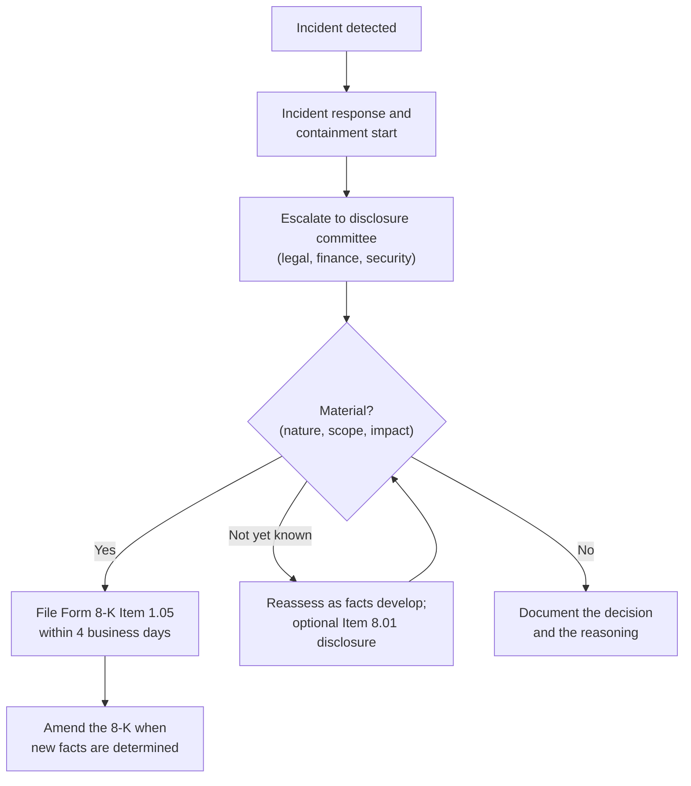

# Compliance Guide - SEC Cybersecurity Disclosure Rule

> **As of 2026-11-07.** The rule text below was read from the SEC's adopting release (Release No. 33-11216). Section "Status" lists what has been proposed since. Check the SEC site before relying on it for a filing decision.

## Overview

In July 2023 the US Securities and Exchange Commission adopted rules that make public companies tell investors about cybersecurity in two ways:

1. **Fast, event-driven disclosure.** A new **Item 1.05 of Form 8-K** requires a company to report a cybersecurity incident it determines to be **material**.
2. **Annual, program-level disclosure.** A new **Item 106 of Regulation S-K** requires each annual report (Form 10-K) to describe how the company manages cybersecurity risk and who governs it.

The rule is about **investor information**, not about which security controls you must have. It does not say "use MFA". It says: tell investors what happened when it matters, and tell them each year how you oversee the risk. In practice that pushes companies to build incident-escalation, materiality-assessment and board-reporting processes before they are needed.

Who it covers: companies that file reports under the Securities Exchange Act (US-listed registrants, including smaller reporting companies). **Foreign private issuers** have matching duties on Form 6-K (incidents) and Form 20-F (risk management and governance).

---

## Key dates

| Date | What happened |
|------|---------------|
| 26 July 2023 | SEC adopts the rules |
| 5 September 2023 | Rules effective |
| 15 December 2023 | Item 106 disclosures start with annual reports for fiscal years ending on or after this date |
| 18 December 2023 | Form 8-K Item 1.05 compliance starts (all registrants except smaller reporting companies) |
| 15 June 2024 | Form 8-K Item 1.05 compliance starts for smaller reporting companies |
| 15 December 2024 | Inline XBRL tagging of Item 106 disclosures starts (fiscal years ending on or after this date) |
| 18 December 2024 | Inline XBRL tagging of Item 1.05 disclosures starts |

**[📖 SEC press release 2023-139: SEC adopts cybersecurity disclosure rules](https://www.sec.gov/newsroom/press-releases/2023-139)** - adoption date and summary.

**[📖 Final rule: Release No. 33-11216 (PDF)](https://www.sec.gov/files/rules/final/2023/33-11216.pdf)** - the adopting release, including the compliance-dates section and the summary table of each item.

---

## Form 8-K Item 1.05: material incidents

**What triggers it.** A company that experiences a cybersecurity incident and **determines it to be material** must file an Item 1.05 Form 8-K within **four business days of that determination**. The clock starts at the materiality determination, not at discovery of the incident.

**When must the determination be made?** "Without unreasonable delay" after discovery. The SEC added that wording to the final rule to stop companies from delaying the decision to avoid disclosing.

**What the filing describes.** The material aspects of the incident's **nature, scope and timing**, and its **impact or reasonably likely impact** on the company, including its financial condition and results of operations. Information not yet known can be filed later by **amending** the 8-K.

**Delay for national security.** Disclosure can be delayed only if the **US Attorney General** determines that immediate disclosure would pose a substantial risk to national security or public safety and tells the SEC in writing. The release describes an initial delay of up to 30 days, a further 30 days, and in extraordinary circumstances a final period of up to 60 days.

### What counts as material

The rule uses the standard securities-law meaning: information is material if there is a substantial likelihood that a reasonable investor would consider it important in making an investment decision. Impact is not only financial. The release gives examples such as harm to reputation, customer or vendor relationships, and competitiveness, and the possibility of litigation or regulatory investigation.

### Item 1.05 versus Item 8.01

On 21 May 2024 the Director of the SEC's Division of Corporation Finance issued a statement on how to use the items. In summary: Item 1.05 is for incidents the company has determined to be **material**. A company that chooses to disclose an incident it has **not yet assessed, or has judged not material**, is encouraged to use a different item, such as **Item 8.01 (Other Events)**. If it later finds the incident material, it files under Item 1.05 within four business days of that determination.

**[📖 SEC Corporation Finance statement on disclosing cybersecurity incidents (21 May 2024)](https://www.sec.gov/newsroom/speeches-statements/gerding-cybersecurity-incidents-05212024)** - the Item 1.05 and Item 8.01 guidance.

*The diagram shows the decision path. Detection triggers response and an escalation to a disclosure committee, which makes the materiality call. A yes starts the four-business-day clock for Item 1.05. An unknown outcome loops back as facts develop, and a no is documented so the reasoning can be shown later. A filed 8-K is amended when new facts are determined.*

---

## Regulation S-K Item 106: annual disclosure

Item 106 sits in the 10-K and has two parts.

**Risk management and strategy (Item 106(b)).** Describe the company's **processes**, if any, for assessing, identifying and managing material risks from cybersecurity threats, and whether any such risks have materially affected, or are reasonably likely to materially affect, its business strategy, results of operations or financial condition. The release also asks whether the company uses outside assessors or consultants and whether it has processes to oversee risks tied to third-party service providers.

**Governance (Item 106(c)).** Describe:

- The **board's oversight** of cybersecurity risk (for example, which committee, and how it is informed).
- **Management's role** in assessing and managing material risks, including which positions or committees are responsible, their relevant expertise, and how they are informed about and monitor incidents.

Note the "if any" in 106(b): a company without a formal process must say so rather than invent one.

---

## What auditors and regulators look at

- **Consistency.** A 10-K that describes a mature process the company does not run is the risk. Disclosure statements must match reality.
- **Incident timeline evidence.** When was the incident detected, when did it reach the people who decide materiality, and when was the decision made? Keep contemporaneous records.
- **Third parties.** Incidents at vendors can still be material to the registrant.

For a worked public example of the clock in practice, see the Item 1.05 filing in the [Change Healthcare case study](../case-study-change-healthcare-2024.md) and the MGM Resorts filings in the [MGM Resorts case study](../case-study-mgm-resorts-2023.md).

---

## Status (as of 2026-11-07)

The rule remains as adopted. Industry groups, including a May 2025 petition and an April 2026 joint trades letter, have asked the SEC to rescind Item 1.05 and/or Item 106 as part of a broader review of Regulation S-K. **I did not find a formal SEC proposal or final rule that amends or rescinds either item** (the evidence is trade-group letters and commentary, so treat this as unverified and check the SEC site).

**[📖 Joint trades letter on reforming Regulation S-K cybersecurity disclosures (April 2026)](https://www.sifma.org/advocacy/letters/reforming-regulation-s-ks-cybersecurity-disclosures-joint-trades)** - shows the industry request; it is advocacy, not SEC action.

---

## Preparation checklist

### Incident side (Item 1.05)

- [ ] A written path from the SOC or IR team to a **disclosure committee** (legal, finance, security, investor relations), with named people and on-call cover
- [ ] A materiality framework approved in advance: quantitative and qualitative factors, who decides, how it is documented
- [ ] Triggers that force an early materiality review (data theft, operational outage, ransom demand, regulator contact)
- [ ] A draft 8-K template and a process to amend it
- [ ] Contract terms that make vendors notify you quickly, so a supplier incident reaches the committee in time
- [ ] Tabletop exercise that runs the clock from detection to filing

### Annual side (Item 106)

- [ ] A current description of the cyber risk management process, reviewed by security, legal and internal audit for accuracy
- [ ] Board or committee minutes showing cyber is on the agenda and what the board is told
- [ ] Management roles and expertise described, matching the real organization chart
- [ ] Third-party risk oversight described only as far as it exists

### Evidence

| Evidence | Source |
|----------|--------|
| Board and committee cyber briefings | Minutes, board portal |
| Materiality assessments and decisions | Disclosure committee records |
| Incident timeline | Ticketing system, IR log with timestamps |
| Process descriptions | Policies, risk register, audit reports |

---

## Certification exam relevance

- [ISACA CISM](../../exams/isaca/cism/) and [CISA](../../exams/isaca/cisa/) - governance, board reporting, incident management
- [ISC2 CISSP](../../exams/isc2/cissp/) - legal and regulatory requirements, breach notification

Exams test the idea (escalation, materiality, governance accountability) more than form numbers.

---

## Related

- [SOX IT general controls](./sox-itgc.md) - the other SEC-driven control regime
- [Risk management basics](../../learn/concepts/risk-management-basics.md)
- [Incident response basics](../../learn/concepts/incident-response-basics.md)
- [NIS2](./nis2.md) and [DORA](./dora.md) - EU incident-reporting regimes with their own clocks

---

## Documentation Links

**[📖 SEC cybersecurity disclosure rule press release](https://www.sec.gov/newsroom/press-releases/2023-139)** - adoption announcement.

**[📖 Final rule 33-11216](https://www.sec.gov/files/rules/final/2023/33-11216.pdf)** - full adopting release.

**[📖 Corporation Finance statement, 21 May 2024](https://www.sec.gov/newsroom/speeches-statements/gerding-cybersecurity-incidents-05212024)** - Item 1.05 versus Item 8.01.
