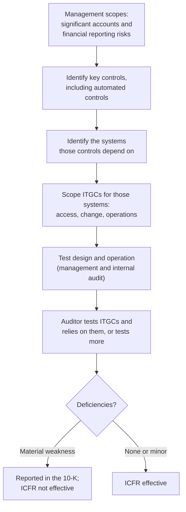

# Compliance Guide - SOX IT General Controls (ITGCs)

> **As of 2026-11-07.** Statute text was read on Cornell LII (15 U.S.C. 7262) and the SEC's management guidance (Release No. 33-8810). The PCAOB site blocked automated fetching, so auditor-standard details below are marked where they could not be checked against the standard itself.

## Overview

The **Sarbanes-Oxley Act of 2002 (SOX)** was passed after major accounting frauds. Two parts matter for security people:

- **Section 404(a):** each annual report must contain an **internal control report**. Management states that it is responsible for adequate internal control over financial reporting (**ICFR**) and **assesses its effectiveness** as of the end of the most recent fiscal year.
- **Section 404(b):** the external auditor must **attest to and report on** management's assessment, under PCAOB standards. Per 15 U.S.C. 7262, this does not apply to issuers that are neither large accelerated filers nor accelerated filers, and emerging growth companies are excluded.

SOX is not a security standard. It cares about one thing: can you trust the **financial statements**? But financial numbers live in software. If someone can change the code, the database or the access rules without anyone noticing, the numbers cannot be trusted. **IT general controls (ITGCs)** are the controls over that technology environment.

**[📖 15 U.S.C. 7262 (SOX Section 404)](https://www.law.cornell.edu/uscode/text/15/7262)** - the statute text.

**[📖 SEC Release No. 33-8810: management's report on ICFR](https://www.sec.gov/files/rules/interp/2007/33-8810.pdf)** - the SEC's interpretive guidance for management.

---

## What an ITGC is

The SEC guidance explains the role. Controls that address financial reporting risk may be manual, automated, or a mix. **Automated controls** (for example, a system that matches an invoice to a purchase order) and IT-dependent controls only work reliably if the technology underneath is controlled. In the SEC's words, IT general controls alone do not ordinarily address financial reporting risks, but the proper operation of automated controls often **depends on effective ITGCs**.

The guidance names four areas management might consider: **program development, program changes, computer operations, and access to programs and data.** It also says management only needs to evaluate the ITGCs that are necessary for the proper and consistent operation of other controls that address financial reporting risks. ITGCs about efficiency alone are out of scope.

In audit practice these four areas are usually grouped as:

| Domain | Question it answers | Typical controls |
|--------|--------------------|------------------|
| **Access to programs and data** | Who can read or change financial systems and data? | Joiner, mover, leaver process; periodic user access reviews; privileged access management; segregation of duties; MFA; password policy |
| **Program change management** | Can code or configuration change without approval and testing? | Ticketed change requests; peer review; testing before release; separate developer and deployer; emergency change process with after-the-fact review |
| **Program development** | Are new systems built and implemented under control? | Project governance; data migration testing; go-live sign-off |
| **Computer operations** | Do jobs run completely and can data be recovered? | Job scheduling and monitoring; backup and restore tests; incident and problem management |

---

## How it works end to end

*The diagram shows the top-down flow. Management starts from financial reporting risk, finds the key controls, then the systems those controls rely on, and only then scopes the ITGCs. Both management and the auditor test them. Serious unremediated gaps become a material weakness reported in the annual report.*

This is the SEC's "top-down, risk-based approach": ITGC scope follows the financial risk, not the other way round. It is why SOX scope is usually a short list of in-scope applications (ERP, general ledger, billing), the databases and operating systems under them, and the cloud accounts that host them.

A **material weakness** is defined in SEC rules as a deficiency, or combination of deficiencies, in ICFR such that there is a **reasonable possibility** that a material misstatement of the annual or interim financial statements will not be prevented or detected on a timely basis.

---

## Cloud and modern environments

SOX does not name technologies, so cloud systems are in scope when they host in-scope applications. Examples of how the four domains look there:

- **Access:** federated SSO with MFA, privileged roles that are time-limited, quarterly review exports from the identity provider and from cloud IAM, break-glass accounts monitored.
- **Change:** infrastructure as code in version control with required reviews, protected main branches, pipeline logs as evidence, no direct console changes to production (or detected and reviewed).
- **Operations:** managed backup policies, tested restores, job scheduler alerts.
- **Third parties:** if a SaaS provider runs an in-scope process, expect to obtain its **SOC 1** report (controls relevant to a customer's financial reporting), and map your complementary user entity controls. See [SOC 2](./soc2.md) for the sibling reports.

Auditors will test **populations**, not just samples you hand over, so evidence must be complete and exportable: all users with access on the review date, all changes to production in the period.

---

## Common deficiencies

These recur in practice and in public auditor-inspection findings (the PCAOB has repeatedly reported ITGC testing as an audit weakness; I could not confirm paragraph-level wording on pcaobus.org, so this is marked as unverified detail):

- Access reviews done but not evidenced, or reviewers approving without checking.
- Leavers still active in a financial application.
- Developers with write access to production and no detective control.
- Change tickets approved after the change went live.
- Shared or generic privileged accounts with no attribution.
- Backups taken but never restored in a test.
- Reports used in controls (for example, an aged-debt report) with no control over how the report logic was built.

---

## Preparation checklist

### Scoping

- [ ] A current list of in-scope applications, tied to significant accounts
- [ ] Each in-scope application mapped to its database, operating system, network and cloud accounts
- [ ] Service organizations identified, with SOC 1 reports collected and reviewed

### Access

- [ ] Documented joiner, mover and leaver process, with approval records
- [ ] Periodic access reviews with sign-off and a record of changes made as a result
- [ ] Privileged access limited, logged and reviewed
- [ ] Segregation of duties rules defined and monitored

### Change

- [ ] All production changes ticketed, approved, tested and traceable to the deployed code
- [ ] Developers cannot deploy to production alone
- [ ] Emergency changes reviewed after the fact

### Operations

- [ ] Backups monitored; restore tested and evidenced
- [ ] Batch jobs and interfaces monitored with failure handling

### Evidence

| Evidence | Source | Automation |
|----------|--------|------------|
| User lists and role assignments | IdP, application, cloud IAM | Scheduled export |
| Change approvals | Ticketing, Git, CI/CD logs | Pipeline gates that block unapproved deploys |
| Review sign-offs | GRC tool, tickets | Workflow with reminders |
| Restore tests | Backup tool reports | Scheduled restore tests |

---

## Certification exam relevance

- [ISACA CISA](../../exams/isaca/cisa/) - ITGC testing is core exam content (IS audit, governance, change and access controls)
- [ISACA CISM](../../exams/isaca/cism/) and [ISC2 CISSP](../../exams/isc2/cissp/) - governance, separation of duties, change management

---

## Related

- [SEC cybersecurity disclosure rule](./sec-cyber-disclosure-rule.md) - the other SEC disclosure regime
- [SOC 2](./soc2.md) - third-party assurance reports
- [Least privilege explained](../../learn/concepts/least-privilege-explained.md)
- [IAM explained](../../learn/concepts/iam-explained.md)
- [Logging and detection](../../learn/concepts/logging-and-detection.md)
- [NIST SP 800-53](./nist-sp-800-53.md) - control families that map to the ITGC domains (AC, CM, CP, AU)

---

## Documentation Links

**[📖 15 U.S.C. 7262](https://www.law.cornell.edu/uscode/text/15/7262)** - Section 404 as codified.

**[📖 SEC Release 33-8810](https://www.sec.gov/files/rules/interp/2007/33-8810.pdf)** - management guidance, including the role of ITGCs.

**[📖 PCAOB AS 2201](https://pcaobus.org/oversight/standards/auditing-standards/details/AS2201)** - the auditor standard for an audit of ICFR (not machine-readable when checked; read it directly).
