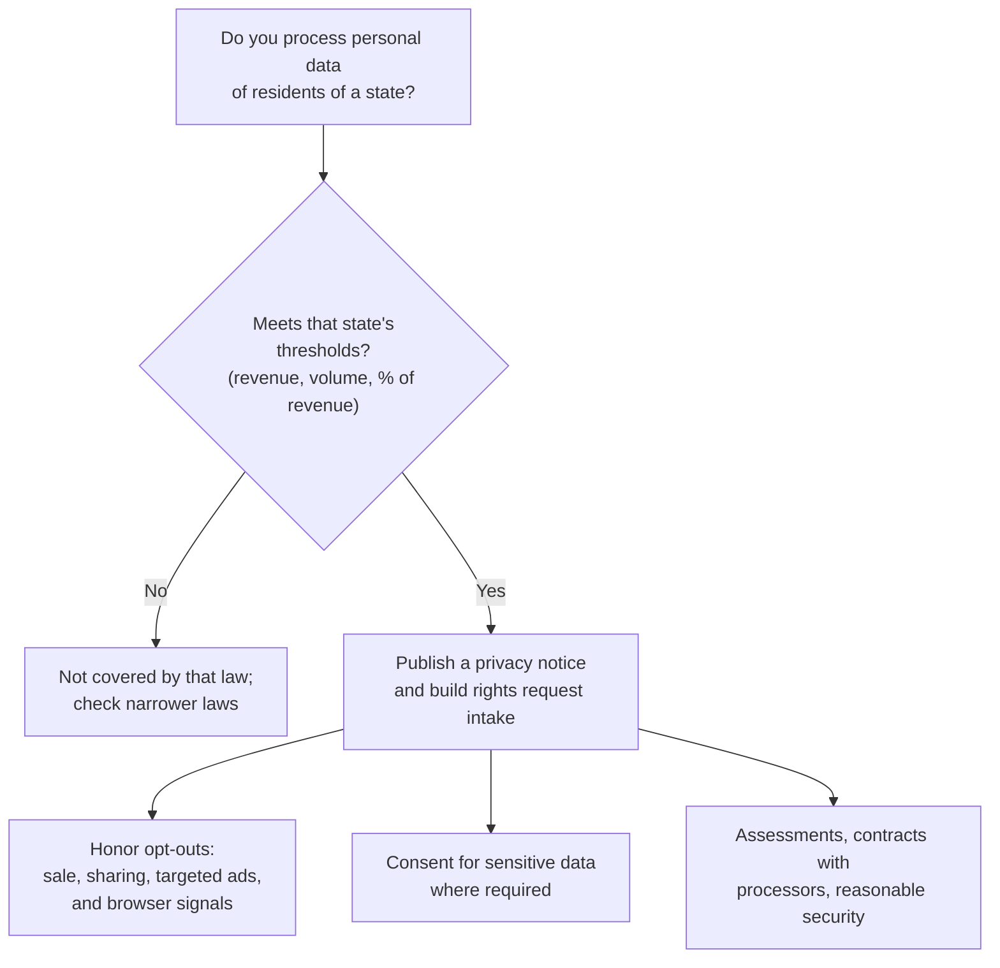

# Compliance Guide - US State Privacy Laws (CCPA/CPRA and Others)

> **As of 2026-11-07.** The California material was read on the California Attorney General's CCPA page and the California Privacy Protection Agency (CPPA) site. The overview of other states comes from **secondary sources** (a law firm's effective-date timeline last updated August 2024 and a compliance vendor's roundup last reviewed 13 October 2026), because I could not open each state's statute. Verify any state against its own statute before relying on it. This is education, not legal advice.

## Overview

The United States has no single federal privacy law covering consumer data in general. Instead there is a **patchwork**: sector laws (for example [HIPAA](./hipaa.md) for health data) plus a growing set of **state comprehensive consumer privacy laws**. California went first with the **California Consumer Privacy Act (CCPA)**, enacted in 2018 and amended by the **California Privacy Rights Act (CPRA)**, which voters approved as Proposition 24 in November 2020. The CPRA is an amendment to the CCPA, not a separate law, and its new protections took effect on 1 January 2023.

For a security engineer, state privacy laws matter in three ways: they require **reasonable security** and impose breach liability, they give people **rights** (access, delete, opt out) that your systems must be able to carry out, and they create **new technical duties** (honor opt-out signals, run risk assessments, and in California, commission cybersecurity audits).

If you have read the [GDPR guide](./gdpr.md), expect familiar ideas with a different default. GDPR is largely **opt-in** (you need a lawful basis to process). The US state laws are mostly **opt-out** (you may process, but people can say stop for sales, sharing, targeted advertising and profiling), with **consent** required for sensitive data in many states.

**[📖 California AG: California Consumer Privacy Act](https://oag.ca.gov/privacy/ccpa)** - overview, rights, thresholds and dates.

**[📖 California Privacy Protection Agency](https://cppa.ca.gov/)** - the dedicated privacy regulator: regulations, announcements, enforcement.

---

## California: CCPA as amended by CPRA

### Who must comply

A for-profit business doing business in California that meets **any one** of these thresholds, per the Attorney General's page:

- Gross annual revenue **over $25 million**
- Buys, sells or shares personal information of **100,000 or more** California residents or households
- Derives **50 percent or more** of annual revenue from selling California residents' personal information

(The dollar threshold is adjusted for inflation in the statute; the AG page states $25 million. Check the CPPA for the current adjusted figure.) Nonprofits and government agencies are generally not covered.

### Consumer rights

| Right | What it means in systems terms |
|-------|--------------------------------|
| **Know** | Tell people what you collect, use, share or sell, and give them a copy |
| **Delete** | Delete on request, and tell service providers to delete |
| **Correct** | Fix inaccurate information |
| **Opt out of sale or sharing** | A "Do Not Sell or Share My Personal Information" link, honored within a maximum of 15 business days; wait at least 12 months before asking the person to opt in again |
| **Limit use of sensitive personal information** | Restrict use to what is necessary to provide the service |
| **Non-discrimination** | No penalty for exercising rights |

Selling a child's data needs opt-in consent: from a parent or guardian under 13, or the child at 13 to 15.

**Sensitive personal information** includes government identifiers such as Social Security numbers, account log-ins and financial account numbers with credentials, precise geolocation, the contents of mail, email and texts, genetic and biometric data used for identification, health information, sex life or orientation, racial or ethnic origin, religious or philosophical beliefs, and union membership.

**Global Privacy Control (GPC).** The AG describes GPC as a user-enabled opt-out signal that covered businesses must honor as a valid request to stop sale or sharing. Engineering consequence: your consent and tag-management stack must read the signal and suppress selling and sharing for that browser, and the behavior must be testable.

### Enforcement and liability

- The **Attorney General** and the **CPPA** enforce. The CPPA accepted complaints for violations on or after 1 July 2023.
- For certain **data breaches** consumers have a **private right of action** for actual damages or statutory damages of up to **$750 per consumer per incident**, per the AG's page. This is the one place security failures create direct civil exposure.
- Enforcement is active. The CPPA announcements page lists, for 2025, a settlement with **Honda** (12 March 2025), a fine on clothing retailer **Todd Snyder** (6 May 2025, described as six-figure), a **$1.35 million** settlement with a rural lifestyle retailer (30 September 2025), and a series of data broker actions. The launch of the **Delete Request and Opt-out Platform (DROP)** under the Delete Act was announced in January 2026 (the CPPA site notes announcements moved to privacy.ca.gov on 26 January 2026).

### New regulations: risk assessments, ADMT and cybersecurity audits

California's updated CCPA regulations were approved by the Office of Administrative Law in September 2025 (announced 23 September 2025) and took effect on **1 January 2026**. They add three technical programs with phased dates:

| Requirement | Date (per the CPPA announcement) |
|-------------|----------------------------------|
| **Risk assessments** for processing that presents significant risk | Compliance begins 1 January 2026; attestation and summary submitted to the CPPA by **1 April 2028** |
| **Automated decisionmaking technology (ADMT)** used for significant decisions | Compliance from **1 January 2027** |
| **Cybersecurity audits** (certification to the CPPA) | **1 April 2028** (revenue over $100 million), **1 April 2029** ($50 million to $100 million), **1 April 2030** (under $50 million) |

**[📖 CPPA: California finalizes regulations to strengthen consumers' privacy](https://cppa.ca.gov/announcements/2025/20250923.html)** - the approval announcement with these dates.

The cybersecurity audit is the first state requirement that asks a broad set of businesses for an independent audit of their security program. Expect auditors to map to recognized frameworks. See [NIST CSF 2.0](./nist-csf.md), [CIS Controls](./cis-controls-v8.md) and [NIST SP 800-53](./nist-sp-800-53.md). I did not read the audit rule text itself; read the regulation for the required components.

---

## Other states: dated overview (secondary sources)

After California, states have passed their own comprehensive laws, usually modelled on either Virginia or Connecticut. Common features: rights to access, correct, delete and opt out of targeted advertising, sale and profiling; consent for sensitive data; data protection assessments; contracts with processors; and enforcement by the state attorney general, often with a cure period (some have expired).

Effective dates of the laws in force or scheduled, per the Sidley Austin timeline (last updated 4 August 2024) and the October 2026 RadarFirst roundup:

| Effective date | States |
|----------------|--------|
| 1 January 2023 | Virginia |
| 1 July 2023 | Colorado, Connecticut |
| 31 December 2023 | Utah |
| 1 July 2024 | Texas, Florida (a narrower law), Oregon |
| 1 October 2024 | Montana |
| 1 January 2025 | Iowa, Delaware, Nebraska, New Hampshire |
| 15 January 2025 | New Jersey |
| 1 July 2025 | Tennessee |
| 31 July 2025 | Minnesota |
| 1 October 2025 | Maryland |
| 1 January 2026 | Indiana, Kentucky, Rhode Island |
| 1 January 2027 | Louisiana, Oklahoma (enacted 2026 per RadarFirst; single source) |
| 1 May 2027 | Alabama (enacted 2026 per RadarFirst; single source) |
| 1 January 2028 | Vermont (enacted 2026 per RadarFirst; single source) |

Other notes from the sources, all unverified against statute:

- RadarFirst reports that IAPP counted 23 states with enacted comprehensive laws by June 2026. Counts differ between trackers depending on whether narrow laws such as Florida's are included.
- Oregon's universal opt-out recognition requirement applies from 1 January 2026, and its statutory cure period expired at the start of 2026.
- Colorado and Connecticut have amended their laws since passage (Sidley lists Colorado amendments effective 1 July 2025; one search summary of a 2026 tracker mentions Connecticut amendments effective 1 July 2026; unverified).
- Several states also have narrower laws for biometric, health or children's data that are not in this table.

For a current count, the IAPP maintains a state legislation tracker (the page shows an update date of 8 September 2026): **[📖 IAPP US State Privacy Legislation Tracker](https://iapp.org/resources/article/us-state-privacy-legislation-tracker/)**.

*The diagram shows the common decision flow. First check whether a state's law applies, using its thresholds. If it does, build the notice and rights-request process, honor opt-outs and opt-out signals, get consent for sensitive data where required, and keep assessments, processor contracts and security measures in place.*

---

## Building once for many states

Teams rarely build 20 compliance programs. Common approach:

1. **Pick the strictest common denominator** for rights handling, then add state-specific exceptions.
2. **Map your data** (what personal data, where, why, who receives it). Every law starts here. See [Privacy engineering basics](../../learn/concepts/privacy-engineering-basics.md) and [Data loss prevention explained](../../learn/concepts/data-loss-prevention-explained.md).
3. **Build a rights request workflow** with identity verification, deadlines and logging.
4. **Honor opt-out signals** such as GPC at the edge, and document how.
5. **Contract with vendors**: processor and service-provider terms, deletion and sub-processor flow-down.
6. **Security**: encryption, access control, logging, retention limits. Breach liability in California makes this a legal control and not only a good idea. See [Encryption explained](../../learn/concepts/encryption-explained.md).

---

## Preparation checklist

- [ ] Thresholds assessed per state, with the result and date recorded
- [ ] Data inventory and map of sale, sharing and targeted advertising flows
- [ ] Privacy notice updated and includes the required disclosures and opt-out links
- [ ] Rights request intake, verification, deadline tracking (each law sets its own response period; check the statute) and audit trail
- [ ] GPC and other universal opt-out signals honored and tested
- [ ] Sensitive data inventory; consent captured where required
- [ ] Risk or data protection assessments for high-risk processing (California from 2026; many states already require them)
- [ ] Vendor contracts reviewed for service-provider and processor terms
- [ ] California: plan for ADMT rules (1 January 2027) and the cybersecurity audit schedule (2028 to 2030)
- [ ] Breach response plan including state notification laws

### Common gaps

- A cookie banner that offers choices but does not actually stop tags firing
- Opt-out honored on the site but not in the data warehouse or ad partners
- Deletion requests that miss backups, logs and processors
- No record of which signal or request was honored when

---

## Certification exam relevance

- [ISC2 CISSP](../../exams/isc2/cissp/) and [CCSP](../../exams/isc2/ccsp/) - privacy and legal requirements
- [ISACA CISM](../../exams/isaca/cism/) and [CISA](../../exams/isaca/cisa/) - privacy governance
- Microsoft SC-401 (data protection and compliance) - see the Azure section of the exams index

---

## Related

- [GDPR](./gdpr.md) - the EU comparison
- [HIPAA](./hipaa.md) - health data, with its own rules that interact with state laws
- [Privacy engineering basics](../../learn/concepts/privacy-engineering-basics.md)
- [SEC cybersecurity disclosure rule](./sec-cyber-disclosure-rule.md)

---

## Documentation Links

**[📖 California AG CCPA page](https://oag.ca.gov/privacy/ccpa)** - rights, thresholds and effective dates.

**[📖 CPPA regulations](https://cppa.ca.gov/regulations/)** - current regulation packages.

**[📖 CPPA approval announcement, 23 September 2025](https://cppa.ca.gov/announcements/2025/20250923.html)** - risk assessment, ADMT and audit dates.

**[📖 Sidley Austin effective-date timeline (August 2024)](https://datamatters.sidley.com/wp-content/uploads/sites/2/2024/08/Timeline-of-Effective-Dates-US-State-Comprehensive-Consumer-Privacy-Laws-pdf-finAL-4866-2227-7589-2.pdf)** - law firm reference for effective dates; it says to verify against the statutes.
