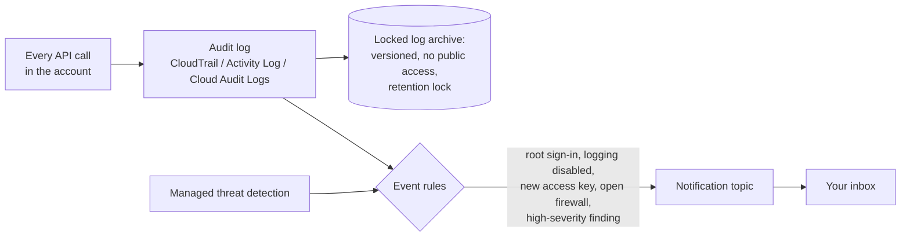

# Hands-On Project: Centralized Logging and Alerting

Turn your cloud account's audit log into a tamper-resistant record and a small set of alerts that email you when something high-risk happens.

**Estimated Time:** 3-4 hours
**Difficulty:** Intermediate
**Prerequisites:** A personal or sandbox cloud account (not production), the cloud CLI installed and authenticated, basic JSON. Read [Logging and detection](../../learn/concepts/logging-and-detection.md) first.

**Cost:** Close to zero in a quiet sandbox. The first copy of AWS CloudTrail management events is free; S3, SNS and EventBridge costs are cents at this volume; GuardDuty has a 30-day free trial. Azure Activity Log and GCP Admin Activity audit logs are free to collect, with small charges for Log Analytics ingestion. Do the cleanup at the end.

---

## What you will build



*Every API call lands in the audit log, which is archived where it cannot be quietly changed and is also matched against rules that send high-risk events straight to your inbox.*

By the end you will have:

- an audit trail covering every region, stored in a bucket with integrity validation and no public access;
- managed threat detection turned on;
- five alert rules for high-signal events, delivered by email;
- evidence you have tested each one.

The main walk-through uses **AWS**. Equivalent steps for **Azure** and **Google Cloud** follow.

---

## Step 1: Create the log archive bucket (AWS)

Set a few variables first. Use your own unique bucket name.

```bash
export AWS_REGION=us-east-1
export ACCOUNT_ID=$(aws sts get-caller-identity --query Account --output text)
export LOG_BUCKET="audit-logs-${ACCOUNT_ID}"
echo "Account: $ACCOUNT_ID  Bucket: $LOG_BUCKET"
```

Create the bucket, block all public access, and turn on versioning so overwritten or deleted log files can be recovered:

```bash
aws s3api create-bucket --bucket "$LOG_BUCKET" --region "$AWS_REGION"

aws s3api put-public-access-block --bucket "$LOG_BUCKET" \
  --public-access-block-configuration \
  BlockPublicAcls=true,IgnorePublicAcls=true,BlockPublicPolicy=true,RestrictPublicBuckets=true

aws s3api put-bucket-versioning --bucket "$LOG_BUCKET" \
  --versioning-configuration Status=Enabled
```

Allow CloudTrail, and only CloudTrail for this account's trail, to write to it. Save as `bucket-policy.json`, replacing the placeholders:

```json
{
  "Version": "2012-10-17",
  "Statement": [
    {
      "Sid": "AWSCloudTrailAclCheck",
      "Effect": "Allow",
      "Principal": { "Service": "cloudtrail.amazonaws.com" },
      "Action": "s3:GetBucketAcl",
      "Resource": "arn:aws:s3:::LOG_BUCKET",
      "Condition": { "StringEquals": { "aws:SourceArn": "arn:aws:cloudtrail:us-east-1:ACCOUNT_ID:trail/org-audit-trail" } }
    },
    {
      "Sid": "AWSCloudTrailWrite",
      "Effect": "Allow",
      "Principal": { "Service": "cloudtrail.amazonaws.com" },
      "Action": "s3:PutObject",
      "Resource": "arn:aws:s3:::LOG_BUCKET/AWSLogs/ACCOUNT_ID/*",
      "Condition": {
        "StringEquals": {
          "s3:x-amz-acl": "bucket-owner-full-control",
          "aws:SourceArn": "arn:aws:cloudtrail:us-east-1:ACCOUNT_ID:trail/org-audit-trail"
        }
      }
    },
    {
      "Sid": "DenyInsecureTransport",
      "Effect": "Deny",
      "Principal": "*",
      "Action": "s3:*",
      "Resource": ["arn:aws:s3:::LOG_BUCKET", "arn:aws:s3:::LOG_BUCKET/*"],
      "Condition": { "Bool": { "aws:SecureTransport": "false" } }
    }
  ]
}
```

```bash
sed -i "s/LOG_BUCKET/${LOG_BUCKET}/g; s/ACCOUNT_ID/${ACCOUNT_ID}/g" bucket-policy.json
aws s3api put-bucket-policy --bucket "$LOG_BUCKET" --policy file://bucket-policy.json
```

**Going further:** in a real organisation this bucket lives in a separate **log archive account** that workload admins cannot touch, and has **S3 Object Lock** in compliance mode so nobody, including the account root, can delete logs before the retention period ends. Object Lock must be enabled when the bucket is created; try it on a second bucket once the basics work.

**[📖 Amazon S3 bucket policy for CloudTrail](https://docs.aws.amazon.com/awscloudtrail/latest/userguide/create-s3-bucket-policy-for-cloudtrail.html)** - the required statements and why the `SourceArn` condition matters

---

## Step 2: Create a multi-region trail

```bash
aws cloudtrail create-trail \
  --name org-audit-trail \
  --s3-bucket-name "$LOG_BUCKET" \
  --is-multi-region-trail \
  --include-global-service-events \
  --enable-log-file-validation \
  --region "$AWS_REGION"

aws cloudtrail start-logging --name org-audit-trail --region "$AWS_REGION"
```

What each flag buys you:

- **Multi-region**: attackers like to launch resources in regions you never look at. One trail now records them all.
- **Global service events**: IAM, STS and console sign-in activity.
- **Log file validation**: CloudTrail writes signed digest files every hour, so you can later prove whether any log file was modified or deleted (`aws cloudtrail validate-logs`).

Check it is working:

```bash
aws cloudtrail get-trail-status --name org-audit-trail --region "$AWS_REGION" \
  --query '{Logging:IsLogging,LastDelivery:LatestDeliveryTime}'
```

Within about 15 minutes you will see files under `s3://$LOG_BUCKET/AWSLogs/$ACCOUNT_ID/CloudTrail/`.

**[📖 Creating a trail](https://docs.aws.amazon.com/awscloudtrail/latest/userguide/cloudtrail-create-a-trail-using-the-console-first-time.html)** - trail options explained

---

## Step 3: Turn on managed threat detection

GuardDuty analyses CloudTrail, VPC flow logs and DNS logs with AWS-maintained detections (credential misuse, crypto-mining, calls from known malicious IPs, and more). It is the fastest way to get good baseline detection.

```bash
aws guardduty create-detector --enable --region "$AWS_REGION"
```

GuardDuty is regional. In a real account, enable it in every region you use, ideally through AWS Organizations with a delegated administrator.

**[📖 What is Amazon GuardDuty?](https://docs.aws.amazon.com/guardduty/latest/ug/what-is-guardduty.html)** - data sources and finding types

---

## Step 4: Create the notification topic

```bash
export TOPIC_ARN=$(aws sns create-topic --name security-alerts \
  --region "$AWS_REGION" --query TopicArn --output text)

aws sns subscribe --topic-arn "$TOPIC_ARN" --protocol email \
  --notification-endpoint you@example.com --region "$AWS_REGION"
```

Confirm the subscription from the email AWS sends you. Then allow EventBridge to publish to the topic. Save as `topic-policy.json`:

```json
{
  "Version": "2012-10-17",
  "Statement": [{
    "Sid": "AllowEventBridgePublish",
    "Effect": "Allow",
    "Principal": { "Service": "events.amazonaws.com" },
    "Action": "sns:Publish",
    "Resource": "TOPIC_ARN"
  }]
}
```

```bash
sed -i "s|TOPIC_ARN|${TOPIC_ARN}|" topic-policy.json
aws sns set-topic-attributes --topic-arn "$TOPIC_ARN" \
  --attribute-name Policy --attribute-value file://topic-policy.json --region "$AWS_REGION"
```

---

## Step 5: Write the alert rules

EventBridge receives CloudTrail management events as they happen and matches them against patterns. IAM and console sign-in events are global and arrive in **us-east-1**, which is why this walk-through uses that region.

Each rule below is a pattern file plus two commands. Create a small helper:

```bash
make_rule () {
  local name="$1" pattern_file="$2"
  aws events put-rule --name "$name" --event-pattern "file://$pattern_file" --region "$AWS_REGION"
  aws events put-targets --rule "$name" --targets "Id=sns,Arn=$TOPIC_ARN" --region "$AWS_REGION"
}
```

### Rule 1: root account sign-in

The root user should almost never be used. Any sign-in deserves a look. `root-signin.json`:

```json
{
  "detail-type": ["AWS Console Sign In via CloudTrail"],
  "detail": { "userIdentity": { "type": ["Root"] } }
}
```

### Rule 2: audit logging tampered with

Attackers often try to blind you first. `logging-tamper.json`:

```json
{
  "source": ["aws.cloudtrail"],
  "detail-type": ["AWS API Call via CloudTrail"],
  "detail": {
    "eventSource": ["cloudtrail.amazonaws.com"],
    "eventName": ["StopLogging", "DeleteTrail", "UpdateTrail", "PutEventSelectors"]
  }
}
```

### Rule 3: new IAM users, access keys or admin grants

`iam-changes.json`:

```json
{
  "source": ["aws.iam"],
  "detail-type": ["AWS API Call via CloudTrail"],
  "detail": {
    "eventSource": ["iam.amazonaws.com"],
    "eventName": ["CreateUser", "CreateAccessKey", "AttachUserPolicy", "AttachRolePolicy", "PutUserPolicy", "CreateLoginProfile"]
  }
}
```

### Rule 4: firewall opened

`sg-ingress.json`:

```json
{
  "source": ["aws.ec2"],
  "detail-type": ["AWS API Call via CloudTrail"],
  "detail": {
    "eventSource": ["ec2.amazonaws.com"],
    "eventName": ["AuthorizeSecurityGroupIngress"]
  }
}
```

This one fires on every ingress rule change. In production you would narrow it to `0.0.0.0/0` on admin ports with a small Lambda function or a posture tool; for learning, seeing every change is useful.

### Rule 5: high-severity GuardDuty findings

`guardduty-high.json`:

```json
{
  "source": ["aws.guardduty"],
  "detail-type": ["GuardDuty Finding"],
  "detail": { "severity": [{ "numeric": [">=", 7] }] }
}
```

Create all five:

```bash
make_rule alert-root-signin      root-signin.json
make_rule alert-logging-tamper   logging-tamper.json
make_rule alert-iam-changes      iam-changes.json
make_rule alert-sg-ingress       sg-ingress.json
make_rule alert-guardduty-high   guardduty-high.json
```

**[📖 EventBridge: AWS CloudTrail events](https://docs.aws.amazon.com/eventbridge/latest/ref/events-ref-cloudtrail.html)** - how CloudTrail and service events reach EventBridge

---

## Step 6: Test every alert

An untested alert is a guess. Trigger each rule safely in your sandbox and confirm the email arrives (allow a few minutes).

```bash
# Rule 3: create a throwaway user and access key, then remove them
aws iam create-user --user-name alert-test-user
KEY_ID=$(aws iam create-access-key --user-name alert-test-user --query AccessKey.AccessKeyId --output text)
aws iam delete-access-key --user-name alert-test-user --access-key-id "$KEY_ID"
aws iam delete-user --user-name alert-test-user

# Rule 4: add then remove an ingress rule on a test security group
SG=$(aws ec2 create-security-group --group-name alert-test-sg --description "alert test" --query GroupId --output text)
aws ec2 authorize-security-group-ingress --group-id "$SG" --protocol tcp --port 22 --cidr 203.0.113.10/32
aws ec2 delete-security-group --group-id "$SG"

# Rule 5: generate sample GuardDuty findings (clearly marked as samples)
DETECTOR=$(aws guardduty list-detectors --query 'DetectorIds[0]' --output text)
aws guardduty create-sample-findings --detector-id "$DETECTOR"
```

For Rule 2, run `aws cloudtrail stop-logging --name org-audit-trail` and then immediately `start-logging` again. For Rule 1, sign in to the console as root once (with MFA) and sign out.

Then **find the same events in the archive**. This is the habit that matters during a real incident:

```bash
aws cloudtrail lookup-events --region "$AWS_REGION" \
  --lookup-attributes AttributeKey=EventName,AttributeValue=CreateAccessKey \
  --max-results 5 --query 'Events[].{Time:EventTime,User:Username,Event:EventName}'
```

Write a short triage note for each alert: what it means, how to check whether it is expected, and what to do if it is not. That note is the start of a runbook (see [Incident response basics](../../learn/concepts/incident-response-basics.md)).

---

## Azure equivalent

Azure records control-plane operations in the **Activity Log** and sign-ins in **Microsoft Entra** logs.

```bash
RG=rg-security-logging
LOCATION=eastus
SUB_ID=$(az account show --query id -o tsv)

az group create -n $RG -l $LOCATION
az monitor log-analytics workspace create -g $RG -n law-security -l $LOCATION
WS_ID=$(az monitor log-analytics workspace show -g $RG -n law-security --query id -o tsv)

# Send the subscription Activity Log to the workspace
az monitor diagnostic-settings subscription create \
  --name activity-to-law --location $LOCATION --workspace "$WS_ID" \
  --logs '[{"category":"Administrative","enabled":true},{"category":"Security","enabled":true},{"category":"Policy","enabled":true}]'

# Email action group
az monitor action-group create -g $RG -n ag-security --short-name secalert \
  --action email me you@example.com

# Alert on new role assignments (privilege changes)
az monitor activity-log alert create -g $RG -n alert-role-assignment \
  --scopes "/subscriptions/$SUB_ID" \
  --condition category=Administrative and operationName=Microsoft.Authorization/roleAssignments/write \
  --action-group ag-security

# Alert on network security group rule changes
az monitor activity-log alert create -g $RG -n alert-nsg-rule \
  --scopes "/subscriptions/$SUB_ID" \
  --condition category=Administrative and operationName=Microsoft.Network/networkSecurityGroups/securityRules/write \
  --action-group ag-security
```

Turn on **Microsoft Defender for Cloud** (the free foundational posture tier at minimum) for posture findings, and consider **Microsoft Sentinel** on the same workspace if you are studying for SC-200. Test by assigning a Reader role to a test user and removing it.

**[📖 Azure Monitor activity log](https://learn.microsoft.com/en-us/azure/azure-monitor/fundamentals/activity-log)** - categories, retention and export

**[📖 Azure Monitor alerts overview](https://learn.microsoft.com/en-us/azure/azure-monitor/alerts/alerts-overview)** - alert types and action groups

---

## Google Cloud equivalent

**Admin Activity** audit logs are always on and free. **Data Access** logs are off by default for most services; enable them for sensitive services only.

```bash
PROJECT_ID=$(gcloud config get-value project)

# A dedicated log bucket with 400-day retention, then lock it so retention cannot be reduced
gcloud logging buckets create audit-archive --location=global --retention-days=400
gcloud logging buckets update audit-archive --location=global --locked

# Route admin activity audit logs into it
gcloud logging sinks create audit-to-archive \
  "logging.googleapis.com/projects/$PROJECT_ID/locations/global/buckets/audit-archive" \
  --log-filter='logName:"cloudaudit.googleapis.com%2Factivity"'

# A log-based metric that counts IAM policy changes
gcloud logging metrics create iam-policy-changes \
  --description="IAM policy set on a project" \
  --log-filter='protoPayload.methodName="SetIamPolicy" AND logName:"cloudaudit.googleapis.com%2Factivity"'
```

Locking a bucket is permanent: its retention can no longer be reduced and the bucket cannot be deleted until every entry has aged out. That is the point, but do it in a sandbox project you are happy to keep or shut down.

Then create an **email notification channel** and an **alerting policy** on the `iam-policy-changes` metric in Cloud Monitoring (the console is simplest here), or use a **log-based alert** directly on the filter. Turn on **Security Command Center** (Standard tier) for posture and threat findings. Test by granting and then removing a role on the project.

**[📖 Cloud Audit Logs overview](https://cloud.google.com/logging/docs/audit)** - log types and which are on by default

**[📖 Configure log-based alerts](https://cloud.google.com/logging/docs/alerting/log-based-alerts)** - alert directly on matching log entries

---

## Verification Checklist

- [ ] The trail (or diagnostic setting, or sink) covers every region and is logging.
- [ ] The archive has no public access, has versioning or a retention lock, and only the logging service can write to it.
- [ ] Log file integrity validation is on (AWS).
- [ ] Managed threat detection is enabled.
- [ ] Every alert rule was triggered once and the email arrived.
- [ ] You found each test event in the archive by searching for it.
- [ ] Each alert has a written triage note.

---

## Cleanup

```bash
# AWS
for r in alert-root-signin alert-logging-tamper alert-iam-changes alert-sg-ingress alert-guardduty-high; do
  aws events remove-targets --rule "$r" --ids sns --region "$AWS_REGION"
  aws events delete-rule --name "$r" --region "$AWS_REGION"
done
aws sns delete-topic --topic-arn "$TOPIC_ARN" --region "$AWS_REGION"
aws guardduty delete-detector --detector-id "$(aws guardduty list-detectors --query 'DetectorIds[0]' --output text)" --region "$AWS_REGION"
aws cloudtrail delete-trail --name org-audit-trail --region "$AWS_REGION"
# Empty and delete the bucket last (versioned buckets need all versions removed; the console's "Empty" button is easiest)

# Azure
az group delete -n rg-security-logging --yes
az monitor diagnostic-settings subscription delete --name activity-to-law --yes

# GCP: delete the sink and metric; a locked bucket stays until its entries expire
gcloud logging sinks delete audit-to-archive --quiet
gcloud logging metrics delete iam-policy-changes --quiet
```

Leaving the trail and GuardDuty running in a personal account is a reasonable choice: the cost is low and you will want the history if something ever goes wrong.

---

## Additional Resources

- [Logging and detection](../../learn/concepts/logging-and-detection.md) - the concepts behind this build
- [Incident response basics](../../learn/concepts/incident-response-basics.md) - what to do when one of these alerts is real
- [Security tools compared](../service-comparison-security-tools.md) - GuardDuty vs Defender for Cloud vs Security Command Center
- [Set up a monitoring stack](https://cloud.noblerworks.com/resources/hands-on-projects/setup-monitoring-stack/) on Cloud Zero to Hero - the operational monitoring side
