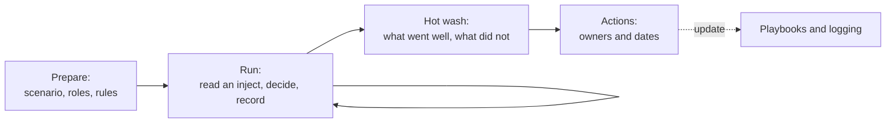

# Hands-On Project: Cloud Incident Response Tabletop

A facilitated discussion exercise for a small team, or for one learner playing every role. A made-up company gets a leaked cloud key. You work through five timed injects, make decisions, and list the evidence you would collect. No cloud account, tool or command is needed, and nothing is touched.

**Estimated Time:** 90 minutes (60 for the exercise, 30 for the review)
**Difficulty:** Intermediate
**Prerequisites:** Read [Incident response basics](../../learn/concepts/incident-response-basics.md) and the [leaked cloud access key](../playbooks/leaked-cloud-access-key.md) and [publicly exposed storage bucket](../playbooks/publicly-exposed-storage-bucket.md) playbooks. Keep both playbooks open during the exercise.
**Cost:** Free.

---

## Why a tabletop

A playbook that has never been practised has gaps you find at 3 a.m. A tabletop finds them in a meeting room. It tests decisions, hand-offs and who has authority, which no tool can test for you. The playbooks recommend running one each quarter.

*One inject at a time: read it, decide, record. After the last one, review and turn the gaps into owned actions that update the playbooks.*

## How this was run

This page is a design, not a record. It was **not** run with a team: NOT RUN. After you run it, record what happened under "Results" at the bottom and send what you learn back to the playbooks. No commands are listed because none are needed. The inject details are invented. Any resemblance to a real company is accidental.

---

## Ground rules

- **Facilitator** reads injects and answers "what do the logs show?" from the card text only. If a question is not answered on the card, the answer is "unknown, and here is how you would find out". Do not improvise facts.
- **Roles** (one person can hold several): incident commander, cloud engineer, SOC analyst, communications lead, and a business owner (decides on outages and customer impact).
- **Blameless.** Decisions are judged by what was known at the time.
- **Defensive only.** Nobody plays the attacker, and the injects describe effects, never methods.
- Write each decision and the time you made it in a log. That log is also what you practise producing for real.

## The scenario

**Brightleaf Analytics** is a 60-person company that builds dashboards for clinics. Everything runs in one cloud account. Customer exports sit in object storage. Engineers deploy from a CI system. There is a small SOC of two people, covered 8-6 on weekdays. Audit logging is on and kept 90 days. The company has no 24-hour on-call for security.

It is Friday, 17:40.

---

## Inject 1 - the alert (17:40)

The Git host's secret scanning sends an alert: an access key for the CI deploy user appears in a **public** repository, in a commit pushed 35 minutes ago by a contractor's personal fork. The key ID is shown. The secret is also visible in the diff.

**Decide:**

1. Who is incident commander, and how do you reach them out of hours?
2. What is your first action, and why before any investigation? (See Contain in the playbook.)
3. Do you delete the key or deactivate it? What do you lose by deleting?
4. What do you do about the public commit, and why is deleting it not enough?

**Evidence to collect now:** the alert itself, the key ID (never copy the secret into tickets or chat), the repo URL and commit hash, the time the commit was pushed, the key's owner, the key's creation date and last-used time from the identity system.

**Debrief cue:** the playbook says to treat the key as used until logs say otherwise. Did anyone wait for proof first?

## Inject 2 - the logs (18:05)

The key is deactivated. The SOC analyst exports audit logs for the deploy user from the last 24 hours. The facilitator reads this card:

- The key made normal calls from the CI provider's address range until 16:50.
- At 17:21, **16 minutes after the commit was pushed**, calls begin from an address in a country where Brightleaf has no staff or vendors. The calls list storage buckets and list roles.
- At 17:26 a new access key is created for a different user, `reporting-svc`.
- At 17:33 a bucket policy changes on `brightleaf-customer-exports`.

**Decide:**

1. Which of these four events is **persistence**, and which is **data exposure**? What does each change about your next step?
2. Is the incident now bigger than "one leaked key"? Who do you wake up?
3. Do you deactivate the new key for `reporting-svc`? What could break?
4. What does the clock tell you about how the secret was found so quickly?

**Evidence to collect:** the full audit log export for the window, kept read-only with a hash; a snapshot of the bucket policy before and after if versions exist; the list of keys and roles created in the window; the permissions attached to the deploy user (the blast radius).

## Inject 3 - the bucket (18:30)

The changed bucket policy grants read access to anyone. The bucket holds customer export files, some with patient names and dates of service. The access logs for the bucket are **not enabled**. Object-level data events are also not enabled in the audit trail.

**Decide:**

1. What do you do to the bucket right now? (See the public bucket playbook: block public access at bucket and account level, keep the data and the logs.)
2. You cannot prove whether anyone downloaded files. How do you decide what to assume? Who makes that call?
3. What other sources might show downloads: the storage service's own metrics, a CDN or load balancer in front, network flow logs, the provider's support team?
4. When does legal need to know, and why now rather than Monday?

**Evidence to collect:** the bucket policy and public access settings as found, object listing with sizes and last-modified times, any metrics showing request counts during the exposure window, a list of which customers' files were in scope.

**Debrief cue:** this is the gap most real tabletops find. Logging that was never on cannot be turned on afterwards. Add it to the actions list.

## Inject 4 - the clock (Saturday 09:00)

The customer success lead says two clinic customers have noticed export links "behaving strangely". Legal confirms the files include protected health information for US clinics and personal data for one EU clinic. No ransom note, no outage.

**Decide:**

1. What does each of these laws or contracts say about notification timing? Read the guides rather than guess: [HIPAA](../compliance-guides/hipaa.md), [GDPR](../compliance-guides/gdpr.md), [US state privacy laws](../compliance-guides/us-state-privacy-laws.md). Also look in your customer contracts.
2. Who talks to customers, what do they say, and what must they **not** say yet?
3. Do you hire outside forensics or notify your cyber insurer? Who has authority to spend?
4. What do you tell staff, and through what channel if the company chat might be affected?

**Evidence to collect:** a timeline with sources for every entry, the decisions log, the list of affected customers and data types, and the date and time each person first learned of the incident (several deadlines start from awareness).

## Inject 5 - eradicate and recover (Monday 08:00)

Containment holds. The SOC found that `reporting-svc`'s new key was used once, from the same foreign address, to read secrets from the secrets store. The secrets include a database password and a third-party email API key.

**Decide:**

1. What must be rotated, in what order, and what breaks while you do it?
2. How do you prove nothing else was left behind (new roles, trust policies, scheduled jobs, new users)?
3. What replaces the long-lived CI key so this class of leak cannot happen again? (The playbook's Recover section names the options.)
4. What would you tell the contractor, and what would you change about contractor access?

**Evidence to collect:** rotation records with times, a diff of identities and policies against the last known good state, proof that the old key can no longer authenticate, the new CI access design.

---

## Hot wash questions

Take 20 minutes straight after the last inject.

1. How long from first exposure to deactivation? What would cut it in half?
2. Which decision was slowest, and was it unclear authority, missing information or fear?
3. Which log did we want and not have? (Write down the exact source.)
4. Which playbook step did not match reality? Edit the playbook this week.
5. Where did we nearly say something to a customer that we could not support?

## Score yourself

| Area | Good looks like |
|---|---|
| Containment | Key disabled within minutes of the alert, before any investigation |
| Scope | Persistence and data exposure found and separated |
| Evidence | Logs exported read-only before changes; log of decisions kept |
| Communication | Legal involved early; one named voice to customers |
| Recovery | Long-lived key replaced, not just rotated |
| Learning | Missing logging turned into an owned action |

## Results (fill in after you run it)

| Date | Participants | Time to first containment action | Gaps found | Actions and owners |
|---|---|---|---|---|
| | | | | |

## Variations

- Swap inject 3 for the [suspicious OAuth app grant](../playbooks/suspicious-oauth-app-grant.md) or the [ransomware first hour](../playbooks/ransomware-first-hour.md) playbook.
- Remove the facilitator's hint cues and see which gaps survive.
- Run it with the business owner role played by someone from outside security. Their questions are usually the best ones.

## Cert connections

The incident response lifecycle, evidence handling and communication planning map to [CySA+](../../exams/comptia/cysa-plus/), the incident response domain in the [AWS Security Specialty](../../exams/aws/specialty/security-scs-c02/) and security operations in [CISSP](../../exams/isc2/cissp/).

## Related

- [Incident response playbooks](../playbooks/)
- [Incident response basics](../../learn/concepts/incident-response-basics.md)
- [Digital forensics basics](../../learn/concepts/digital-forensics-basics.md)
- [Centralized logging and alerting](./centralized-logging-and-alerting.md) - the lab that fixes the missing-logs gap in inject 3
- [Case study: Capital One 2019](../case-study-capital-one-2019.md) - a cloud breach through an over-permissioned role
