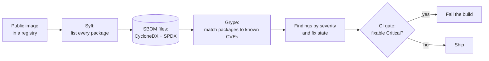

# Hands-On Project: Container Image Scan with an SBOM

Build a software bill of materials (SBOM) for a public container image, scan it for known vulnerabilities, and decide what to fix first. All of it runs on your own machine, needs no cloud account and changes nothing outside Docker.

**Estimated Time:** 1-2 hours
**Difficulty:** Intermediate
**Prerequisites:** Docker, and a terminal. Read [Container security basics](../../learn/concepts/container-security-basics.md) and [Software supply chain security](../../learn/concepts/software-supply-chain-security.md) first.
**Cost:** Free. You pull two scanner images and read one public image from its registry.

---

## What you will build



*The image is read once to make an SBOM. The scanner then works from the SBOM, not the image, and a gate turns the result into pass or fail.*

You will have a package inventory of an image, a count of vulnerabilities by severity, a list of the ones that have a fix, and a gate command you can paste into CI.

## How this was run

Every command below was run on 2026-11-07 on a WSL2 Linux machine, using Docker to run the tools so nothing was installed on the host. Output is pasted from that run. It will differ for you: vulnerability databases update daily, so counts move even for the same image. The numbers show the shape of the result, not a benchmark.

**Tools:** [Syft](https://github.com/anchore/syft) (SBOM generator, v1.57.0 here) and [Grype](https://github.com/anchore/grype) (vulnerability scanner, v0.121.2 here). Trivy does the same job in one tool; this lab uses the Syft and Grype pair because they make the SBOM a separate, saved file.

---

## Step 1: Pick an image and pull the tools

The target is a deliberately old public image, `nginx:1.25.0`, so there is something to find. Scan images you are allowed to scan; this one is public.

```bash
docker pull anchore/syft:latest
docker pull anchore/grype:latest
docker run --rm anchore/syft:latest version | head -4
```

```text
Application:   syft
Version:       1.57.0
BuildDate:     2026-11-05T20:44:22Z
GitCommit:     30f4bce762f31136e055f2965185f12eb95fbe47
```

## Step 2: Generate the SBOM

The `registry:` prefix tells Syft to read the image straight from the registry, so you do not need to pull `nginx` itself.

```bash
mkdir -p ~/sbom-lab && cd ~/sbom-lab
docker run --rm anchore/syft:latest registry:nginx:1.25.0 -o table | head -8
```

```text
NAME                       VERSION                         TYPE          
adduser                    3.118                           deb           
apt                        2.2.4                           deb           
base-files                 11.1+deb11u7                    deb           
base-passwd                3.5.51                          deb           
bash                       5.1-2+deb11u1                   deb           
bsdutils                   1:2.36.1-8+deb11u1              deb           
ca-certificates            20210119                        deb           
```

That table had 143 package rows. Now save the SBOM in the two standard formats:

```bash
docker run --rm -v "$PWD":/out anchore/syft:latest registry:nginx:1.25.0 \
  -o cyclonedx-json=/out/sbom.cdx.json -o spdx-json=/out/sbom.spdx.json
ls -la
```

```text
-rw-r--r-- 1 root root 1391466 Nov  7 12:09 sbom.cdx.json
-rw-r--r-- 1 root root 3302372 Nov  7 12:09 sbom.spdx.json
```

The files are owned by root because the container wrote them. Pass `--user "$(id -u):$(id -g)"` to `docker run` if you want them owned by you.

Look inside the CycloneDX file:

```bash
python3 -c "
import json
d = json.load(open('sbom.cdx.json'))
print(d['bomFormat'], d['specVersion'], len(d['components']))
from collections import Counter
print(Counter(c['type'] for c in d['components']))"
```

```text
CycloneDX 1.7 4024
Counter({'file': 3880, 'library': 143, 'operating-system': 1})
```

Of 4,024 components, 143 are packages (`library`), one is the operating system, and the rest are individual files. The 143 are the ones a scanner cares about.

**Why two formats?** CycloneDX and SPDX are both accepted SBOM standards. Different customers and regulators ask for one or the other, and generating both costs nothing.

## Step 3: Scan the SBOM

Grype can scan an SBOM instead of the image. That means you can store the SBOM at build time and re-scan it next month, when new CVEs are published, without touching the image.

```bash
docker run --rm -v "$PWD":/out anchore/grype:latest sbom:/out/sbom.cdx.json -o json > grype.json
python3 - <<'PY'
import json
from collections import Counter
m = json.load(open('grype.json'))['matches']
print(len(m), 'matches')
print(Counter(x['vulnerability']['severity'] for x in m))
print(Counter(x['vulnerability']['fix']['state'] for x in m))
PY
```

```text
659 matches
Counter({'Medium': 235, 'High': 206, 'Negligible': 142, 'Critical': 41, 'Low': 33, 'Unknown': 2})
Counter({'fixed': 288, 'not-fixed': 236, 'wont-fix': 135})
```

659 matches sounds alarming. Read it in layers:

- **Matches are not unique vulnerabilities.** The same CVE is reported once per affected package, and `openssl` and `libssl1.1` are two packages from one source.
- **Fix state matters.** 288 matches have a fixed version available. 236 have none yet, and 135 the distribution has decided not to fix. You can act on the first group today.
- **Severity is a starting point.** CVSS score does not know if the vulnerable code is reachable in your container. See [Vulnerability management](../../learn/concepts/vulnerability-management.md) for EPSS and the KEV list, which add exploitation evidence.

## Step 4: Find what to fix first

Take the Critical findings that have a fix:

```bash
python3 - <<'PY'
import json
m = json.load(open('grype.json'))['matches']
crit = [x for x in m if x['vulnerability']['severity']=='Critical'
        and x['vulnerability']['fix']['state']=='fixed']
print('fixable criticals', len(crit))
for x in crit[:4]:
    v, a = x['vulnerability'], x['artifact']
    print(v['id'], a['name'], a['version'], '->', v['fix']['versions'])
PY
```

```text
fixable criticals 19
CVE-2023-38545 curl 7.74.0-1.3+deb11u7 ['7.74.0-1.3+deb11u10']
CVE-2023-38545 libcurl4 7.74.0-1.3+deb11u7 ['7.74.0-1.3+deb11u10']
CVE-2024-5535 libssl1.1 1.1.1n-0+deb11u5 ['1.1.1w-0+deb11u2']
CVE-2024-5535 openssl 1.1.1n-0+deb11u5 ['1.1.1w-0+deb11u2']
```

Each row names the package, the version in the image, and the version that fixes it. The usual fix is not to patch inside the container but to **rebuild from a newer base image**, which brings in all the fixed packages at once.

## Step 5: Add a gate

This is the line you would put in CI. It exits non-zero when any Critical finding has a fix available:

```bash
docker run --rm -v "$PWD":/out anchore/grype:latest sbom:/out/sbom.cdx.json \
  --only-fixed --fail-on critical -o json > fixed.json
echo "exit=$?"
```

```text
[0104] ERROR discovered vulnerabilities at or above the severity threshold
exit=2
```

Exit code 2 fails the pipeline. Gating only on fixable Criticals is a deliberate starting point: a gate that fails on things no one can fix gets switched off.

## Step 6: Compare with a newer image (NOT RUN)

NOT RUN. Repeat steps 2-3 on a current tag of the same image (for example the latest stable tag) and compare the counts. The point to learn: a newer base image usually removes most findings with no code change. Record both counts in your notes.

---

## Check your understanding

- Why scan the SBOM rather than the image?
- Why is a count of 659 matches a poor headline number?
- Which of the three fix states can you act on today, and how?
- What would you change in the Dockerfile to reduce this list? Start with [Container security basics](../../learn/concepts/container-security-basics.md): smaller base image, fewer packages.

## What this lab does not cover

- **Signing and provenance.** An SBOM says what is inside; a signature says who built it. See [Software supply chain security](../../learn/concepts/software-supply-chain-security.md).
- **Runtime.** A scanner sees files at rest, not what the running container does.
- **Reachability.** Neither tool says whether the vulnerable function is called.
- **Application dependencies.** `nginx` ships no language packages. A Node or Python image adds `library` entries that Syft also catches and Grype also scans.

## Cleanup

```bash
docker image rm anchore/syft:latest anchore/grype:latest
rm -rf ~/sbom-lab   # files owned by root may need a root-owned delete; or run the scans with --user next time
```

`--rm` already removed the containers. Nothing was installed on the host.

## Cert connections

The container scan and signing ideas appear in [CKS](../../exams/kubernetes/cks/) (supply chain security) and [GitHub Advanced Security](../../exams/github/advanced-security/) (dependency and SBOM features). Prioritising findings maps to the vulnerability management objectives in [CySA+](../../exams/comptia/cysa-plus/).

## Related

- [Container security basics](../../learn/concepts/container-security-basics.md)
- [Software supply chain security](../../learn/concepts/software-supply-chain-security.md)
- [Vulnerability management](../../learn/concepts/vulnerability-management.md)
- [Case study: Log4Shell 2021](../../resources/case-study-log4shell-2021.md) - where an SBOM answers "are we affected?" in minutes
