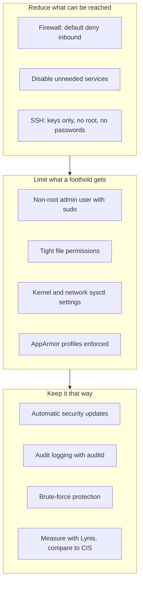

# Hands-On Project: Harden a Linux Server

Take a fresh Ubuntu server from default settings to a hardened baseline, measuring the improvement with an audit tool before and after.

**Estimated Time:** 2-3 hours
**Difficulty:** Beginner to intermediate
**Prerequisites:** A fresh Ubuntu 24.04 LTS VM you can throw away (a cloud free-tier instance or a local VM), SSH access with a key, basic comfort with a terminal and a text editor. [SSH basics](https://cloud.noblerworks.com/learn/day-one/ssh-basics/) and [File permissions](https://cloud.noblerworks.com/learn/day-one/file-permissions/) on Cloud Zero to Hero cover the background.

**Safety first:** several steps change how you log in. **Keep one SSH session open the whole time** and test changes from a second session. If a change locks you out, the open session lets you undo it. Never practise this on a server someone else depends on.

---

## What "hardening" means

Hardening is reducing a system's **attack surface** (what an attacker can reach) and **blast radius** (what they get if they succeed), while keeping it patched and observable. Concretely:



*The three goals of hardening and the steps in this project that serve each one.*

Industry baselines such as the **CIS Benchmarks** describe hundreds of settings for each OS. This project covers the high-value core; the benchmark is where you go next.

**[📖 CIS Benchmarks](https://www.cisecurity.org/cis-benchmarks)** - consensus hardening baselines for Ubuntu and other systems

---

## Step 0: Take a baseline measurement

Lynis is an open-source auditing tool that checks hundreds of settings and gives a hardening index. Run it before you change anything so you can measure progress.

```bash
sudo apt update
sudo apt install -y lynis
sudo lynis audit system --quick | tee ~/lynis-before.txt
grep -i "hardening index" ~/lynis-before.txt
```

Note the hardening index and skim the **Warnings** and **Suggestions** sections. Lynis only reads; it changes nothing.

**[📖 Lynis](https://cisofy.com/lynis/)** - what it checks and how to read the report

---

## Step 1: Patch, and keep patching

Most compromises of internet-facing servers use known vulnerabilities with patches already available. Update now, then make security updates automatic.

```bash
sudo apt update && sudo apt full-upgrade -y
sudo apt install -y unattended-upgrades
sudo dpkg-reconfigure -plow unattended-upgrades   # answer Yes
```

Check what it will do:

```bash
cat /etc/apt/apt.conf.d/20auto-upgrades
sudo unattended-upgrade --dry-run --debug 2>&1 | tail -20
```

By default Ubuntu installs updates from the security pocket only, which is the right trade-off for a server. Some kernel updates need a reboot; `cat /var/run/reboot-required` tells you when. On a production fleet you would schedule reboots or use Canonical Livepatch; here, just reboot when told.

**[📖 Ubuntu Server: Automatic updates](https://documentation.ubuntu.com/server/how-to/software/automatic-updates/)** - how unattended-upgrades is configured

---

## Step 2: Use a named admin account, not root

Cloud images usually give you a default user (`ubuntu`) with passwordless sudo. Create your own named admin so actions are attributable, and keep sudo usage logged.

```bash
sudo adduser alice              # choose a strong password; sudo will ask for it
sudo usermod -aG sudo alice

# Copy your SSH key to the new user
sudo mkdir -p /home/alice/.ssh
sudo cp ~/.ssh/authorized_keys /home/alice/.ssh/
sudo chown -R alice:alice /home/alice/.ssh
sudo chmod 700 /home/alice/.ssh && sudo chmod 600 /home/alice/.ssh/authorized_keys
```

From a **second terminal**, confirm `ssh alice@<server>` works and `sudo -v` asks for alice's password. Only then continue.

Check that root has no password login and that no other accounts have empty passwords:

```bash
sudo passwd -S root                     # expect "L" (locked)
sudo awk -F: '($2 == "") {print $1}' /etc/shadow   # expect no output
```

---

## Step 3: Harden SSH

SSH is usually the only door into a server, and internet-wide bots try passwords against every open port 22 within minutes of a server appearing. Put the hardened settings in a drop-in file so package updates do not overwrite them:

```bash
sudo tee /etc/ssh/sshd_config.d/10-hardening.conf > /dev/null <<'EOF'
# Keys only
PasswordAuthentication no
KbdInteractiveAuthentication no
PubkeyAuthentication yes
# No direct root login
PermitRootLogin no
# Only these users may log in
AllowUsers alice
# Fewer guesses per connection and shorter login window
MaxAuthTries 3
LoginGraceTime 30
# Turn off features this server does not need
X11Forwarding no
AllowAgentForwarding no
AllowTcpForwarding no
# Drop idle sessions
ClientAliveInterval 300
ClientAliveCountMax 2
EOF

sudo sshd -t && sudo systemctl reload ssh
```

`sshd -t` checks the configuration for errors before reloading. **Test from a second session** that `alice` can still log in and that `ssh ubuntu@<server>` and password logins are refused. Then remove the default user's key, or the user, if you no longer need it.

**[📖 OpenSSH sshd_config manual](https://man.openbsd.org/sshd_config)** - every option and its default

---

## Step 4: Firewall with default deny

Allow only what the server must expose. Even better, in the cloud also restrict SSH at the security group or firewall rule to your own IP, so the host firewall is a second layer.

```bash
sudo ufw default deny incoming
sudo ufw default allow outgoing
sudo ufw limit OpenSSH          # allow SSH, rate-limited
# sudo ufw allow 443/tcp        # only if this server serves HTTPS
sudo ufw enable
sudo ufw status verbose
```

`ufw limit` blocks an address that opens 6 or more connections in 30 seconds, which slows brute force without extra software. If the server only needs to be reached from one network, use `sudo ufw allow from 203.0.113.0/24 to any port 22 proto tcp` instead.

**Going further:** restrict outbound traffic too. A server that only needs to reach package mirrors and one API should not be able to reach the whole internet; egress control stops malware calling home.

**[📖 Ubuntu Server: Firewall (ufw)](https://documentation.ubuntu.com/server/how-to/security/firewalls/)** - ufw rules, logging and application profiles

---

## Step 5: Remove what you do not need

Every running service is attack surface. List what is listening on the network:

```bash
sudo ss -tulpn
```

On a minimal cloud image you should see little beyond `sshd` and perhaps `systemd-resolved` on localhost. For anything else, decide whether you need it. To stop and disable a service:

```bash
sudo systemctl disable --now <service-name>
```

Also list installed packages and remove what you know you will not use (`apt list --installed`), and check for unexpected scheduled jobs:

```bash
sudo ls /etc/cron.* /var/spool/cron/crontabs 2>/dev/null
systemctl list-timers --all
```

---

## Step 6: Brute-force protection with fail2ban

With password authentication off, SSH brute force cannot succeed, but it still fills logs. fail2ban bans addresses that fail repeatedly.

```bash
sudo apt install -y fail2ban
sudo tee /etc/fail2ban/jail.local > /dev/null <<'EOF'
[sshd]
enabled = true
backend = systemd
maxretry = 5
findtime = 10m
bantime = 1h
EOF
sudo systemctl enable --now fail2ban
sudo fail2ban-client status sshd
```

---

## Step 7: Kernel and network settings

A handful of `sysctl` settings close common network-level weaknesses and limit information leaks. Ubuntu already sets some of these; setting them explicitly documents your intent.

```bash
sudo tee /etc/sysctl.d/90-hardening.conf > /dev/null <<'EOF'
# Ignore ICMP redirects and source-routed packets (route manipulation)
net.ipv4.conf.all.accept_redirects = 0
net.ipv4.conf.default.accept_redirects = 0
net.ipv6.conf.all.accept_redirects = 0
net.ipv4.conf.all.send_redirects = 0
net.ipv4.conf.all.accept_source_route = 0
# Reverse-path filtering drops spoofed source addresses
net.ipv4.conf.all.rp_filter = 1
# SYN flood protection
net.ipv4.tcp_syncookies = 1
# Log packets with impossible addresses
net.ipv4.conf.all.log_martians = 1
# Restrict kernel pointer and log access to root
kernel.kptr_restrict = 2
kernel.dmesg_restrict = 1
# Only a process's parent can ptrace it
kernel.yama.ptrace_scope = 1
EOF
sudo sysctl --system
```

This server is not a router, so it should never forward packets; leave `net.ipv4.ip_forward` at `0` (but note that hosts running Docker or Kubernetes need forwarding on).

---

## Step 8: Mandatory access control with AppArmor

AppArmor confines programs to the files and capabilities their profile allows, so a compromised service cannot roam the whole system. Ubuntu enables it by default; confirm profiles are enforcing:

```bash
sudo aa-status | head -20
```

You should see a number of profiles "in enforce mode". If you install services such as nginx, check whether a profile exists for them (`apparmor-profiles` and `apparmor-utils` packages add more).

---

## Step 9: File permissions

A few checks catch the most common permission mistakes:

```bash
# Sensitive files should not be readable by everyone
ls -l /etc/shadow /etc/gshadow /etc/ssh/sshd_config

# World-writable files outside temporary directories (expect none)
sudo find / -xdev -type f -perm -0002 ! -path "/proc/*" ! -path "/sys/*" 2>/dev/null

# SUID/SGID binaries: review the list and know why each is there
sudo find / -xdev \( -perm -4000 -o -perm -2000 \) -type f 2>/dev/null
```

`/etc/shadow` should be `-rw-r-----` owned by `root:shadow`. SUID binaries run with their owner's privileges; the stock list (`sudo`, `passwd`, `su`, `mount` and similar) is expected, and anything unfamiliar deserves investigation.

---

## Step 10: Audit logging with auditd

System logs record what services say; `auditd` records what the kernel sees: who changed identity files, who ran commands as root, who changed the time. These are the events an investigator will ask for.

```bash
sudo apt install -y auditd
sudo tee /etc/audit/rules.d/hardening.rules > /dev/null <<'EOF'
# Identity and authentication files
-w /etc/passwd -p wa -k identity
-w /etc/shadow -p wa -k identity
-w /etc/group -p wa -k identity
-w /etc/sudoers -p wa -k sudoers
-w /etc/sudoers.d/ -p wa -k sudoers
# SSH configuration
-w /etc/ssh/sshd_config -p wa -k sshd
-w /etc/ssh/sshd_config.d/ -p wa -k sshd
# Commands run as root by a logged-in user
-a always,exit -F arch=b64 -S execve -F euid=0 -F auid>=1000 -F auid!=unset -k root-commands
EOF
sudo augenrules --load
sudo systemctl enable --now auditd
```

Test it: run `sudo touch /etc/sudoers.d/test && sudo rm /etc/sudoers.d/test`, then search:

```bash
sudo ausearch -k sudoers --start recent -i | tail -20
```

In a real environment, ship these logs off the server (to a SIEM or your cloud's log service), because an attacker with root can delete local logs. The [centralized logging and alerting project](./centralized-logging-and-alerting.md) builds the cloud side of that.

---

## Step 11: Measure again

```bash
sudo lynis audit system --quick | tee ~/lynis-after.txt
grep -i "hardening index" ~/lynis-before.txt ~/lynis-after.txt
```

The index should have risen noticeably. Read the remaining suggestions: some will be worth doing (a separate `/tmp` partition with `noexec`, password ageing for local accounts, a malware scanner), and some will not apply to your server. Deciding which is the skill. Record each one you skip and why: that is your exceptions list.

---

## Verification Checklist

- [ ] Lynis hardening index recorded before and after.
- [ ] Unattended security upgrades enabled and confirmed with a dry run.
- [ ] Logging in as `alice` with a key works; password logins, root logins and other users are refused.
- [ ] `ufw status` shows default deny inbound with only the ports you need.
- [ ] `ss -tulpn` shows only expected listeners.
- [ ] fail2ban `sshd` jail is active.
- [ ] Sysctl settings applied (`sysctl net.ipv4.conf.all.accept_redirects` returns 0).
- [ ] AppArmor profiles in enforce mode.
- [ ] No unexpected world-writable files or SUID binaries.
- [ ] auditd records a change to `/etc/sudoers.d/`.

---

## Make it repeatable

Hardening by hand does not scale and drifts over time. Once the steps work, capture them as code:

- An **Ansible playbook**, or a **cloud-init** file applied at first boot, so every new server starts hardened.
- A **golden image** built with Packer, so servers are hardened before they ever boot.
- **Configuration compliance scanning** (CIS-CAT, OpenSCAP, Lynis in CI, or your cloud's posture tools) to detect drift.
- **Immutable infrastructure**: replace servers instead of patching them in place.

---

## Cleanup

Destroy the VM when you are done, or keep it as a reference for your automation. If it was a cloud instance, also delete any public IP, volume snapshots and security group rules you created.

---

## Additional Resources

- [Network security basics](../../learn/concepts/network-security-basics.md) - firewalls and segmentation beyond one host
- [Vulnerability management](../../learn/concepts/vulnerability-management.md) - patching as a programme, not a one-off
- [Least privilege explained](../../learn/concepts/least-privilege-explained.md) - the principle behind several of these steps
- [Logging and detection](../../learn/concepts/logging-and-detection.md) - what to do with the audit logs you now collect
