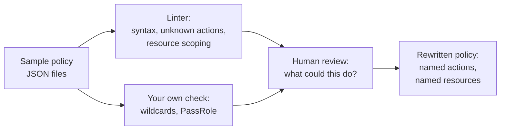

# Hands-On Project: Least-Privilege IAM Review

Review five sample IAM policies offline: find the ones that grant too much, run a linter, write your own check, and rewrite the worst one. No cloud account, no credentials and no API calls are involved. Everything works on JSON files on your machine.

**Estimated Time:** 1-2 hours
**Difficulty:** Intermediate
**Prerequisites:** Python 3, `uv` or `pip`. Read [Least privilege explained](../../learn/concepts/least-privilege-explained.md) and [IAM explained](../../learn/concepts/iam-explained.md) first.
**Cost:** Free.

---

## What you will build



*Two automated passes find the cheap problems. A person then asks what the policy could do in the wrong hands and rewrites it.*

## What is local here and what a real account adds

This lab is deliberately offline. It teaches you to read policies. It cannot tell you which permissions are actually used, which is the part that makes right-sizing safe. In a real account you would add:

- **Last-accessed data.** AWS shows when a role last used each service, so you can remove what is unused: **[📖 Refining permissions using last accessed information (AWS)](https://docs.aws.amazon.com/IAM/latest/UserGuide/access_policies_last-accessed.html)** - the data behind a safe cut. GCP offers the same idea as **[📖 IAM Recommender overview](https://cloud.google.com/iam/docs/recommender-overview)**. NOT RUN here; needs an account.
- **Access Analyzer-style policy generation** from audit logs (AWS CloudTrail), producing a policy from observed calls. NOT RUN.
- **External access and unused access findings.** NOT RUN.
- **Effective permissions.** Policies combine with permission boundaries, SCPs and resource policies. Sample files cannot show that.

Read the vendor guidance: **[📖 IAM security best practices (AWS)](https://docs.aws.amazon.com/IAM/latest/UserGuide/best-practices.html)** - apply least-privilege permissions. A linter that runs in the account: **[📖 Policy validation (IAM Access Analyzer)](https://docs.aws.amazon.com/IAM/latest/UserGuide/access-analyzer-policy-validation.html)** - the managed version of the check in step 2.

## How this was run

On 2026-11-07, in a throwaway Python virtual environment under `~/.cache`, with the open-source linter [Parliament](https://github.com/duo-labs/parliament) (1.6.4). It needed `setuptools<81` to import. The venv was deleted afterwards. No AWS profile was set or used.

---

## Step 1: Write the five sample policies

Make a `policies/` folder. These are invented examples, not from a real account.

`01-app-role.json` - a role "just to get the app working":

```json
{"Version": "2012-10-17",
 "Statement": [{"Sid": "Everything", "Effect": "Allow", "Action": "*", "Resource": "*"}]}
```

`02-s3-wide.json` - "the app uses S3 and reads logs":

```json
{"Version": "2012-10-17",
 "Statement": [
  {"Sid": "S3All", "Effect": "Allow", "Action": "s3:*", "Resource": "*"},
  {"Sid": "ReadLogs", "Effect": "Allow",
   "Action": ["logs:GetLogEvents", "logs:DescribeLogStreams"], "Resource": "*"}]}
```

`03-passrole.json` - a deploy role:

```json
{"Version": "2012-10-17",
 "Statement": [{"Sid": "Deploy", "Effect": "Allow",
  "Action": ["lambda:CreateFunction", "lambda:UpdateFunctionCode", "iam:PassRole"],
  "Resource": "*"}]}
```

`04-scoped.json` - read one prefix of one bucket:

```json
{"Version": "2012-10-17",
 "Statement": [
  {"Sid": "ReadReports", "Effect": "Allow", "Action": ["s3:GetObject"],
   "Resource": "arn:aws:s3:::example-reports-bucket/monthly/*"},
  {"Sid": "ListReports", "Effect": "Allow", "Action": "s3:ListBucket",
   "Resource": "arn:aws:s3:::example-reports-bucket",
   "Condition": {"StringLike": {"s3:prefix": "monthly/*"}}}]}
```

`05-typo.json` - two misspelled action names:

```json
{"Version": "2012-10-17",
 "Statement": [{"Effect": "Allow",
  "Action": ["s3:GetObjects", "ec2:DescribeInstancez"], "Resource": "*"}]}
```

**Before running anything, review them by eye.** For each, write down: what is the worst thing this could do if the role's credentials leaked? Compare with your notes after step 3.

## Step 2: Run a linter

```bash
uv venv -q iamvenv
uv pip install -q --python iamvenv/bin/python parliament "setuptools<81"
iamvenv/bin/parliament --directory policies < /dev/null 2>/dev/null | cut -c1-110
```

The `< /dev/null` matters: Parliament reads stdin when it is attached, and refuses to combine that with a path. Real output (the long action lists are cut):

```text
LOW - Unknown action -  - Unknown action s3:GetObjects - {'string': 's3:GetObjects', 'line': 4, ...
LOW - Unknown action -  - Unknown action ec2:DescribeInstancez - {'string': 'ec2:DescribeInstancez', ...
LOW - Unnecessary use of Resource * -  - ['s3:AbortMultipartUpload', 's3:AssociateAccessGrantsIdentityCenter', ...
LOW - Unnecessary use of Resource * -  - ['logs:DescribeLogStreams', 'logs:GetLogEvents'] - {'line': 5, ...
LOW - Unnecessary use of Resource * -  - ['iam:PassRole', 'lambda:CreateFunction', 'lambda:UpdateFunctionCode'] - ...
```

What the linter caught and missed:

| Policy | Linter result |
|---|---|
| `01-app-role.json` | **Nothing.** `Action: "*"` on `Resource: "*"` is valid syntax, so a syntax linter passes it. |
| `02-s3-wide.json` | Resource `*` flagged for the logs actions and for the S3 actions. |
| `03-passrole.json` | Resource `*` flagged. It does not say that `iam:PassRole` plus function creation is a privilege escalation path. |
| `04-scoped.json` | Clean. |
| `05-typo.json` | Both misspelled actions flagged. A typo here would silently grant nothing, and the app would fail in production. |

The lesson: a linter checks that a policy is well-formed. It does not check that it is wise. The worst policy in the set passed.

## Step 3: Write a check for what the linter misses

```python
# review.py - flags over-broad Allow statements
import json, glob

def as_list(x):
    return x if isinstance(x, list) else [x]

for path in sorted(glob.glob("policies/*.json")):
    doc = json.load(open(path))
    flags = []
    for st in as_list(doc["Statement"]):
        if st.get("Effect") != "Allow":
            continue
        actions = as_list(st.get("Action", []))
        resources = as_list(st.get("Resource", []))
        if "*" in actions:
            flags.append("ALL ACTIONS")
        for a in actions:
            if a.endswith(":*") and a != "*":
                flags.append(f"service wildcard {a}")
        if "*" in resources and "Condition" not in st:
            flags.append("Resource * with no Condition")
        if "iam:PassRole" in actions and "*" in resources:
            flags.append("iam:PassRole on any role")
    print(f"{path}: {', '.join(flags) if flags else 'no flags'}")
```

```bash
python3 review.py
```

```text
policies/01-app-role.json: ALL ACTIONS, Resource * with no Condition
policies/02-s3-wide.json: service wildcard s3:*, Resource * with no Condition, Resource * with no Condition
policies/03-passrole.json: Resource * with no Condition, iam:PassRole on any role
policies/04-scoped.json: no flags
policies/05-typo.json: Resource * with no Condition
```

Together the two passes now cover all five. The script is a teaching tool, about 20 lines. It has false positives (some actions cannot be scoped to a resource, so `Resource: "*"` is correct) and false negatives (it does not know that a `Deny` elsewhere may cancel the grant). Treat its output as questions for a human, not verdicts.

## Step 4: The human review

For each policy, answer:

1. **What can it do?** `01` is full administrator. `02` can read, overwrite and delete every bucket in the account, and change bucket policies. `03` can create a function that runs as any role it is allowed to pass, which can reach more than the deploy role itself holds. See the [leaked cloud access key playbook](../playbooks/leaked-cloud-access-key.md) for why the blast radius is the permission set.
2. **What does the job need?** Ask the owner for the list of API calls. In a real account, last-accessed data and audit logs answer this.
3. **What is the smallest rewrite?** Named actions, named resources, a condition where one fits.

Rewrite `02-s3-wide.json` for an app that reads one prefix and writes to another:

```json
{"Version": "2012-10-17",
 "Statement": [
  {"Sid": "ReadInput", "Effect": "Allow", "Action": "s3:GetObject",
   "Resource": "arn:aws:s3:::example-app-bucket/input/*"},
  {"Sid": "WriteOutput", "Effect": "Allow", "Action": "s3:PutObject",
   "Resource": "arn:aws:s3:::example-app-bucket/output/*"},
  {"Sid": "ReadOwnLogs", "Effect": "Allow",
   "Action": ["logs:GetLogEvents", "logs:DescribeLogStreams"],
   "Resource": "arn:aws:logs:us-east-1:111122223333:log-group:/app/example:*"}]}
```

The account number `111122223333` and bucket name are placeholders. NOT RUN against a linter in the lab session; run it through step 2 and `review.py` yourself and confirm it is clean.

For `03-passrole.json`, the fix is to limit `iam:PassRole` to the ARN of the one execution role the deploy needs, and to add a condition that the role is passed to the Lambda service. Check the exact condition key in the vendor docs before using it.

## Step 5: Make it a habit

- Run a policy linter in CI on every infrastructure change.
- Require a justification and an expiry for any `*`.
- Review roles on a schedule using last-accessed data. A role with no use in 90 days is a deletion candidate.

## Check your understanding

- Why did a linter pass an administrator policy?
- Why is `iam:PassRole` on `*` dangerous even when the role itself looks small?
- What does last-accessed data tell you that reading the policy cannot?

## Cleanup

```bash
rm -rf iamvenv policies review.py
```

## Cert connections

Right-sizing policies and the account-level guardrails around them are core to [AWS Security Specialty](../../exams/aws/specialty/security-scs-c02/) (identity and access management), [CCSP](../../exams/isc2/ccsp/) and the access control objectives in [Security+](../../exams/comptia/security-plus/). The same ideas apply on [Azure](https://learn.microsoft.com/en-us/entra/identity/role-based-access-control/best-practices) and [GCP](https://cloud.google.com/iam/docs/using-iam-securely).

## Related

- [Least privilege explained](../../learn/concepts/least-privilege-explained.md)
- [IAM explained](../../learn/concepts/iam-explained.md)
- [Case study: Capital One 2019](../case-study-capital-one-2019.md) - an over-permissioned role in practice
- [Identity and IAM topic](../../topics/iam.md)
