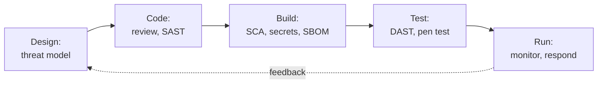

# AppSec Interview Preparation Guide

## Overview

Application security interviews test whether you can find a flaw in a design or a piece of code, explain it to a developer, and fit the fix into how they work. Expect a threat modeling exercise, a code review or a read-through of a vulnerable snippet, questions on CI tooling, and questions about working with engineers. For the career path, see the [AppSec engineer roadmap](../certification-roadmap-appsec-engineer.md).

Always give the fix with the flaw. An answer that names a weakness and stops is half an answer.

*Where each AppSec activity sits in the life of a change. Interviewers like candidates who can place any tool on this line.*

## Core knowledge

### OWASP Top 10

Know each category in one sentence, with an example and a defence. Start with broken access control, security misconfiguration, software supply chain failures, cryptographic failures and injection (the top five in the 2025 list; the 2021 list had insecure design and SSRF as separate items). See [OWASP Top 10 explained](../../learn/concepts/owasp-top-10-explained.md). Reference: **[📖 OWASP Top 10](https://owasp.org/www-project-top-ten/)** - the current list.

### Authentication and sessions

- Password storage with a slow hash, MFA, session handling, and OAuth/OIDC flows. See [Hashing and password storage](../../learn/concepts/hashing-and-password-storage.md) and [OAuth and OIDC explained](../../learn/concepts/oauth-and-oidc-explained.md).
- Know why authorization is checked on the server for every request.

### Supply chain and secrets

- Dependency risk, SBOMs, signing, build integrity. See [Software supply chain security](../../learn/concepts/software-supply-chain-security.md).
- Never keep secrets in code. See [Secrets management](../../learn/concepts/secrets-management.md).

### Tool types

| Tool | What it checks | Weakness |
|---|---|---|
| SAST | Source code patterns | False positives, misses runtime issues |
| SCA | Known-vulnerable dependencies | Noise from unreachable code |
| Secret scanning | Credentials in code and history | Misses secrets in unusual formats |
| DAST | A running app from outside | Limited coverage of logic flaws |
| IAST/RASP | Instrumented runtime behaviour | Needs deployment effort |

## Common questions

### "Threat model a password reset feature."

Draw the data flow: user, web app, email, token store. Walk the threats: guessable or reusable tokens, no expiry, tokens leaked in logs or referrer headers, account enumeration through different messages, no rate limit, takeover through a compromised mailbox. Mitigations: long random single-use tokens with short expiry, identical responses, rate limits, notify the user, require MFA for sensitive changes. See [Threat modeling explained](../../learn/concepts/threat-modeling-explained.md).

### "Explain SQL injection and how you prevent it."

User input is treated as part of a query. Use parameterised queries, least-privilege database accounts, input validation as a second layer, and an ORM used correctly. Say that escaping alone is fragile.

### "What is broken access control, and why is it the top item?"

A user can reach data or actions they should not, for example by changing an ID in a request. It is common because every endpoint needs the check, and tools find it poorly. Defence: deny by default, check ownership on the server, test with two accounts, centralise authorization.

### "What is the difference between authentication and authorization?"

Who you are versus what you may do. Add that OAuth is for delegated authorization and OIDC adds identity on top.

### "Cross-site scripting: what is it and how do you stop it?"

Untrusted data runs as script in another user's browser. Use context-aware output encoding, a framework that escapes by default, a content security policy as defence in depth, and safe cookie flags. Reference: **[📖 OWASP Cheat Sheet Series](https://cheatsheetseries.owasp.org/)** - per-topic guidance.

### "A scanner reports 400 findings. What do you do?"

Triage, do not forward. Deduplicate, rank by reachability, exploitability and data exposure (CVSS plus context; EPSS and the CISA KEV list help for dependencies), fix the critical few, set SLAs, and tune the tool. See [Vulnerability management](../../learn/concepts/vulnerability-management.md).

### "How would you roll out security scanning without slowing developers?"

Start in report-only mode, fix the loudest false positives, then block only on high-confidence critical issues. Run fast checks on pull requests and slow ones nightly. Show developers the fix in the tool. Track time-to-fix, not finding count.

### "A critical dependency vulnerability is announced. What happens?"

Find where it is used (the SBOM answers this), assess reachability and exposure, patch or mitigate, redeploy, and watch for exploitation. See the [Log4Shell case study](../case-study-log4shell-2021.md).

### "What is a security champion programme?"

Developers on each team who act as the local security contact. It scales a small AppSec team. It works with time allowed for the role, training, and recognition.

### "What would you check in a code review for an API?"

Authentication on every route, object-level authorization, input validation, rate limits, error messages that leak nothing, safe logging (no secrets), and how secrets are loaded.

## Behavioural questions

- **A developer rejects your finding:** show you check you are right, then explain the impact with a concrete example.
- **A deadline conflicts with a fix:** show a risk-based option such as a mitigation, a ticket and a date.
- **Teaching:** show one time you taught developers something and what changed.

## Questions to ask them

- How many developers per AppSec engineer?
- Which scanners run in CI, and who tunes them?
- How are findings tracked and who owns fixing?
- Is there a threat model for new designs, and who joins?

## Related

- [AppSec engineer roadmap](../certification-roadmap-appsec-engineer.md)
- [GitHub Advanced Security study guide](../../exams/github/advanced-security/)
- [Security engineer interview prep](./security-engineer-interview.md)
