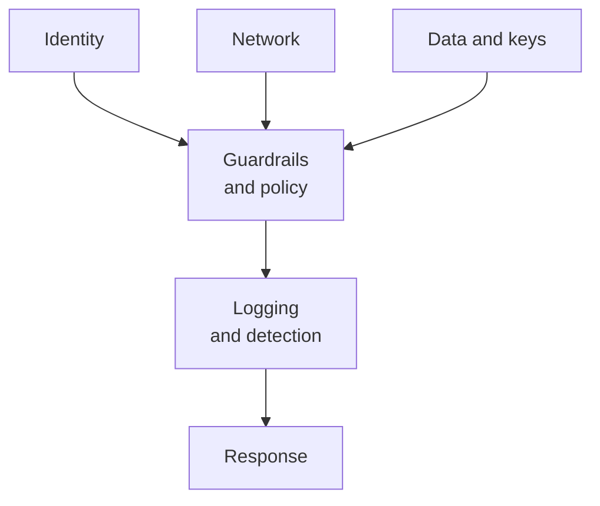

# Cloud Security Interview Preparation Guide

## Overview

This guide is narrower than the [Security engineer interview prep](./security-engineer-interview.md): it focuses on the questions a cloud security engineer role asks, in AWS, Azure or GCP. Expect identity design, a misconfiguration scenario, logging, and an incident. For the career path, see the [cloud security engineer roadmap](../certification-roadmap-cloud-security-engineer.md).

Use the vocabulary of whichever cloud the employer runs, and say the equivalent in the other two if you know it.

*The areas a cloud security interview moves through. Be ready to go deep on identity and logging.*

## Core knowledge

### Shared responsibility

The provider secures the cloud; you secure what you put in it. The split moves with the service type. See [Shared responsibility model](../../learn/concepts/shared-responsibility-model.md).

### Identity

- Roles, not users with keys. Temporary credentials. Federation from a central identity provider.
- Least privilege and how you get there: start broad in a sandbox, narrow using access analysis, then review.
- Reference: **[📖 AWS IAM security best practices](https://docs.aws.amazon.com/IAM/latest/UserGuide/best-practices.html)** and **[📖 GCP workload identity federation](https://cloud.google.com/iam/docs/workload-identity-federation)**.
- See [IAM explained](../../learn/concepts/iam-explained.md) and [Least privilege explained](../../learn/concepts/least-privilege-explained.md).

### Guardrails

Organisation-level policies that cap what accounts can do, and posture tools that check what they did. See [CSPM and CNAPP explained](../../learn/concepts/cspm-and-cnapp-explained.md).

### Logging

Which audit logs exist by default, which need turning on (data events, flow logs), where they are stored, and who can delete them. See [Logging and detection](../../learn/concepts/logging-and-detection.md).

## Common questions

### "Design access for 200 engineers across 30 accounts."

Central identity provider with SSO, groups mapped to roles, permission sets per job, short sessions, MFA, no IAM users or static keys, break-glass accounts with alarms, and regular access reviews. Mention separating production from development accounts.

### "An S3 bucket (or storage container) was found public. What do you do?"

Block public access, keep the evidence, review access logs, classify the data, fix the policy and the template, add org-level guardrails, and decide on notification. Full runbook: [Publicly exposed storage bucket](../playbooks/publicly-exposed-storage-bucket.md).

### "A developer committed an access key to a public repo."

Deactivate, revoke sessions, review the audit trail, remove persistence, rotate what it could read, move to roles. Runbook: [Leaked cloud access key](../playbooks/leaked-cloud-access-key.md).

### "How do you secure a Kubernetes cluster?"

RBAC with least privilege, Pod Security Standards, network policies, image scanning and signing, secrets outside plain manifests, audit logging, and node patching. See [Kubernetes security basics](../../learn/concepts/kubernetes-security-basics.md) and [Container security basics](../../learn/concepts/container-security-basics.md).

### "How do you encrypt data in the cloud?"

At rest with provider-managed or customer-managed keys, in transit with TLS, envelope encryption through a key management service, key policies that separate key admins from key users, and rotation. See [Encryption explained](../../learn/concepts/encryption-explained.md).

### "What logging would you enable first in a new account?"

Organisation-wide audit logging into a separate, locked archive account, plus threat detection and a configuration recorder. Say who can read and who can delete. Build: [Centralized logging and alerting](../hands-on-projects/centralized-logging-and-alerting.md).

### "Security groups versus network ACLs?"

Security groups are stateful and attached to resources; network ACLs are stateless and attached to subnets. See [Network security basics](../../learn/concepts/network-security-basics.md).

### "How do you stop a bad configuration from reaching production?"

Policy as code in the pipeline, template scanning, organisation-level preventive policies, and a posture tool for drift. Prevent first, detect second, fix third.

### "Walk through the Capital One breach and what you would have done."

A web application flaw let the attacker reach credentials on the cloud metadata service of a role with broad access. Defences: fix the app, enforce the hardened metadata service, narrow the role's permissions, and alert on unusual data access. See [Capital One 2019](../case-study-capital-one-2019.md).

### "How would you compare AWS, Azure and GCP security services?"

Give the pairs: threat detection, posture management, key management, secrets, identity. See [Security tools comparison](../service-comparison-security-tools.md) and [Identity and IAM comparison](../service-comparison-identity-iam.md).

### "How do you handle multiple clouds?"

Common standards first (identity, logging format, policy), then cloud-specific controls. Be honest that tooling differs and that depth in one cloud beats a thin view of three.

## Behavioural questions

- **A team ships without review:** show you add guardrails and a quick path rather than only a gate.
- **A cost versus security trade-off:** show you quantify both.
- **Incident under pressure:** use a real one, say what you did first.

## Questions to ask them

- How many accounts or subscriptions, and how are they organised?
- Which guardrails are enforced at the organisation level?
- How long does it take to detect and fix a public resource today?
- Who owns cloud security: central team, platform team, or each product team?

## Related

- [Cloud security engineer roadmap](../certification-roadmap-cloud-security-engineer.md)
- [Security engineer interview prep](./security-engineer-interview.md)
- [Playbooks](../playbooks/)
