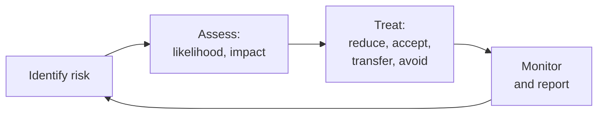

# GRC and Audit Interview Preparation Guide

## Overview

GRC (governance, risk and compliance) and IT audit interviews test judgement, clear writing and whether you can talk to both engineers and executives. Expect questions on frameworks, risk method, evidence, and how you handle pushback. For the career path, see the [GRC analyst roadmap](../certification-roadmap-grc-analyst.md).

Good answers do three things: use the right term, give a small concrete example, and show that you think about what the business needs as well as what the framework says.

*The risk management loop. Most GRC questions are a variation on one of these four steps.*

## Core knowledge

### Risk

- Risk is likelihood times impact, in some form. Know qualitative (high, medium, low) versus quantitative (expected loss) and when each is used.
- Four responses: reduce, accept, transfer, avoid.
- Inherent risk is before controls; residual risk is after.
- See [Risk management basics](../../learn/concepts/risk-management-basics.md). Reference: **[📖 NIST SP 800-30 Rev. 1: Guide for Conducting Risk Assessments](https://csrc.nist.gov/pubs/sp/800/30/r1/final)** - a standard method.

### Frameworks and what they are for

| Framework | One line |
|---|---|
| [SOC 2](../compliance-guides/soc2.md) | An auditor's report on controls, requested by customers |
| [ISO 27001](../compliance-guides/iso-27001.md) | A certifiable management system for information security |
| [NIST CSF 2.0](../compliance-guides/nist-csf.md) | A voluntary framework to organise and communicate a security programme |
| [HIPAA](../compliance-guides/hipaa.md) | US health data law |
| [PCI DSS](../compliance-guides/pci-dss.md) | Card data standard |
| [GDPR](../compliance-guides/gdpr.md) | EU personal data law |

Know the difference between a framework (guidance), a standard (certifiable), a regulation (law) and a contract requirement.

### Controls and evidence

- Preventive, detective, corrective. Technical, administrative, physical.
- A control that is not evidenced did not happen, in an auditor's eyes. Evidence is a record: a ticket, a log, a screenshot with a date, a signed review.
- Population and sample: auditors pick items from a full list, so you must be able to produce the full list.
- Reference: **[📖 NIST SP 800-53 Rev. 5](https://csrc.nist.gov/pubs/sp/800/53/r5/upd1/final)** - the control catalogue.

## Common questions

### "Explain a risk register and what a good entry looks like."

A good entry has: a clear statement (cause, event, impact), an owner, a rating before and after controls, a treatment with a date, and a review date. Bad entries are vague ("hackers") or have no owner.

### "How would you prepare a company for its first SOC 2 audit?"

Scope the systems and the trust criteria, run a gap assessment against the criteria, write the missing policies, assign owners, collect evidence on a schedule, test the controls yourself (a readiness check), pick the report type, and plan the observation window. Read [SOC 2](../compliance-guides/soc2.md) and say the difference between Type 1 and Type 2.

### "An engineer says a control is too slow and wants an exception. What do you do?"

Understand the need, assess the risk without the control, look for a compensating control, and if the exception is justified document it with an owner, an expiry date and approval by the risk owner. Never say "no" without an alternative, and never grant one with no end date.

### "How do you map one control across frameworks?"

Take the intent (for example, multi-factor authentication for admins), then show how each framework phrases the requirement. One control and one body of evidence can satisfy several. A mapping table is the working tool.

### "What is the difference between an internal audit, an external audit and an assessment?"

Internal audit is independent assurance inside the company; an external audit is by an outside firm that issues an opinion or report; an assessment is an advisory review that may not carry formal assurance. Know that auditors must stay independent from the work they audit.

### "Explain separation of duties with an example."

No single person can both create and approve a sensitive action, for example a developer who writes a change cannot also approve it into production. Mention compensating controls when a small team cannot split roles.

### "What would you do if you found a control had failed for three months?"

Do not hide it. Establish the facts, fix the control, assess impact on the period, tell the control owner and your manager, and disclose to the auditor as required. Honesty is the point of the question.

### "How do you assess a vendor?"

Classify by data and access, send a questionnaire or ask for an existing report (a SOC 2 report or ISO certificate), read the scope and exceptions, check subprocessors, agree contract terms (breach notice, audit rights), and review on a schedule. A report that does not cover the service you use proves little.

### "A breach involving personal data happens. What do you check?"

What data, whose, where, when you became aware, and which laws apply. Notification deadlines may be short, so involve legal and privacy at once. See [GDPR](../compliance-guides/gdpr.md), [HIPAA](../compliance-guides/hipaa.md) and [Incident response basics](../../learn/concepts/incident-response-basics.md).

### "How do you measure whether a security programme works?"

Pick measures tied to risk: time to patch critical items, MFA coverage, percent of systems logging, time to detect and contain, training reporting rate. Avoid vanity numbers. Report trends to executives with a clear ask.

## Behavioural questions

- **Telling an executive something they do not want to hear:** show you bring evidence and options.
- **Working with engineers who see you as a blocker:** show you start with their goal.
- **Handling a large evidence request on a deadline:** show a plan, a tracker and early starts.
- **A time you changed a process:** show you measured before and after.

## Questions to ask them

- Which frameworks and audits are on the calendar this year?
- Is GRC part of the security team or separate, and who owns the risk register?
- How automated is evidence collection?
- What was the last finding, and how was it fixed?

## Related

- [GRC analyst roadmap](../certification-roadmap-grc-analyst.md)
- [CISA study guide](../../exams/isaca/cisa/) and [CISM study guide](../../exams/isaca/cism/)
- [Security engineer interview prep](./security-engineer-interview.md)
