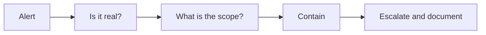

# SOC Analyst Interview Preparation Guide

## Overview

SOC interviews test how you think through an alert, not whether you can recite a tool's menu. Expect scenario questions, a few networking and log questions, and questions about shift work and communication. This guide gives the common questions, what a good answer covers, and how to practise. For the career path, see the [SOC analyst roadmap](../certification-roadmap-soc-analyst.md).

How to answer scenario questions: state your assumptions, say what you would check first and why, say what you would do if it is real, and say when you would escalate. Short and ordered beats long and clever.

*A simple frame for any alert question. Say it out loud as you answer.*

## Core knowledge

### Event, alert, incident

- An **event** is anything observable. An **alert** is an event a rule thought worth a look. An **incident** is harm, or likely harm, to confidentiality, integrity or availability.
- Know false positive (alert, no problem) versus false negative (problem, no alert). See [Incident response basics](../../learn/concepts/incident-response-basics.md).

### The lifecycle

Be able to name the phases and say what you do in each: prepare, detect and analyse, contain, eradicate, recover, lessons learned.

### Logs and detection

- Which logs matter first: identity and authentication, endpoint, DNS, proxy or web, cloud audit, email. See [Logging and detection](../../learn/concepts/logging-and-detection.md).
- Why time sync and retention matter.
- Reference: **[📖 NIST SP 800-92: Guide to Computer Security Log Management](https://csrc.nist.gov/pubs/sp/800/92/final)** - log management basics.

### Frameworks

- MITRE ATT&CK: tactics are goals, techniques are the how. Use it to describe coverage and to label what you saw. **[📖 MITRE ATT&CK](https://attack.mitre.org/)** - the knowledge base.

## Common questions

### "Walk me through a phishing report."

Cover: save the original with headers, check sender authentication, inspect links and attachments safely, search for other recipients, purge, block, find who interacted, reset and revoke if they did, tell the reporter. Mention that you never click the link on a normal machine. Full runbook: [Phishing report triage](../playbooks/phishing-report-triage.md).

### "An alert says a user signed in from two countries ten minutes apart. What do you do?"

Good points: it might be a VPN, a mobile network or a travelling user. Check the user's usual locations, the device, whether MFA was satisfied, the sign-in method and what happened after sign-in (mail rules, file downloads, new MFA methods). If suspicious, contact the user by a different channel, revoke sessions, reset the password. Mention the false positive rate and how you would tune the rule.

### "EDR flags a process on a server. How do you decide if it is malicious?"

Look at the parent process and command line, the user, the file's signature and prevalence, network connections, and what else the host did around that time. Compare to baseline. Isolate if there is real doubt and the business impact is acceptable, and tell the system owner. See [Endpoint security: EDR and XDR](../../learn/concepts/endpoint-security-edr-xdr.md).

### "What would you do first when you suspect ransomware?"

Declare an incident, isolate the affected hosts (not power off), protect the backups, contain accounts, preserve evidence, notify the right people. Do not wipe anything yet. See [Ransomware, the first hour](../playbooks/ransomware-first-hour.md).

### "A developer's cloud key appears in a public repo."

Deactivate it first, revoke sessions, export audit logs, check what it did, remove persistence, rotate what it could read. See [Leaked cloud access key](../playbooks/leaked-cloud-access-key.md).

### "How do you tell a true positive from a false positive?"

Context and corroboration: a second source (endpoint, network, identity) that agrees, a known good explanation, or behaviour that fits an attacker's pattern. Write down the reasoning so the next analyst can reuse it.

### "Explain the difference between IDS and IPS, or SIEM and SOAR."

IDS detects and alerts; IPS can also block inline. A SIEM collects and correlates logs and raises alerts; SOAR automates response steps with playbooks. See [SOC detection and response pipeline](../architecture-patterns/soc-detection-and-response-pipeline.md).

### "How would you reduce alert fatigue?"

Measure which rules produce the most false positives, tune or retire them, add context to alerts, group related alerts into cases, automate the repetitive checks, and keep a feedback loop with the people who triage. Never silence a rule without checking what outage or attack it would hide.

### "Explain DNS, and how it helps detection."

DNS turns names into addresses. Defenders watch it for newly seen domains, unusual query volume, long random-looking names and known bad domains. Say what you would do with a hit: check the host, process and user.

### "What is the difference between a vulnerability, a threat and a risk?"

A weakness, something that could exploit it, and the combination weighted by likelihood and impact. See [Risk management basics](../../learn/concepts/risk-management-basics.md) and [Vulnerability management](../../learn/concepts/vulnerability-management.md).

## Behavioural questions

- **Shift work and fatigue:** say how you keep notes and hand over cleanly.
- **A mistake you made:** pick a real, small one. Say what you changed afterwards.
- **Disagreeing with a senior analyst:** show that you present evidence, not opinion.
- **Explaining an incident to a non-technical person:** practise a three-sentence version: what happened, what we did, what we need from you.

## Practical tests you may get

- Read a set of log lines and say what happened.
- Write a short incident summary from a timeline.
- Sketch a detection for a given behaviour.
- Use a query language (often KQL or SPL) to find a thing.

Practise with [Centralized logging and alerting](../hands-on-projects/centralized-logging-and-alerting.md) and the [playbooks](../playbooks/).

## Questions to ask them

- How many alerts per analyst per shift, and what share are false positives?
- What is the escalation path, and who owns detections?
- What tools are used, and how much can I tune?
- How do you train new analysts, and what does promotion look like?

## Related

- [SOC analyst roadmap](../certification-roadmap-soc-analyst.md)
- [Security engineer interview prep](./security-engineer-interview.md)
- [Glossary](../../learn/glossary.md)
