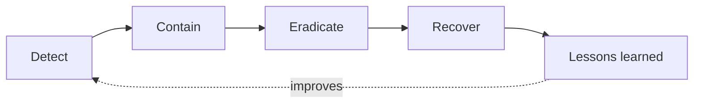

# Incident response playbooks

Short, defensive runbooks for the incidents that fill a security team's week. Each follows the same five steps (detect, contain, eradicate, recover, lessons learned) and ends with a checklist you can copy into a ticket.

They cover what to check, cut off and report. They contain no attack steps. For the theory behind the steps, read [Incident response basics](../../learn/concepts/incident-response-basics.md) first.

| Playbook | Use when | Who usually runs it |
|---|---|---|
| [Leaked cloud access key](./leaked-cloud-access-key.md) | A key is in a repo, chat, log or scanner alert | Cloud security, on-call |
| [Phishing report triage](./phishing-report-triage.md) | A user reports a suspicious message | SOC analyst |
| [Suspicious OAuth app grant](./suspicious-oauth-app-grant.md) | An unknown app was given access to a work account | SOC, identity team |
| [Ransomware, the first hour](./ransomware-first-hour.md) | Files are being encrypted or a ransom note appears | Incident commander, SOC, IT |
| [Lost or stolen laptop](./lost-or-stolen-laptop.md) | A device with company access is gone | Service desk, endpoint team |
| [Publicly exposed storage bucket](./publicly-exposed-storage-bucket.md) | Storage is readable by anyone | Cloud security |

## How to use them

- Adapt before you need them. Put your own tool names, contacts and approval rules in a copy.
- Practice one in a tabletop each quarter.
- After a real incident, update the playbook the same week.

*The shared shape of every playbook here.*

## Related

- [Logging and detection](../../learn/concepts/logging-and-detection.md) - how incidents get noticed
- [SOC detection and response pipeline](../architecture-patterns/soc-detection-and-response-pipeline.md)
- [SOC analyst roadmap](../certification-roadmap-soc-analyst.md) and [SOC analyst interview prep](../interview-prep/soc-analyst-interview.md)
- **[📖 NIST SP 800-61 Rev. 3](https://csrc.nist.gov/pubs/sp/800/61/r3/final)** - incident response recommendations
