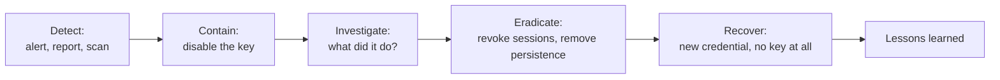

# Playbook: leaked cloud access key

> **Use when:** a long-lived cloud access key (AWS access key, GCP service account key, Azure client secret) has been seen somewhere it should not be: a public repo, a pasted ticket, a chat, a log, or a scanner alert.

Treat every leaked key as used until the logs say otherwise. Assume exposed keys are found quickly, so speed matters more than certainty. This is a defensive runbook: it covers what to check, cut off and report. For the lifecycle behind it, see [Incident response basics](../../learn/concepts/incident-response-basics.md).

*The order of work for a leaked key. Disable first, investigate second: the key stays dangerous while you read logs.*

## Detect

Common sources of the first signal:

- A secret scanning alert from your Git host or a scanner. **[📖 About secret scanning (GitHub)](https://docs.github.com/en/code-security/secret-scanning/introduction/about-secret-scanning)** - how GitHub detects exposed credentials.
- A cloud provider notice that a key was found exposed. **[📖 AWS: compromised or unauthorized access](https://docs.aws.amazon.com/awssupport/latest/user/compromised-or-unauthorized-access.html)** - what AWS support does and what you must do.
- A threat detection finding about credentials used from an unusual place. **[📖 GuardDuty IAM finding types](https://docs.aws.amazon.com/guardduty/latest/ug/guardduty_finding-types-iam.html)** - the IAM-related findings.
- Unexpected spend, new resources in unused regions, or a bill alert.

Write down at once: the key ID (never paste the secret itself), where it was exposed, when it was exposed, and who owns it.

## Contain

1. **Deactivate the key now.** Deactivate rather than delete, so you keep the key ID and its history for the investigation and can still tell what it was attached to. **[📖 AWS: managing access keys](https://docs.aws.amazon.com/IAM/latest/UserGuide/id_credentials_access-keys.html)** - deactivate, rotate and delete.
2. **Revoke active sessions.** Temporary credentials already issued from the identity can outlive the key. Revoke the sessions or attach a deny policy for tokens issued before now. See [IAM explained](../../learn/concepts/iam-explained.md).
3. **Preserve evidence.** Export the audit logs for the identity (CloudTrail, Azure Activity Log, GCP Cloud Audit Logs) before anything is changed further.
4. **Remove the exposure.** Take the secret out of the public place. Remember that deleting a commit does not remove it from forks, caches or clones, so the key is still considered burned.
5. **Tell the owner and the incident lead.** Use an out-of-band channel if chat or email may be affected.

## Investigate

Answer these from the audit logs, for the whole window from first exposure to deactivation:

- Which API calls did the key make, from which IP addresses, user agents and regions?
- Did any call create new identities, keys, roles, trust policies, access grants or federation settings? These are persistence.
- Did it read or copy data (object storage, databases, secrets stores, snapshots)?
- Did it create compute or change security controls, such as turning off logging?
- Which permissions did the key have? The blast radius is the permissions, not the key. See [Least privilege explained](../../learn/concepts/least-privilege-explained.md).

Search for the pattern, not only the key: an attacker who got in will often make a second way back in.

## Eradicate

- Delete any identity, key, role, policy, function, instance or scheduled job the key created that you did not expect.
- Rotate every secret the key could read (database passwords, API tokens, other cloud keys). A key that could read your secrets store means everything in it is exposed. See [Secrets management](../../learn/concepts/secrets-management.md).
- Check that logging and alerting are back to the intended configuration.
- Delete the old key once the investigation no longer needs it.

## Recover

- Replace the key with something that has no long-lived secret: an instance or workload role, a managed identity, or workload identity federation. **[📖 GCP: workload identity federation](https://cloud.google.com/iam/docs/workload-identity-federation)** - access without service account keys.
- Where a key is unavoidable, store it in a secrets manager, scope it down, and set a rotation date.
- Watch the identity and the resources it touched closely for at least a week.
- Decide on notification. If data was read, involve legal and privacy at once: deadlines may already be running (see [GDPR](../compliance-guides/gdpr.md) and [HIPAA](../compliance-guides/hipaa.md)).

## Lessons learned

Ask in a blameless review:

- How did a long-lived key exist at all? Which workload needed it, and could it use a role instead?
- Why was it not found earlier? Add secret scanning on commit, in CI and on the whole organisation.
- Was the permission set larger than the job? Cut it.
- How long between exposure and deactivation? That number is the one to improve.

Related reading: [Capital One 2019](../case-study-capital-one-2019.md) (an over-permissioned role), [Snowflake customer breaches](../case-study-snowflake-customer-breaches-2024.md) (stolen credentials with no MFA).

## Checklist

- [ ] Key deactivated, key ID recorded
- [ ] Sessions revoked
- [ ] Audit logs exported
- [ ] Exposure removed and key treated as burned
- [ ] Persistence searched for and removed
- [ ] Secrets the key could read rotated
- [ ] Replacement uses no long-lived key
- [ ] Review held, actions tracked
