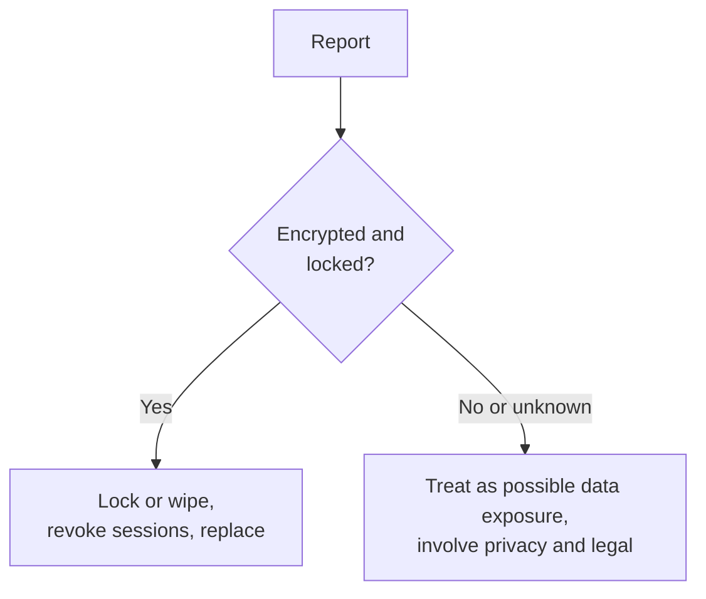

# Playbook: lost or stolen laptop

> **Use when:** a company laptop, phone or tablet is lost, stolen, or left somewhere it should not be.

The question is not "who has the hardware" but "what can they get from it". Full disk encryption plus a locked screen turns most of these into a replacement order. Without them, it is a possible data breach. Background: [Encryption explained](../../learn/concepts/encryption-explained.md) and [Endpoint security: EDR and XDR](../../learn/concepts/endpoint-security-edr-xdr.md).

*Encryption status decides whether this is a hardware loss or a data incident.*

## Detect

- The user reports it. Make this fast and blame-free: staff who fear punishment wait, and the wait is the damage.
- Your device management tool shows the device offline or in an unexpected place.
- Record: the user, device ID and serial number, when and where it was last seen, and whether it was in a bag, a car or a public place.

## Contain

1. **Lock the device remotely** through your device management tool, and **wipe** it if the data is sensitive and the device is not coming back. A wipe command only runs when the device is online, so queue it.
2. **Revoke access.** Sign the user out everywhere, revoke refresh tokens and session cookies, and remove the device from trusted or compliant lists. See [Zero trust explained](../../learn/concepts/zero-trust-explained.md): access should depend on the device being trusted.
3. **Reset the user's passwords** and rotate any secret stored on the device (SSH keys, cloud keys, VPN certificates, saved tokens). See [Secrets management](../../learn/concepts/secrets-management.md).
4. **Disable the device's certificates** and its VPN or Wi-Fi profile.
5. If theft happened, the user files a police report; this also helps with insurance.

## Investigate

- Was the disk encrypted, and was the key protected by a TPM and a screen lock or PIN? Confirm in the management tool, not from memory.
- What data was on it? Check local files, synced folders, offline mail and browser-saved passwords. A data inventory and [Data loss prevention](../../learn/concepts/data-loss-prevention-explained.md) policies help here.
- Look at sign-in logs for the user and device after the loss time: any successful access from new locations?
- Was it a targeted loss, such as a theft that followed a trip or a conference? Warn others travelling with the user.

## Eradicate

- Keep the lock or wipe order active. If the device resurfaces, do not trust it: reimage before reuse.
- Remove the device from the inventory as lost, and disable its device record so it cannot re-enrol.

## Recover

- Issue a replacement, restoring data from sync or backup. If the user's work lived only on the laptop, that is a finding.
- Re-enrol the user's MFA methods if their phone was the lost device. See [MFA and passkeys](../../learn/concepts/mfa-and-passkeys.md).
- Decide on notification. If the device was unencrypted and held personal data, that may be a reportable breach. Hand to privacy and legal with the facts above. See [GDPR](../compliance-guides/gdpr.md) and [HIPAA](../compliance-guides/hipaa.md).

## Lessons learned

- Enforce full disk encryption and a screen lock by policy, and report on the percentage compliant.
- Keep work data in managed cloud storage, not only on the laptop.
- Make the report path one call or one chat message, available out of hours.
- Teach travelling staff what to do first: report, then lock.

## Checklist

- [ ] Report taken, device and last-seen details recorded
- [ ] Remote lock or wipe issued
- [ ] Sessions revoked, passwords and stored secrets rotated
- [ ] Encryption status confirmed from the management tool
- [ ] Sign-in logs checked after the loss
- [ ] Privacy and legal informed if unencrypted
- [ ] Replacement issued
