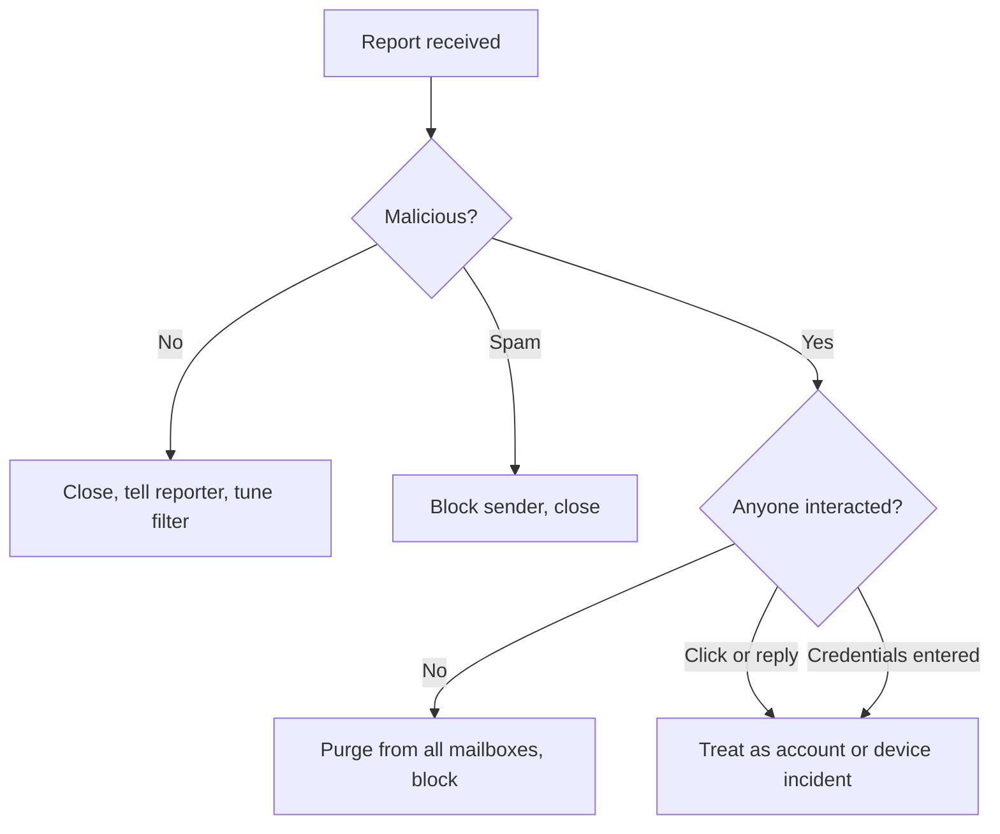

# Playbook: phishing report triage

> **Use when:** an employee reports a suspicious email, text or message, or a mail filter flags one. This is the daily SOC job.

Most reports are harmless or spam. The skill is sorting them fast and finding the few where someone clicked or typed a password. Background: [Phishing and social engineering](../../learn/concepts/phishing-and-social-engineering.md) and [Email security: SPF, DKIM and DMARC](../../learn/concepts/email-security-spf-dkim-dmarc.md).

*The triage decision tree. The key question is whether anyone interacted, because that changes a mail clean-up into an incident.*

## Detect

- Collect the message **as an attachment or with full headers**, not a screenshot, so the headers and links survive. Forwarding in the body strips the evidence.
- Record the reporter, the time received, and how many mailboxes got the same message.
- Make it easy to report. A one-click report button gets more and faster reports. **[📖 Microsoft: admin submissions](https://learn.microsoft.com/en-us/defender-office-365/submissions-admin)** - how admins submit and review reported messages in Defender for Office 365.

## Triage (decide: safe, spam or malicious)

Check, without clicking:

1. **Sender and authentication.** Compare the display name, the from address and the return path. Check the SPF, DKIM and DMARC results in the headers.
2. **Links.** Read the real destination of each link (hover, or view the raw message). Look up domains and URLs in a reputation service or detonate them in a sandbox. Never open them on a normal workstation.
3. **Attachments.** Submit to a sandbox. Treat macros, archives with passwords, and unusual file types as suspect.
4. **Ask for what is being asked.** Urgency, a payment change, gift cards, a login you did not expect, or a request to move to another channel are the common shapes.
5. **Context.** Did this person expect it? Is the sender a known contact whose account may itself be compromised?

CISA's guidance on the first phase of the attack cycle is a good primer for what phishing aims to achieve: **[📖 CISA: phishing guidance, stopping the attack cycle at phase one](https://www.cisa.gov/resources-tools/resources/phishing-guidance-stopping-attack-cycle-phase-one)** - what defenders can do early.

## Contain

If malicious:

- **Search and purge.** Find every copy across mailboxes by sender, subject or message ID and remove it. Do this before users see it.
- **Block** the sender, sending infrastructure, links and file hashes in mail, web proxy and endpoint tools.
- **Find who interacted.** Check mail click tracking, proxy logs and DNS logs for the link domain, and mail logs for replies.
- For every person who clicked or entered credentials: reset the password, revoke sessions and tokens, and check for new mailbox rules and new MFA methods. See [MFA and passkeys](../../learn/concepts/mfa-and-passkeys.md).
- If an attachment was opened: isolate the device through your EDR and hand off to the incident team. See [Endpoint security: EDR and XDR](../../learn/concepts/endpoint-security-edr-xdr.md).

## Eradicate

- Remove malicious mailbox rules (auto-forwarding and hide-from-inbox rules are common), unknown OAuth app grants (see [suspicious OAuth app grant](./suspicious-oauth-app-grant.md)) and unknown MFA registrations.
- Remove any malware and persistence found on a device, or reimage it.
- Report phishing infrastructure to the hosting provider or registrar where practical.

## Recover

- Restore normal access for the affected user after a password reset and a fresh MFA registration.
- Tell the reporter the outcome. A reporter who hears nothing stops reporting.
- If the message impersonated an executive or a supplier, warn the finance team and any other likely targets.
- Check for follow-on fraud, such as changed bank details or unusual transfers.

## Lessons learned

- Reward the report, never blame the clicker. See [Security awareness training](../../learn/concepts/security-awareness-training.md): measure reporting rate and time to report, not click rate alone.
- Why did the filter miss it? Add a detection or a block rule.
- Was MFA phishing-resistant? Passkeys and security keys stop credential relay in a way codes cannot.
- Is DMARC at enforcement for your own domains, so nobody can spoof you?
- Track the numbers that matter: reports per month, time to triage, time to purge, and number of users who interacted.

## Checklist

- [ ] Original message saved with headers
- [ ] Verdict recorded (safe, spam, malicious)
- [ ] Copies purged, indicators blocked
- [ ] Interactions identified from logs
- [ ] Passwords reset, sessions revoked, rules and MFA methods checked
- [ ] Reporter told the outcome
- [ ] Detection or control gap logged
