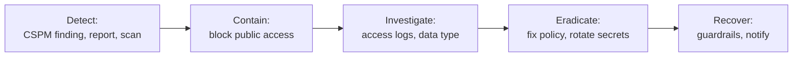

# Playbook: publicly exposed storage bucket

> **Use when:** an object storage bucket or container (S3, Azure Blob, Google Cloud Storage) is readable, or writable, by anyone on the internet, and it should not be.

This is the classic cloud misconfiguration. The task is to close the access quickly, then work out whether anyone used it. Background: [CSPM and CNAPP explained](../../learn/concepts/cspm-and-cnapp-explained.md) and [Shared responsibility model](../../learn/concepts/shared-responsibility-model.md).

*Block first, then look at who accessed what. The data is the reason to care.*

## Detect

- A posture management finding or a managed rule flags public access.
- An outside researcher or customer reports it. Respond fast and thank them.
- A cloud provider notice or a scanner alert.

Record: the bucket name, account and region, the data inside and its classification, who owns it, and when it became public (check the configuration history, not only today's state).

## Contain

1. **Turn on the provider's block-public-access control** at the bucket, and then at the account or organisation level if it is not already on. **[📖 AWS: blocking public access to S3](https://docs.aws.amazon.com/AmazonS3/latest/userguide/access-control-block-public-access.html)** - the four settings and what each does. **[📖 Azure: prevent anonymous read access to blob data](https://learn.microsoft.com/en-us/azure/storage/blobs/anonymous-read-access-prevent)** - disallow anonymous access on the storage account. **[📖 GCP: public access prevention](https://cloud.google.com/storage/docs/public-access-prevention)** - enforce no public access on buckets.
2. **Do not delete the bucket or objects.** You need them, and the access logs, as evidence.
3. If the bucket was **writable**, treat the content as untrusted: someone could have uploaded or changed files, including web content or scripts that others load.
4. Preserve the logs before anything else changes. If server access logging or data event logging was off, say so in the record: it limits what you can prove.

## Investigate

- What was in it? Classify it: public by design (website assets), internal, personal data, credentials, backups.
- Who accessed it while it was open? Use storage access logs and audit data events, and look for requests from unknown IPs, bulk listing and large downloads. **[📖 AWS: security best practices for S3](https://docs.aws.amazon.com/AmazonS3/latest/userguide/security-best-practices.html)** - logging and monitoring options.
- Which control failed? A bucket policy with a wildcard principal, an ACL, a removed guardrail, or a template that shipped public.
- Is the same pattern elsewhere? Scan every bucket and account for the same setting.

## Eradicate

- Fix the policy so that access is by named identities only. Remove wildcard principals and public ACLs.
- If objects held secrets (keys, tokens, passwords), treat them as leaked and rotate them. See [Leaked cloud access key](./leaked-cloud-access-key.md).
- If it was writable, compare content to known-good copies and restore or delete tampered objects.
- Fix the template or code that created the bucket so it does not return.

## Recover

- Confirm from outside the organisation that access is now denied.
- Turn on the account-level guardrails: block public access, policy that denies public grants, and a detection that alerts within minutes. See [Least privilege explained](../../learn/concepts/least-privilege-explained.md).
- Decide on notification with legal and privacy. If personal data was exposed and logs show access (or cannot rule it out), deadlines may apply. See [GDPR](../compliance-guides/gdpr.md) and [HIPAA](../compliance-guides/hipaa.md).
- Where a site legitimately needs public files, serve them through a CDN with a private origin, so the bucket itself stays private.

## Lessons learned

- Why could someone make it public? Remove that permission from most people.
- Why did we find out late? Add continuous posture checks and alerts.
- Are access logs on for every bucket that holds sensitive data?
- Related case: [Capital One 2019](../case-study-capital-one-2019.md) and [Snowflake customer breaches](../case-study-snowflake-customer-breaches-2024.md) show how cloud data is exposed without anyone "hacking" a bucket.

## Checklist

- [ ] Public access blocked (bucket and account)
- [ ] Bucket and objects kept, logs preserved
- [ ] Data classified, access logs reviewed
- [ ] Secrets inside rotated, writes checked
- [ ] Policy and template fixed, same pattern scanned for elsewhere
- [ ] Guardrails and alerting added
- [ ] Notification decision recorded
