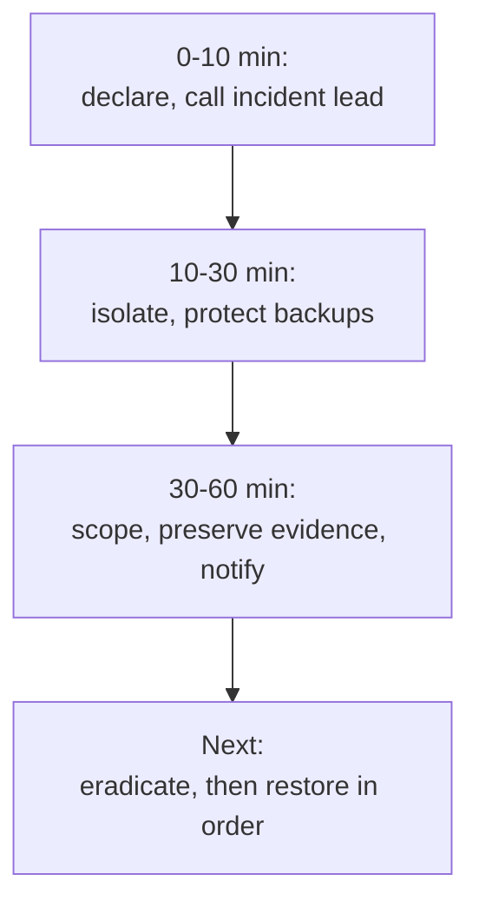

# Playbook: ransomware, the first hour

> **Use when:** files are being encrypted, a ransom note has appeared, or EDR reports mass file changes or backup tampering.

The first hour is about stopping the spread and protecting your backups, not about cleaning up. Decisions about payment, regulators and law enforcement belong to leadership, legal and your insurer, not to the first responder. Background: [Backup and ransomware resilience](../../learn/concepts/backup-and-ransomware-resilience.md) and [Incident response basics](../../learn/concepts/incident-response-basics.md).

*The first hour in three blocks. Containment and backup protection come before investigation.*

## Detect

- EDR alerts on mass file rename or encryption, shadow copy deletion, or a security tool being switched off.
- Users reporting files that will not open, odd file extensions, or a ransom note.
- File servers, hypervisors or backup consoles behaving oddly.

**Declare an incident** and name an incident commander. Start a written timeline: who did what, when. Use an out-of-band channel for communication, since email and chat may be watched.

## Contain (minutes 10-30)

1. **Isolate affected machines from the network** using the EDR isolate action or by disabling the network port. Do **not** power them off if you can avoid it: memory holds evidence. If you cannot isolate, disconnect the network cable or Wi-Fi.
2. **Protect backups first.** Disconnect backup storage and take backup consoles off the network. Check that immutable or offline copies are intact. Backups are what the attacker goes for next.
3. **Contain the identity.** Disable or reset the accounts seen on affected hosts, especially privileged and service accounts. Rotate or block the credentials used for remote access.
4. **Cut the paths in.** Block the known command and control addresses, turn off exposed remote access you can spare, and segment the network to stop lateral movement.
5. **Do not wipe or reimage** anything yet. You need to know how they got in first.

## Investigate (minutes 30-60)

- How did they get in? Typical entry points include phishing, exposed remote access with no MFA, an unpatched internet-facing system, and stolen credentials. CISA's guide lays out the response steps: **[📖 CISA: #StopRansomware Guide](https://www.cisa.gov/stopransomware/ransomware-guide)** - prevention and response checklists.
- What is affected? List hosts, shares, cloud storage, SaaS and backups.
- Was data copied out before the encryption? Many groups steal data first. Look at outbound traffic volume and cloud storage access logs. This changes your legal duties.
- Is the attacker still in? Look for new accounts, remote tools and scheduled tasks.

Preserve evidence: take memory and disk images of a few representative hosts, keep the ransom note and any sample file, and export logs. The attacker may delete logs.

## Notify

Bring in, in this order of urgency: your incident lead and executive sponsor, legal counsel, your cyber insurer (many policies require early notice and approved vendors), and your external IR retainer. Law enforcement reporting and regulator or customer notification are decisions for legal and leadership. Check [GDPR](../compliance-guides/gdpr.md), [HIPAA](../compliance-guides/hipaa.md) and any contract terms for the notification clocks.

## Eradicate

- Remove the attacker's access: close the entry point, reset every credential that could have been exposed (including the directory's most privileged accounts if the domain was reached), and remove persistence.
- Rebuild affected systems from known-good images rather than cleaning them.
- Check whether a free decryptor exists before concluding data is lost: **[📖 No More Ransom](https://www.nomoreransom.org/)** - a joint project of law enforcement and industry with decryption tools. A match is not guaranteed.

## Recover

- Restore in business priority order: identity, core infrastructure, then critical applications.
- Restore from a backup taken **before** the compromise began, and scan it before it goes back on the network.
- Bring systems back in a clean, monitored segment first. Watch for re-infection.
- Keep a status page or regular update for staff and customers.

## Lessons learned

- What made spread easy: flat network, shared admin passwords, missing MFA, unpatched systems? Fix in that order.
- Did the backups survive? Test restores on a schedule. A backup you have never restored is a hope.
- Run a tabletop of this playbook yearly, with executives. See [Incident response basics](../../learn/concepts/incident-response-basics.md).
- Update the plan: contact lists, insurer steps, and who can authorise isolating a production system.

## Checklist

- [ ] Incident declared, commander named, timeline started
- [ ] Affected hosts isolated, not powered off
- [ ] Backups protected and verified
- [ ] Accounts contained
- [ ] Entry point and data theft assessed
- [ ] Legal, insurer and IR retainer called
- [ ] Evidence preserved
- [ ] Restore plan agreed, restore from pre-compromise backup
