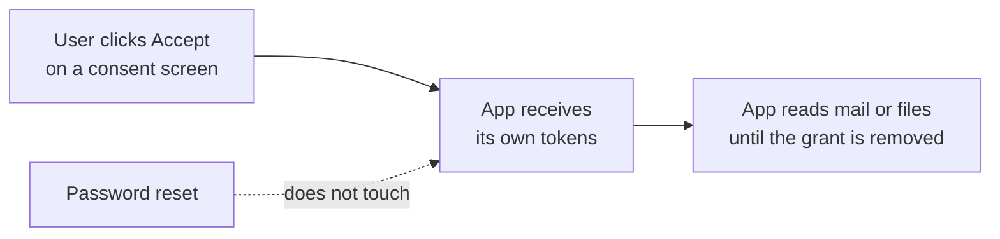

# Playbook: suspicious OAuth app grant

> **Use when:** a user, or an alert, shows that someone granted a third-party app access to their work account (mail, files, calendar, directory) and the app is unknown, unverified or asking for far more than it needs.

An app grant is dangerous because it survives a password reset: the app holds its own tokens. Changing the user's password does not remove the grant. Background: [OAuth and OIDC explained](../../learn/concepts/oauth-and-oidc-explained.md).

*Why password resets are not enough: the app's access runs on tokens, not on the password.*

## Detect

- A consent event in the identity provider audit log for an app you do not recognise, especially from a user who is not an admin.
- Alerts from a cloud app security tool about risky, new or over-privileged apps.
- A user reporting a strange "sign in with" screen or a prompt asking for "read all your mail" after clicking a link.
- Unusual mail, file or API activity by a service principal rather than a person.

Record: the app name and ID, the publisher (and whether it is verified), the permissions granted, who consented, when, and whether consent was for one user or the whole tenant.

## Contain

1. **Disable the app's sign-in** so no new tokens are issued for it while you investigate. **[📖 Microsoft: disable user sign-in for an application](https://learn.microsoft.com/en-us/entra/identity/enterprise-apps/disable-user-sign-in-portal)** - how to turn off an enterprise app without deleting it.
2. **Revoke the grants** and refresh tokens for the app, for every user who consented.
3. **Reset the user's credentials and revoke sessions** if the consent came through a phishing link. See [Phishing report triage](./phishing-report-triage.md).
4. **Preserve logs.** Export the consent events, sign-ins and the app's activity (mail access, file access, directory reads) for the whole window.

## Investigate

- What permissions did the app have? Mail read, file read and offline access are the common high-risk ones. Admin-consented, tenant-wide permissions are the worst case.
- What did it do? Look at the audit and mail access logs for the app's identity: which mailboxes, which files, how much, from which IPs.
- How many users consented? Other users may have been sent the same link.
- Where did the link come from? Find the phishing message and handle it as a phishing incident.
- Did the attacker use the access to create mailbox rules, send mail as the user or add more apps?

## Eradicate

- Delete the app (the enterprise application and its registration, if it is in your tenant) once the evidence is saved.
- Remove related mailbox rules, delegates and extra app grants.
- Block the publisher or the app ID so it cannot return.

## Recover

- Restore the user's access and tell them what happened.
- Fix the root cause: stop users granting tenant data to unvetted apps. **[📖 Microsoft: configure user consent settings](https://learn.microsoft.com/en-us/entra/identity/enterprise-apps/configure-user-consent)** - limit what users may consent to.
- Set up an admin approval flow, so users can ask for an app instead of clicking Accept. **[📖 Microsoft: manage consent requests](https://learn.microsoft.com/en-us/entra/identity/enterprise-apps/manage-consent-requests)** - the admin consent workflow.
- The same pattern exists in Google Workspace and other platforms; use that platform's list of third-party apps and its admin controls.

## Lessons learned

- Review all consented apps on a schedule and remove those unused for months. This is an access review, like any other (see [Least privilege explained](../../learn/concepts/least-privilege-explained.md)).
- Add a detection for first-time consent to an app with high-risk permissions.
- Teach users that "Accept" on a consent screen is a decision to share data, not a login step.
- Count time from consent to disable. That is your exposure.

## Checklist

- [ ] App ID, publisher, permissions and consenting users recorded
- [ ] App sign-in disabled and grants revoked
- [ ] User credentials reset and sessions revoked where phishing was the cause
- [ ] Logs exported, activity reviewed
- [ ] App deleted, publisher blocked
- [ ] User consent policy tightened, admin approval flow in place
