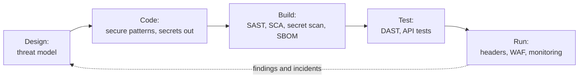

# Application security

Building software that is hard to attack and easy to fix: threat modeling at design time, secure coding against the common risk lists, automated scanning in the pipeline, and a safe supply chain.

*Security checks move left into each stage of delivery, and what production teaches goes back into design.*

---

## Learn

- [Threat modeling explained](../learn/concepts/threat-modeling-explained.md) - STRIDE and data flow diagrams
- [OWASP Top 10 explained](../learn/concepts/owasp-top-10-explained.md) - web application risks and their defences
- [OWASP API Security Top 10 explained](../learn/concepts/owasp-api-security-top-10-explained.md) - the ten API-specific risks
- [Secure SDLC and DevSecOps](../learn/concepts/secure-sdlc-and-devsecops.md) - SAST, DAST, SCA and secret scanning in CI
- [Security headers and CSP](../learn/concepts/security-headers-and-csp.md) - what each header protects and a report-only CSP rollout
- [Software supply chain security](../learn/concepts/software-supply-chain-security.md) - SBOMs, signing, SLSA, dependency risk
- [Secrets management](../learn/concepts/secrets-management.md) - credentials out of code and config
- [OAuth and OIDC explained](../learn/concepts/oauth-and-oidc-explained.md) - delegated access and federated login
- [Hashing and password storage](../learn/concepts/hashing-and-password-storage.md) - salts and slow hashes
- [TLS and HTTPS](../learn/concepts/tls-and-https.md) - encryption in transit
- [Container security basics](../learn/concepts/container-security-basics.md) - minimal images, scanning, signing
- [Kubernetes security basics](../learn/concepts/kubernetes-security-basics.md) - RBAC, Pod Security Standards, admission control
- [Vulnerability management](../learn/concepts/vulnerability-management.md) - CVE, CVSS, EPSS, KEV and patch SLAs

---

## Reference

- [Case study: Log4Shell 2021](../resources/case-study-log4shell-2021.md) - responding to a critical dependency vulnerability
- [Case study: SolarWinds 2020](../resources/case-study-solarwinds-2020.md) - build-system supply chain compromise
- [Case study: MOVEit 2023](../resources/case-study-moveit-2023.md) - an injection flaw in a widely deployed product
- [Case study: Capital One 2019](../resources/case-study-capital-one-2019.md) - SSRF plus an over-permissioned IAM role
- [Architecture pattern: Secrets and PKI platform](../resources/architecture-patterns/secrets-and-pki-platform.md)
- [Compliance: PCI DSS](../resources/compliance-guides/pci-dss.md) - secure development requirements for card data
- [Compliance: EU Cyber Resilience Act](../resources/compliance-guides/eu-cyber-resilience-act.md) - security obligations for products with digital elements
- [AppSec engineer roadmap](../resources/certification-roadmap-appsec-engineer.md) and [AppSec interview prep](../resources/interview-prep/appsec-interview.md)

---

## Build

- [Harden a Linux server](../resources/hands-on-projects/harden-a-linux-server.md) - the host your app runs on
- [Container image scan with an SBOM](../resources/hands-on-projects/container-image-scan-with-sbom.md) - scan a public image and inspect what is inside

---

## Certify

- [GitHub Advanced Security](../exams/github/advanced-security/) - SAST, secret scanning, dependency scanning
- [CKS - Certified Kubernetes Security Specialist](../exams/kubernetes/cks/)
- [KCSA - Kubernetes and Cloud Native Security Associate](../exams/kubernetes/kcsa/)
- [CompTIA Security+](../exams/comptia/security-plus/) - includes application security basics
- [HashiCorp Vault Associate](../exams/hashicorp/vault-associate/) - secrets management
