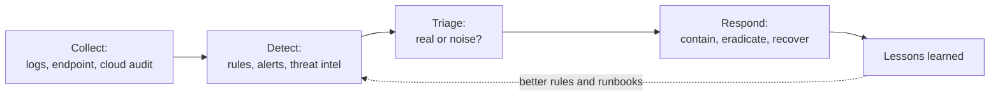

# Detection and response

How a team notices something is wrong and what it does next: logging, detection engineering, triage, incident response, forensics and the lessons loop. Every other control fails sometimes; this is the part that limits the damage.

*The loop this topic covers. Each stage has a concept page below, and the lessons stage feeds back into detection.*

---

## Learn

- [Logging and detection](../learn/concepts/logging-and-detection.md) - what to log, SIEM, detection engineering
- [Endpoint security: EDR and XDR](../learn/concepts/endpoint-security-edr-xdr.md) - behavioural detection, isolation and cross-source incidents
- [MITRE ATT&CK for defenders](../learn/concepts/mitre-attack-for-defenders.md) - reading the matrix and measuring detection coverage
- [Threat intelligence basics](../learn/concepts/threat-intelligence-basics.md) - IOCs vs TTPs, sources, TLP and SOC use
- [Vulnerability management](../learn/concepts/vulnerability-management.md) - CVE, CVSS, EPSS, KEV and patch SLAs
- [Incident response basics](../learn/concepts/incident-response-basics.md) - the NIST lifecycle, runbooks, postmortems
- [Digital forensics basics](../learn/concepts/digital-forensics-basics.md) - evidence handling, chain of custody, volatile-first order
- [Backup and ransomware resilience](../learn/concepts/backup-and-ransomware-resilience.md) - 3-2-1-1-0, immutability, restore testing
- [CSPM and CNAPP explained](../learn/concepts/cspm-and-cnapp-explained.md) - posture findings and attack paths in the cloud

---

## Run an incident

The [playbooks](../resources/playbooks/) are short, defensive runbooks. Each follows detect, contain, eradicate, recover, lessons learned.

- [Leaked cloud access key](../resources/playbooks/leaked-cloud-access-key.md)
- [Phishing report triage](../resources/playbooks/phishing-report-triage.md)
- [Suspicious OAuth app grant](../resources/playbooks/suspicious-oauth-app-grant.md)
- [Ransomware, the first hour](../resources/playbooks/ransomware-first-hour.md)
- [Lost or stolen laptop](../resources/playbooks/lost-or-stolen-laptop.md)
- [Publicly exposed storage bucket](../resources/playbooks/publicly-exposed-storage-bucket.md)

---

## Compare and reference

- [Security tools comparison](../resources/service-comparison-security-tools.md) - GuardDuty vs Defender vs SCC
- [Architecture pattern: Centralized security logging and SIEM](../resources/architecture-patterns/centralized-security-logging-siem.md)
- [Architecture pattern: SOC detection and response pipeline](../resources/architecture-patterns/soc-detection-and-response-pipeline.md)
- [Case study: SolarWinds 2020](../resources/case-study-solarwinds-2020.md) - a compromise found by a customer, not a tool
- [Case study: Log4Shell 2021](../resources/case-study-log4shell-2021.md) - responding to a critical dependency vulnerability
- [Case study: MOVEit 2023](../resources/case-study-moveit-2023.md) - mass exploitation of a file transfer product
- [Case study: Change Healthcare 2024](../resources/case-study-change-healthcare-2024.md) - ransomware and the cost of recovery
- [Case study: Colonial Pipeline 2021](../resources/case-study-colonial-pipeline-2021.md) - an IT-to-OT shutdown decision
- [Case study: MGM Resorts 2023](../resources/case-study-mgm-resorts-2023.md) - help desk impersonation and shutting down to contain
- [Interview prep: SOC analyst](../resources/interview-prep/soc-analyst-interview.md)

---

## Build

- [Centralized logging and alerting](../resources/hands-on-projects/centralized-logging-and-alerting.md) - cloud audit logs into a locked archive and tested alerts

---

## Certify

- [CompTIA CySA+](../exams/comptia/cysa-plus/) - analyst skills: detection, response, vulnerability management
- [Microsoft Security Operations Analyst (SC-200)](../exams/azure/sc-200/) - Sentinel, Defender XDR and KQL
- [AWS Security Specialty (SCS-C02)](../exams/aws/specialty/security-scs-c02/) - detection and incident response domains
- [GCP Cloud Security Engineer](../exams/gcp/cloud-security-engineer/) - security operations
- The career-track view: [SOC analyst roadmap](../resources/certification-roadmap-soc-analyst.md)
