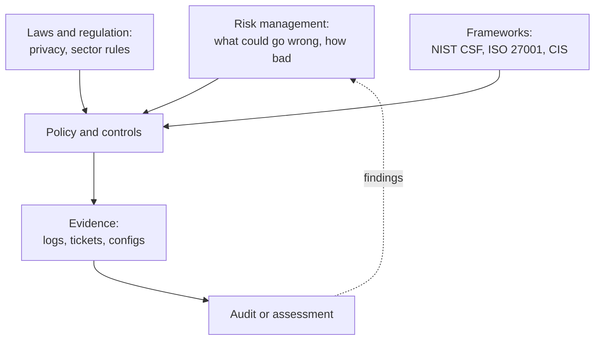

# Governance and compliance

Who decides what "secure enough" means, how that is written down, and how anyone proves it: risk management, control frameworks, regulation, audits and the certs that test them.

*Risk, law and frameworks all shape the controls you adopt; audits test the evidence and feed findings back into the risk register.*

---

## Learn

- [Risk management basics](../learn/concepts/risk-management-basics.md) - registers, appetite, ALE and the four risk responses
- [Privacy engineering basics](../learn/concepts/privacy-engineering-basics.md) - data minimisation, PII inventory and DSAR handling
- [Shared responsibility model](../learn/concepts/shared-responsibility-model.md) - who secures what, per service tier
- [Security awareness training](../learn/concepts/security-awareness-training.md) - a control most frameworks require
- [Data loss prevention explained](../learn/concepts/data-loss-prevention-explained.md) - classification, discovery and DLP policies
- [Least privilege explained](../learn/concepts/least-privilege-explained.md) - the access control auditors ask about first

---

## Frameworks and standards

- [NIST CSF 2.0](../resources/compliance-guides/nist-csf.md)
- [NIST SP 800-53](../resources/compliance-guides/nist-sp-800-53.md)
- [CIS Controls v8](../resources/compliance-guides/cis-controls-v8.md)
- [ISO 27001](../resources/compliance-guides/iso-27001.md)
- [SOC 2](../resources/compliance-guides/soc2.md)
- [SOX IT general controls](../resources/compliance-guides/sox-itgc.md)
- [FedRAMP](../resources/compliance-guides/fedramp.md)
- [CMMC](../resources/compliance-guides/cmmc.md)

## Sector and privacy rules

- [GDPR](../resources/compliance-guides/gdpr.md)
- [US state privacy laws](../resources/compliance-guides/us-state-privacy-laws.md)
- [HIPAA](../resources/compliance-guides/hipaa.md)
- [PCI DSS](../resources/compliance-guides/pci-dss.md)
- [NIS2](../resources/compliance-guides/nis2.md)
- [DORA](../resources/compliance-guides/dora.md)
- [EU Cyber Resilience Act](../resources/compliance-guides/eu-cyber-resilience-act.md)
- [SEC cyber disclosure rule](../resources/compliance-guides/sec-cyber-disclosure-rule.md)

---

## Reference

- [Case study: Capital One 2019](../resources/case-study-capital-one-2019.md) - a breach that led to regulatory penalties
- [Case study: Change Healthcare 2024](../resources/case-study-change-healthcare-2024.md) - HIPAA-regulated data and sector concentration
- [Case study: Snowflake customer breaches 2024](../resources/case-study-snowflake-customer-breaches-2024.md) - shared responsibility for SaaS
- [Interview prep: GRC and audit](../resources/interview-prep/grc-audit-interview.md)
- [GRC analyst roadmap](../resources/certification-roadmap-grc-analyst.md)

---

## Certify

- [ISACA CISA](../exams/isaca/cisa/) - audit
- [ISACA CISM](../exams/isaca/cism/) - management
- [CISSP (ISC2)](../exams/isc2/cissp/) - security and risk management domain
- [CCSP (ISC2)](../exams/isc2/ccsp/) - cloud governance and legal
- [CCSK v5 (Cloud Security Alliance)](../exams/cloud-security-alliance/ccsk/)
- [Microsoft Security, Compliance, and Identity (SC-900)](../exams/azure/sc-900/)
- [Microsoft Information Security Administrator (SC-401)](../exams/azure/sc-401/) - information protection and compliance
