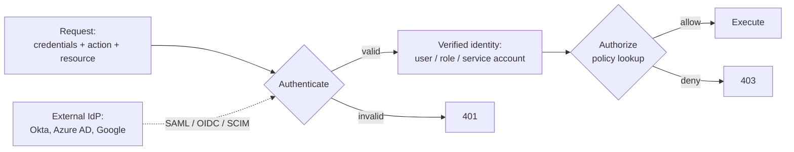

# Identity and IAM

Authentication ("who are you?"), authorization ("what can you do?"), federation, roles vs policies, RBAC vs ABAC, SSO. Every cloud cert tests this; almost every breach starts here.

---

## Learn

- [IAM explained](../learn/concepts/iam-explained.md) - authentication vs authorization, roles vs policies, federation, RBAC vs ABAC
- [MFA and passkeys](../learn/concepts/mfa-and-passkeys.md) - factor types, why SMS and push get phished, FIDO2 and passkeys
- [OAuth and OIDC explained](../learn/concepts/oauth-and-oidc-explained.md) - authorization code + PKCE, access vs ID tokens, SAML, token validation
- [Least privilege explained](../learn/concepts/least-privilege-explained.md) - blast radius, just-in-time access, separation of duties, right-sizing policies
- [Zero trust explained](../learn/concepts/zero-trust-explained.md) - identity as the perimeter, verified on every request

---

## Compare

- [Identity and IAM services](../resources/service-comparison-identity-iam.md) - AWS IAM vs Azure Entra ID vs Google Cloud IAM
- [Security tools](../resources/service-comparison-security-tools.md) - secrets, threat detection, WAF

---

## Reference

- [Architecture pattern: Zero Trust](../resources/architecture-patterns/zero-trust-architecture.md) - identity-centric security
- [Compliance: SOC 2](../resources/compliance-guides/soc2.md) - access controls and identity audit
- [Compliance: HIPAA](../resources/compliance-guides/hipaa.md) - access management requirements
- [Compliance: ISO 27001](../resources/compliance-guides/iso-27001.md) - Annex A access control and privileged access controls

---

## Build

- [Implement zero trust](../resources/hands-on-projects/implement-zero-trust.md) - identity-aware proxy, MFA, least privilege

---

## Certify

IAM appears on most cloud certs. Where it's most heavily tested:

**Foundational**
- [AWS Cloud Practitioner](https://cloud.noblerworks.com/exams/aws/foundational/cloud-practitioner-clf-c02/)
- [Azure AZ-900](https://cloud.noblerworks.com/exams/azure/az-900/)
- [Microsoft Security Fundamentals (SC-900)](../exams/azure/sc-900/)

**Associate**
- [AWS Solutions Architect Associate (SAA-C03)](https://cloud.noblerworks.com/exams/aws/associate/solutions-architect-saa-c03/)
- [AWS Developer Associate (DVA-C02)](https://cloud.noblerworks.com/exams/aws/associate/developer-dva-c02/)
- [Azure Administrator (AZ-104)](https://cloud.noblerworks.com/exams/azure/az-104/)
- [GCP Cloud Engineer](https://cloud.noblerworks.com/exams/gcp/cloud-engineer/)
- [HashiCorp Vault Associate](../exams/hashicorp/vault-associate/) - secrets and identity-based access
- [HashiCorp Boundary Associate](../exams/hashicorp/boundary-associate/) - identity-aware access broker

**Specialty / Expert**
- [AWS Security Specialty (SCS-C02)](../exams/aws/specialty/security-scs-c02/)
- [Azure Security Engineer (AZ-500)](../exams/azure/az-500/)
- [GCP Cloud Security Engineer](../exams/gcp/cloud-security-engineer/)
- [Microsoft Security Operations Analyst (SC-200)](../exams/azure/sc-200/)

**Vendor-neutral capstones**
- [CISSP](../exams/isc2/cissp/) - identity and access management is one of 8 domains
- [CCSP](../exams/isc2/ccsp/)
- [CCSK v5](../exams/cloud-security-alliance/ccsk/)

---

## Roadmap

The career-track view lives in **[Security Engineer roadmap](../resources/certification-roadmap-security-engineer.md)**.
