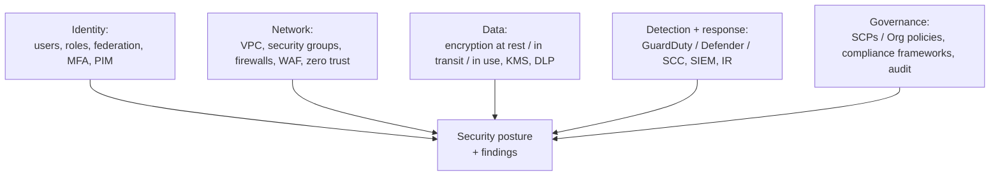

# Security

Cloud security across pillars: shared responsibility, zero trust, secrets, threat detection, compliance, and the certs that test it. Security is the topic with the highest stakes per character of code.

---

## Learn

**Foundations**
- [Shared responsibility model](../learn/concepts/shared-responsibility-model.md) - who secures what, per service tier
- [Threat modeling explained](../learn/concepts/threat-modeling-explained.md) - STRIDE and data flow diagrams
- [Phishing and social engineering](../learn/concepts/phishing-and-social-engineering.md) - the defender's view of the most common attack
- [Risk management basics](../learn/concepts/risk-management-basics.md) - registers, appetite, ALE and the four risk responses

**Identity and access**
- [IAM explained](../learn/concepts/iam-explained.md) - the foundation of authorization
- [MFA and passkeys](../learn/concepts/mfa-and-passkeys.md) - phishing-resistant authentication
- [OAuth and OIDC explained](../learn/concepts/oauth-and-oidc-explained.md) - delegated access and federated login
- [Least privilege explained](../learn/concepts/least-privilege-explained.md) - limiting blast radius
- [Zero trust explained](../learn/concepts/zero-trust-explained.md) - no implicit trust from network location

**Data protection**
- [Encryption explained](../learn/concepts/encryption-explained.md) - at rest, in transit, envelope encryption and KMS
- [TLS and HTTPS](../learn/concepts/tls-and-https.md) - encryption in transit
- [Hashing and password storage](../learn/concepts/hashing-and-password-storage.md) - salts and slow hashes
- [Secrets management](../learn/concepts/secrets-management.md) - credentials out of code and config
- [Data loss prevention explained](../learn/concepts/data-loss-prevention-explained.md) - classification, discovery and DLP policies
- [Backup and ransomware resilience](../learn/concepts/backup-and-ransomware-resilience.md) - 3-2-1-1-0, immutability, restore testing

**Network, application and supply chain**
- [Network security basics](../learn/concepts/network-security-basics.md) - firewalls, segmentation, security groups vs NACLs, WAF
- [OWASP Top 10 explained](../learn/concepts/owasp-top-10-explained.md) - web application risks and their defences
- [Software supply chain security](../learn/concepts/software-supply-chain-security.md) - SBOMs, signing, SLSA, dependency risk
- [Email security: SPF, DKIM and DMARC](../learn/concepts/email-security-spf-dkim-dmarc.md) - domain spoofing protection, alignment and the path to p=reject

**Cloud and containers**
- [CSPM and CNAPP explained](../learn/concepts/cspm-and-cnapp-explained.md) - posture management, CWPP, CIEM and attack paths
- [Container security basics](../learn/concepts/container-security-basics.md) - minimal images, scanning, signing, runtime settings
- [Kubernetes security basics](../learn/concepts/kubernetes-security-basics.md) - RBAC, Pod Security Standards, admission control, network policies

**Detection and response**
- [Logging and detection](../learn/concepts/logging-and-detection.md) - what to log, SIEM, detection engineering
- [Incident response basics](../learn/concepts/incident-response-basics.md) - the NIST lifecycle, runbooks, postmortems
- [Vulnerability management](../learn/concepts/vulnerability-management.md) - CVE, CVSS, EPSS, KEV and patch SLAs
- [Endpoint security: EDR and XDR](../learn/concepts/endpoint-security-edr-xdr.md) - behavioural detection, isolation and cross-source incidents

**AI**
- [Guardrails and safety](https://ai.noblerworks.com/learn/concepts/guardrails-and-safety/) - GenAI-specific, but the principles generalize

---

## Compare

- [Security tools](../resources/service-comparison-security-tools.md) - GuardDuty vs Defender vs SCC, secrets managers, WAFs
- [Identity and IAM services](../resources/service-comparison-identity-iam.md)

---

## Reference

- [Architecture pattern: Zero Trust](../resources/architecture-patterns/zero-trust-architecture.md)
- [Compliance: SOC 2](../resources/compliance-guides/soc2.md)
- [Compliance: ISO 27001](../resources/compliance-guides/iso-27001.md)
- [Compliance: NIST CSF 2.0](../resources/compliance-guides/nist-csf.md)
- [Compliance: HIPAA](../resources/compliance-guides/hipaa.md)
- [Compliance: PCI DSS](../resources/compliance-guides/pci-dss.md)
- [Compliance: GDPR](../resources/compliance-guides/gdpr.md)
- [Compliance: FedRAMP](../resources/compliance-guides/fedramp.md)
- [Compliance: NIS2](../resources/compliance-guides/nis2.md)
- [Compliance: DORA](../resources/compliance-guides/dora.md)
- [Compliance: CMMC](../resources/compliance-guides/cmmc.md)

---

## Build

- [Implement zero trust](../resources/hands-on-projects/implement-zero-trust.md) - identity-aware proxy, MFA, least privilege end-to-end
- [Centralized logging and alerting](../resources/hands-on-projects/centralized-logging-and-alerting.md) - cloud audit logs into a locked archive and tested alerts
- [Harden a Linux server](../resources/hands-on-projects/harden-a-linux-server.md) - SSH, firewall, patching, auditd, measured with Lynis

---

## Certify

**Foundational**
- [Microsoft Security, Compliance, and Identity (SC-900)](../exams/azure/sc-900/)
- [CompTIA Security+](../exams/comptia/security-plus/)

**Cloud security specialties**
- [AWS Security Specialty (SCS-C02)](../exams/aws/specialty/security-scs-c02/)
- [Azure Security Engineer (AZ-500)](../exams/azure/az-500/)
- [Microsoft Security Operations Analyst (SC-200)](../exams/azure/sc-200/)
- [GCP Cloud Security Engineer](../exams/gcp/cloud-security-engineer/)
- [IBM Cloud Security Engineer](../exams/ibm/cloud-security-engineer/)

**Vendor-neutral**
- [CCSK v5 (Cloud Security Alliance)](../exams/cloud-security-alliance/ccsk/)
- [CISSP (ISC2)](../exams/isc2/cissp/) - 8-domain capstone, the gold standard
- [CCSP (ISC2)](../exams/isc2/ccsp/) - cloud-focused
- [CompTIA CySA+](../exams/comptia/cysa-plus/)
- [ISACA CISA](../exams/isaca/cisa/) - audit
- [ISACA CISM](../exams/isaca/cism/) - management

**Kubernetes security**
- [CKS - Certified Kubernetes Security Specialist](../exams/kubernetes/cks/)
- [KCSA - Kubernetes and Cloud Native Security Associate](../exams/kubernetes/kcsa/)

**Network and offensive**
- [Cisco CCNA](https://cloud.noblerworks.com/exams/cisco/ccna-200-301/) - covers basic security
- [Palo Alto PCNSA](../exams/palo-alto-networks/pcnsa/) - firewalls
- [Offensive Security OSCP (PEN-200)](../exams/offensive-security/oscp-pen-200/) - hands-on pentest
- [GitHub Advanced Security](../exams/github/advanced-security/) - SAST/secrets/dependency scanning

**HashiCorp**
- [Vault Associate](../exams/hashicorp/vault-associate/) - secrets management
- [Boundary Associate](../exams/hashicorp/boundary-associate/) - identity-aware access

---

## Roadmap

The career-track view lives in **[Security Engineer roadmap](../resources/certification-roadmap-security-engineer.md)**.
